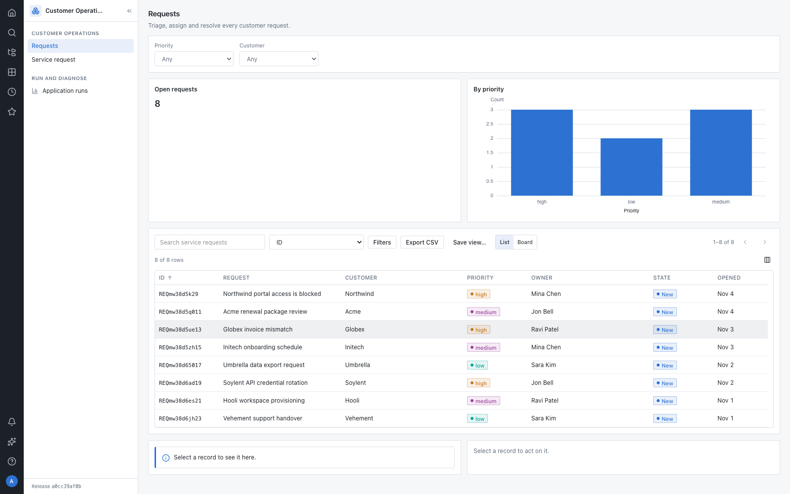
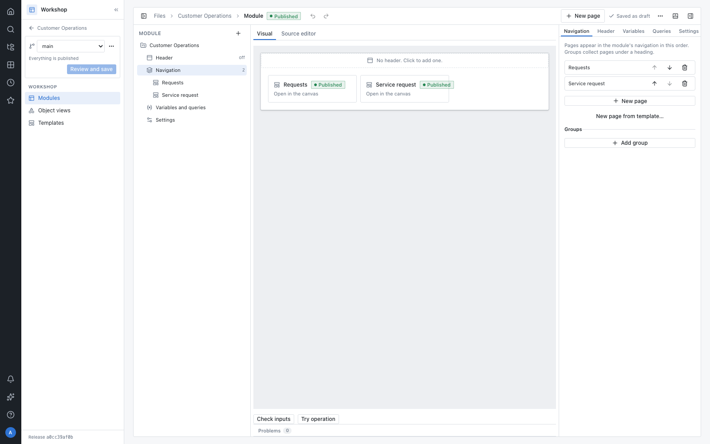
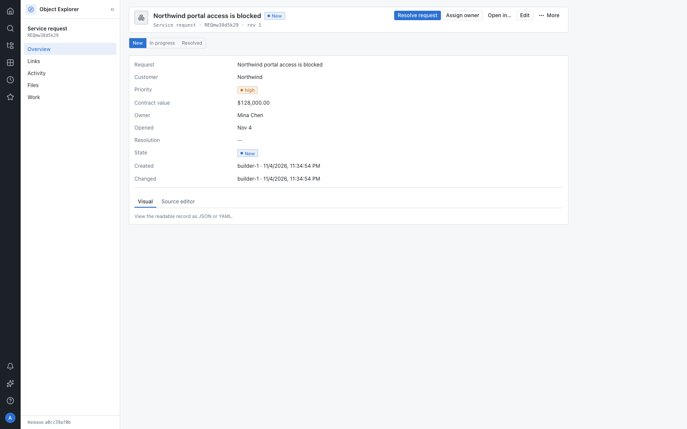
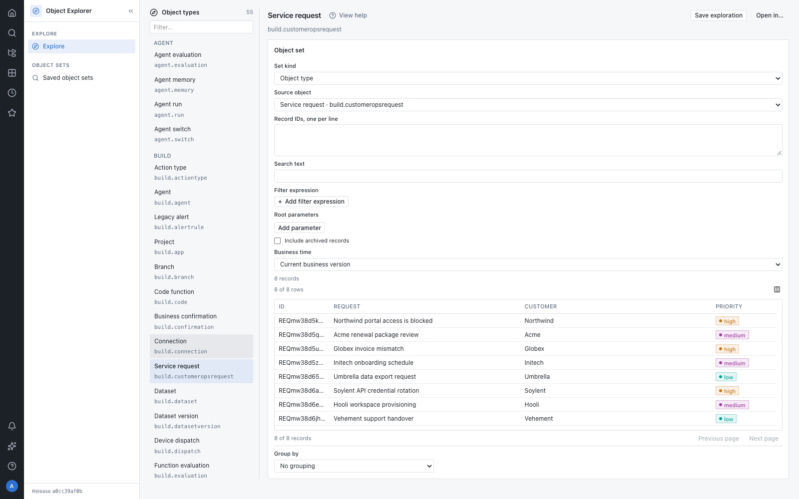

<div align="center">

<a href="https://github.com/xuciro-commits/platform"></a>

# Platform

### 建模业务。运行业务。交付业务。

从数据接入、业务本体、动作与逻辑、Workshop 应用，到不可变产品版本和 Marketplace 安装，<br>全部收在同一条受治理的路径里。

**[快速开始](#快速开始)** &nbsp;·&nbsp; **[产品能力](#产品能力)** &nbsp;·&nbsp; **[系统架构](#系统架构)** &nbsp;·&nbsp; **[文档](#文档)**

[](docs/README.md) [](https://go.dev) [](https://react.dev) [](https://www.postgresql.org)

<br>

<picture>
  <source media="(prefers-color-scheme: dark)" srcset="docs/readme/operations-dark.png">
  
</picture>

<sub>Customer Operations：对象、动作和 Workshop 页面全部由平台自身构建。</sub>

</div>

<br>

## 这是什么

Platform 是一个以 Palantir Foundry 为能力基准的业务应用构建平台。

它不把表格、脚本、表单和权限补丁拼在一起，而是用一套资源与治理模型，把数据、业务语义、写入、应用和交付连成闭环。平台自身与行业应用使用同一套工具；制造业、酒店业等行业概念以产品包表达，不进入宿主代码。

一句话概括它的数据路径：

> 外部系统 → 数据集与管道 → 对象类型 → 动作与函数 → 应用 → 产品版本 → 客户租户

## 适合谁

**适合你，如果你要：**

- 把多套系统的数据变成统一业务对象，而不是再造一张报表。
- 让动作成为对象写入的唯一路径，而不是让脚本、表单和接口各改一处。
- 从第一天就把权限、标记、审计、分支、版本和回滚放进产品。
- 用平台工具构建行业应用，再经 Marketplace 安装、扩展和升级。
- 让业务用户在同一套对象视图、工作项和审批里完成工作。

**不太适合，如果你只需要：**

- 一张独立的 BI 看板，或一个脱离业务对象的表单页面。
- 一套只服务于单个项目、无法打包和升级的内部脚本。

## 快速开始

需要 Go 1.27.1、Node.js ≥ 22.18.0、pnpm 12.5.1、Python 3。完整运行需要 Docker。

```bash
git clone https://github.com/xuciro-commits/platform.git
cd platform
make setup
make local
```

打开 [http://localhost:8495](http://localhost:8495)。页面、应用、API 与登录共用这一个入口。

新环境从空租户开始。按下面的路径创建第一个项目，即可从数据走到可用的业务应用：

```text
项目 → 数据集 → 对象类型 → 动作 → Workshop 页面 → 评审保存 → 激活版本
```

账号保存在本地 `.build/local/credentials.md`；不要把它们写进代码或提交。完整启动方式、`make docker`、`make lite` 和配置细节见 [本地运行](deploy/local/README.md)。

## 产品能力

平台不是一组互不相干的页面，而是一张有唯一归属的产品矩阵：

| 能力 | 产品 | 产出 |
| --- | --- | --- |
| 数据接入 | Data Connection | 连接、数据源、监听器、回写与同步 |
| 数据准备 | Dataset Preview、Pipeline Builder | 版本化数据集、管道、调度与匹配规则 |
| 业务本体 | Ontology Manager | 对象类型、属性、关系、接口、值类型与动作定义 |
| 计算与自动化 | Logic、Automate | 函数、决策表、AIP 函数、逻辑流与触发条件 |
| 业务应用 | Workshop、Object Explorer | 模块、对象视图、对象列表与运行时页面 |
| AI | Agent Studio、AIP Assist | 智能体、检索源、评估、全局助手与页面上下文 |
| 治理与交付 | Control Panel、DevOps、Marketplace、Data Lineage、Monitoring | 成员与权限、分支与提案、产品版本、安装升级、血缘与运行诊断 |

在所有这些产品之下，只有一套授权引擎、一套规则求值、一套对象读取和一套资源目录。每个资源类型只有一个应用拥有编辑权，其他应用通过链接打开它。

### 构建者

对象、动作、函数和页面都在同一组工作台里完成。编辑自动保存到分支；`main` 只在评审与合并后改变。

<p align="center">
  <picture>
    <source media="(prefers-color-scheme: dark)" srcset="docs/readme/workshop-dark.png">
    
  </picture>
</p>

### 业务用户

业务用户不接触 SQL、脚本或原始 JSON。他们从应用、搜索或工作项进入对象，在同一个对象视图里查看上下文并执行动作；每次执行都留下不可改写的 Activity 记录。

<table>
<tr>
<td width="50%">
<picture>
  <source media="(prefers-color-scheme: dark)" srcset="docs/readme/request-dark.png">
  
</picture>
</td>
<td width="50%">
<picture>
  <source media="(prefers-color-scheme: dark)" srcset="docs/readme/explorer-dark.png">
  
</picture>
</td>
</tr>
<tr>
<td align="center"><sub>对象视图：业务对象与可执行动作</sub></td>
<td align="center"><sub>Object Explorer：用对象集探索同一个模型</sub></td>
</tr>
</table>

## 系统架构

<p align="center">
  
</p>

**一条数据路径。** 外部系统只经数据接入进入；数据集保留版本，管道生成新的版本；对象由数据源投影和动作产生的事实组成；应用只读取对象并调用动作。回写也走同一套受控连接。

**一份权威状态。** 新写入只经接受结果进入权威日志。PostgreSQL 保存日志与租户投影，S3 兼容存储保存文件、数据集载荷和不可变制品；重启只重放已接受映像，结果保持逐字节一致。

**一套治理。** 每个读取与写入都经过同一授权路径；标记沿血缘传播；分支与提案把未合并修改隔离在 `main` 之外；审计、监控和发布记录都从接受结果长出来。

**一条交付链。** DevOps 从已保存资源和依赖闭包冻结不可变产品版本；Marketplace 把版本安装到客户租户。升级只替换受管项目，客户在自有项目中的扩展继续有效。

技术选型刻意保持直接：

| 组成 | 选型 |
| --- | --- |
| 宿主 | 单个 Go 进程，多租户隔离，不拆微服务 |
| 跨应用协议 | `contract/` 下的版本化 protobuf 契约 |
| 权威状态 | PostgreSQL 接受结果日志 + 按租户投影 |
| 文件与制品 | S3 兼容对象存储（本地为 RustFS） |
| 隔离计算 | 独立进程，经 Unix socket 通信 |
| Web | React 19、TypeScript、Tailwind v4、Vite |
| 部署 | Docker、本地热更新、无 Docker 的 lite 模式 |

## 不只是页面

平台的几个不变量决定了它如何工作：

1. **动作是唯一的对象写入口。** 应用、自动化和 AI 都不能绕过动作直接改对象。
2. **一个能力只有一个实现。** 权限、规则求值、依赖解析、搜索和模型调用不按应用复制。
3. **一个资源只有一个编辑者。** 引用跳转到拥有者，不在别处再造编辑器。
4. **平台与客户共用工具。** 平台方构建行业应用和客户构建扩展没有两套路径。
5. **不能打包的能力不算完成。** 每项平台能力都必须能进入产品包、安装和升级。

## 现在到哪一步

Platform 仍在“平台成形”阶段：先把构建者从空租户走到可用应用、再交付为产品版本的黄金路径做完整，然后才是行业应用和客户运营。

当前重点不是追求 Foundry 的功能数量或像素复刻，而是把能力边界、受治理路径和可交付性收敛正确。分析工具（Contour、Quiver）、专业开发工具（Code Workbook、Repositories、Vertex）、Gotham、Apollo 和本体动态层不在当前范围。

当前批次、已知差距和验收边界以 [路线图](docs/roadmap.md) 与 [验证规范](docs/7-system/verification.md) 为准；规划不会在这里写成已交付能力。

## 文档

规范领导代码。代码与规范冲突时改代码；规范只在设计本身被推翻时修改。

| 文档 | 内容 |
| --- | --- |
| [文档体系](docs/README.md) | 文档类型、加载方式与治理规则 |
| [企业架构](docs/1-enterprise.md) | 使命、终局、质量目标、技术约束 |
| [产品体系](docs/2-product.md) | 产品矩阵、能力归属、平台与行业应用边界 |
| [信息架构](docs/3-information.md) | 导航、资源分类、URL、Search、Files |
| [交互与体验](docs/5-experience.md) | 角色、任务路径、可发现性、文案与验收路径 |
| [领域架构](docs/6-domain/README.md) | 本体、数据、动作、函数、安全、变更与交付 |
| [系统架构](docs/7-system/README.md) | 进程、包边界、读写路径、前端与运行机制 |
| [验证](docs/7-system/verification.md) | 静态检查、内核不变量与黄金路径验收 |
| [路线图](docs/roadmap.md) | 当前批次、下一步与已知差距 |

## 开发

```bash
make help       # 可用命令
make contract   # 生成宿主类型与页面契约
make build      # 构建 Web 工作区与宿主
make verify     # 静态检查、内核不变量、黄金路径验收
make verify-sql # 在隔离 PostgreSQL 中验证写入与恢复
```

代码、规范和钩子的工作约定见 [AGENTS.md](AGENTS.md)，按批交付见 `.claude/skills/platform-batch/SKILL.md`。

```text
capabilities/server   Go 宿主、领域服务与隔离计算
contract             版本化 protobuf 契约
web                   React 工作区与应用包
deploy               本地、容器与轻量部署
docs                 目标设计、规格、差距与验收
```
