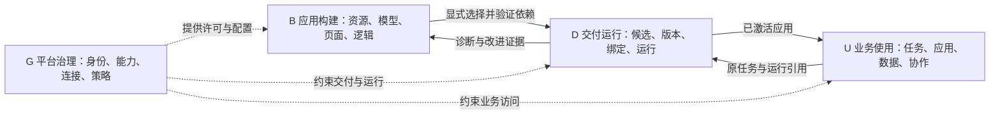

# ADR-0018：对标 Palantir 的平台体验重构（Shell、入口、菜单与功能块）

<a id="adr-0018"></a>

**意图：** 让平台像 Palantir Foundry/AIP 一样，以**本体（Ontology）为中心、以应用门户为入口、以可配置工作区为交付面**，而不是以源码包、owner 角色和"surface"枚举为入口。业务人员打开的是"应用"，构建者打开的是"本体与工坊"，管理员打开的是"控制面板"；三者共享一个 Shell、一套搜索、一套资源寻址和一套权限投影。

**状态：** 现行 · 2026-10-06 · Shell、门户、工作区与应用设计台的组织（并入原 0015、0016、0019）。

**设计日期与基线：** 2026-10-06，`main@9ba4cca9`。本轮为源码审查与设计；沙箱内无 Go 工具链与浏览器，未运行宿主与 Playwright，Shell 预览通过 `?preview=pattern/workspace` 固定装置核对。

---

## 1. 现状诊断：为什么"再调一次菜单"不够

下表每行都对应源码证据，而不是印象。

| 层面 | 现状（证据） | 问题 |
|---|---|---|
| **平台架构（前端视角）** | 工作区用固定包表按 owner 角色决定加载哪些 UI 包（`web/apps/workspace/src/App.tsx` `packages[]`）；`AppUI.id` 同时是 owner ID、启动器图标和 view 命名空间（`@platform/app` `AppUI`）。 | 产品结构 = 源码包结构。新增一个 owner 就多一个"应用"，租户看到的是我们的代码组织，不是他们的业务。Foundry 的用户永远不会看到"platform/org/ai/flow/agent/knowledge"这种 owner 列表，他们看到的是 *Ontology Manager、Workshop、AIP Logic*。 |
| **前端应用架构** | `App.tsx` 412 行同时承担：会话/身份切换、租户恢复、包加载、`/v1/*` 读取与订阅、`Host` 装配、surface 推断、selection 记忆、路由 → app 归属解析、nav/commands/search 拼装、release 状态对话框。 | 没有分层：**Shell 状态、会话状态、数据层、导航模型、应用注册表**全在一个组件里。任何入口调整都要改这个文件；视图归属靠 `owner.get(activeRoute.view) ?? pageApplication(...) ?? surface===developer` 这类回退链推断。 |
| **菜单架构** | 左侧 nav 是 `My work` + `Saved views` + `Dashboards` + `app.nav(host)` 的拼接；Studio 的 nav 按资产类型（对象/关系/属性/页面/查询/流程/函数/代码）平铺（`packages/build/src/index.tsx`）；Tenant console 的 nav 是 15 个 view 的三段式列表（`packages/platform/src/index.tsx`）。 | 菜单是能力清单，不是任务路径。Foundry 的 Ontology Manager 按 *对象类型 → 属性/链接/动作/函数/接口* 的**对象上下文**组织；我们按资产类型平铺，构建者要在 8 个列表间跳。 |
| **Shell 架构** | `@platform/ui` `Workspace.tsx` 523 行：36px 顶栏（汉堡 + 两个 `AppMenu` 下拉 + Menubar + 会话菜单）+ 左侧 nav + Dockview + ⌘K。"入口切换"（work/studio/tenant/developer）和"应用切换"是顶栏里两个并排的下拉。 | 两层下拉把最重要的导航藏在 36px 顶栏里；没有 Foundry 式的**常驻侧栏**（Home / Search / Notifications / Recent / Applications / Favorites / Account / Other workspaces）；没有"最近"与"收藏"；没有全局资源面包屑；没有应用门户（Applications portal）。 |
| **用户功能入口** | `entryPoints` 由四个 `WorkspaceSurface` 枚举硬编码；进入 studio 后 launcher 变成"Studio applications"列表；进入 tenant 后 launcher 消失。默认首页是 `#/inbox`。 | 入口的可见性靠 `surface` 字符串与 `role()` 判断散落各处。Foundry 的做法是：**一个应用门户列出所有可用应用（平台应用 + 推广的自定义应用），工作区（Carbon）是面向岗位的受限投影**。我们相反：把"工作区"当成类型枚举，把应用塞进其中。 |
| **功能块** | 已有后端能力可观：对象/属性/关系/查询（Ontology）、页面与 60+ Widget（Workshop）、AI 函数（Logic）、Agents/Evals、Flow/Work（Automate）、Code（Functions）、Candidates/Release、Integrations/Connectors、Members/Org、Audit、Knowledge。 | 这些块**散在三个 surface 的 nav 中**，缺少 Foundry 的三类关键视图：① **Object Explorer / 对象视图**（跨应用按对象浏览、链接导航、动作面板）；② **Projects & files 资源树**（按项目组织的资产浏览、权限、血缘）；③ **Developer Console**（OSDK/API 接入）。Catalog 承担了部分 ③，但放在"developer surface"里与业务入口并列。 |
| **使用方式** | 深链 = `#/view?params`；view ID 全工作区唯一且无命名空间；旧布局 JSON 存 localStorage；切换租户/身份靠重置一堆 state。 | 没有**资源 RID 式的稳定寻址**（`app:kind:name` 已有 `Definition.ref`，但路由不用）；无法从任意位置"Open in …"（Foundry 的对象/资源右键菜单）；无 Recent/Favorites/Pin；无"在 Workshop 中打开此对象类型"这类跨工具跳转。 |

**结论：** 需要重建的是**产品层的三件事**——(1) Shell 与入口模型，(2) 应用/资源/对象的统一寻址与导航模型，(3) 功能块按 Foundry 的工具边界重新切分——而不是继续在 `App.tsx` 里加分支。后端 owner、API 与权限保持不变（ADR-0038 §8 边界）。

---

## 2. 对标：Palantir 产品地图 → 本平台功能块

对标的是**功能设计与使用方式**，不是复刻其数据模型或执行栈（Platform §10.1 边界）。每一行给出：Foundry 工具 → 我们的目标块名称 → 现有实现归属 → 差距等级（A 已有可投影 / B 需重组前端 / C 需补后端）。

### 2.1 平台 Shell 与导航

| Foundry | 目标块 | 现有归属 | 差距 |
|---|---|---|---|
| Workspace navigation sidebar（Home / Search / Notifications / Recent / Files / Applications / Favorites / AIP Assist / Account / Other workspaces） | **Platform Rail**（常驻左侧图标栏） | `Workspace.tsx` 顶栏两个下拉 | B |
| Applications portal（平台应用 + 推广应用，分类、搜索、收藏） | **Applications** 视图 | `chromeViews.home`（只列业务应用） | B |
| Quicksearch（对象、资源、应用、动作统一搜索） | **⌘K 统一搜索**：记录 / 资产 / 应用 / 命令分组 | `/v1/search` 只搜记录 + 命令 | B（资产/应用搜索可前端索引） |
| Carbon workspaces（面向岗位的受限工作区、自定义首页、菜单栏、推广工作区） | **Application（租户应用）= Carbon 工作区**；ADR-0046 的 `build.app` 已是"名称+图标+页面+分组" | `tenantApps.tsx` 投影 | A→B（补首页/菜单栏/锁定导航） |
| Home（组织着陆页：搜索、最近、收藏、推荐） | **Home** 视图 | 无（默认 `#/inbox`） | B |
| Notifications / Inbox / Tasks | **My work**（收件箱、审批、我的申请、通知） | `chromeViews` inbox/requests/notifications | A |
| Control Panel（组织、用户组、权限、资源管理、配额、审计） | **Control Panel**（租户控制台改名并重组） | `@pkg/platform` | B |

### 2.2 本体与数据（Ontology & Data）

| Foundry | 目标块 | 现有归属 | 差距 |
|---|---|---|---|
| Ontology Manager（对象类型 / 属性 / 链接类型 / 动作类型 / 函数 / 接口 / 共享属性；以对象类型为中心的侧栏） | **Ontology**（对象中心工作台）：对象类型页内含 属性 · 链接 · 动作 · 生命周期 · 函数 · 权限 · 使用处 | `build` 的 `model` / `process` / `link-type` / `property-type`（四个平铺入口） | B |
| Object Explorer（按对象类型浏览、过滤、聚合、链接导航、保存探索） | **Object Explorer** | `Records`/`AllRecords`/`RecordDetail`、`SavedView`、`exploration/` | A→B（统一入口 + 链接导航 + "Open in"） |
| Object view（单对象页：属性、链接对象、动作面板、历史、关联工作） | **Record page** 标准布局 | `RecordDetail` + `RecordWork/Events/Activity` widget | B |
| Data Connection / Pipeline Builder（来源、同步、映射、血缘） | **Data Connection**（来源 → 映射 → 受控对象） | `Integrations`/`/v1/connectors`、`module-import`、WorkQueue #134 | C（首个接入在 #134） |
| Data Lineage | **Lineage**（资源依赖图：对象 ← 查询 ← 页面 ← 应用；候选闭包） | `/v1/releases/drafts/referenced`、候选差异 | B |
| Projects & files（Compass：项目树、资源、权限、Marketplace 安装产物） | **Projects & resources** | `Applications`/`StudioOverview`/`/v1/definitions`/`/v1/packages`；本文 §4.1 Project | B |

### 2.3 构建应用（Build）

| Foundry | 目标块 | 现有归属 | 差距 |
|---|---|---|---|
| Workshop（模块 = 页面 + 变量 + 事件 + 布局；左组件栏 / 中画布 / 右属性） | **Workshop**（页面编辑器改名、按 ADR-0048） | `build/page-editor`、`@platform/app` widgets/runtime | A |
| Slate / 自定义代码应用 | （不采纳；代码应用走 `AppUI` 贡献） | 原生 UI 包 | — |
| Functions / Code Repositories | **Code**（Go/TinyGo Wasm 函数、SDK） | `build/code.tsx`、ADR-0057 | A |
| AIP Logic（无代码 LLM 函数：输入/输出类型、工具、调试、发布到 Ontology） | **AIP Logic → "AI Functions"** | `build/function.tsx`（ADR-0008） | A |
| AIP Agent Studio（Agent：系统提示、工具、记忆、评测、发布） | **Agents** | `platform/processes.tsx` Agents + `/v1/agents` | B（移入 Build 域，运行留 Operate） |
| AIP Evals | **Evals** | `Evaluations` 视图、`/v1/releases/evaluations` | B |
| Automate（对象条件 → 效果：动作/通知/函数；运行历史） | **Automate**（Flow 编辑 + 触发） | `build/workflow.tsx`、`platform/operations.tsx Automation` | B（编辑与运行分家：编辑在 Build、运行在 Operate） |
| Developer Console（OSDK 应用注册、权限范围、API 文档、SDK 生成） | **Developer Console**（Catalog 的开发者视角 + 契约/SDK） | `@platform/catalog-app`、`/v1/build/code/sdk` | B |
| Marketplace（打包、安装、升级） | **Packages**（能力包生命周期） | `/v1/packages`、WorkQueue #141 | C |

### 2.4 交付与运维（Deliver & Operate）

| Foundry | 目标块 | 现有归属 | 差距 |
|---|---|---|---|
| Ontology proposals / 分支 → 合并（提案审查） | **Candidates & releases**（草稿 → 候选 → 审查 → 激活） | `release.tsx`、`simulate.tsx`、ADR-0045 | A |
| Builds / Job tracker / Monitoring views | **Runs**（Flow / Agent / 计算 / Work / 外部效果，按应用归属过滤） | `Flows`/`RunView`/`FlowInstanceView`/`/v1/effects`、WorkQueue #141-C | B |
| Resource policies / Data lineage impact | **Impact & dependencies** | 候选差异、`drafts/referenced` | B |
| Control Panel → Enrollments / Organizations / Settings | **Control Panel**（身份与访问 · 包与能力 · 连接与模型 · 策略与审计） | `@pkg/platform` 四段 nav | A→B |
| Host（跨租户） | **Host Console** | `/v1/host`、WorkQueue #141 第 7 批 | C |

---

## 3. 目标产品结构

### 3.1 一个 Shell，三种工作区投影

```text
Platform Shell（所有人同一 Shell）
├─ Rail（常驻左侧，Foundry sidebar 对应物）
│  ├─ Home            组织着陆页：搜索 · 我的工作摘要 · 最近 · 收藏 · 推广应用
│  ├─ Search ⌘K       记录 / 资产 / 应用 / 命令
│  ├─ Notifications   未读徽标
│  ├─ ───────
│  ├─ Recent          最近打开的应用与资源
│  ├─ Applications    应用门户（分类：业务应用 · 本体与数据 · 构建 · 交付运维 · 开发者）
│  ├─ Favorites       收藏的应用与资源
│  ├─ ───────（底部）
│  ├─ Assist          AI 助手（仅 `agent.run.start`）
│  ├─ Account         成员 · 租户 · 身份切换 · 语言 · 退出
│  └─ Workspaces      当前工作区投影切换（见下）
├─ Context pane（随当前应用出现，可折叠）
│  └─ 当前应用的导航：业务应用的岗位菜单 / Ontology 的对象类型树 / Control Panel 的分区
└─ Dock（现有 Dockview：标签即路由；浮动、弹出、未保存保护不变）
```

"工作区投影"替代 `WorkspaceSurface` 枚举，但**只有三个且由权限自动得出**：

| 投影 | 谁看到 | Rail 的 Applications 里出现什么 |
|---|---|---|
| **Operations**（默认） | 所有成员 | 业务应用（原生 + 租户 Application）、Object Explorer（获权对象）、My work |
| **Build** | `build.builder` / `publisher` | + Ontology、Workshop、AI Functions、Agents、Automate、Code、Evals、Candidates、Developer Console |
| **Admin** | `platform.admin` / `auditor` / `publisher` / 各 owner admin | + Control Panel 分区、Runs、Packages、Host Console（独立主体） |

投影只影响门户分类与默认首页，**不影响任何读取/动作授权**（本文 §5.1）。单一职责成员直接进入其投影；多职责成员在 Rail 底部切换，记忆上次选择。租户 Application 可声明 `locked: true`（Carbon 的"限制导航"）：该应用成员的 Rail 只保留 Home/Search/Notifications/Account，Context pane 为其菜单栏。

### 3.2 平台应用清单（Applications portal 的固定分类）

| 分类 | 平台应用（ID 稳定，名称可本地化） | 来源包 |
|---|---|---|
| 业务应用 | 每个原生 `AppUI`（CRM/ERP/MES/PMS/HCM/CSM）、每个租户 Application | `@pkg/*`、`tenantApps` |
| 本体与数据 | **Ontology** · **Object Explorer** · **Data Connection** · **Lineage** | `@pkg/build`（model/link/property/process 合并）、workspace chrome、`@pkg/platform` integrations |
| 构建 | **Workshop** · **AI Functions** · **Agents** · **Automate** · **Code** · **Evals** · **Projects** | `@pkg/build`、`@pkg/platform` processes |
| 交付与运维 | **Candidates & Releases** · **Runs** · **Packages** · **Environments** | `@pkg/build` release/simulate、`@pkg/platform` operations |
| 治理 | **Control Panel**（成员 · 组织 · 包与能力 · 连接与模型 · 策略与审计） · **Host Console** | `@pkg/platform` |
| 开发者 | **Developer Console**（Catalog · Sandbox · 契约与 SDK · 质量与兼容） | `@platform/catalog-app` |

一个源码包可贡献多个平台应用（`contributions`），一个平台应用可由多个包贡献 view（命名空间见 §4.3）。**包不再 = 应用。**

### 3.3 对象中心的 Ontology 工作台（替代 Studio 的资产类型平铺）

```text
Ontology
├─ 左：对象类型树（按应用/命名空间分组，搜索）＋ 共享属性 · 链接类型 · 接口 · 动作类型（全局列表）
└─ 右：所选对象类型
   ├─ Overview      标题 · 主键 · 描述 · 使用处（页面/查询/流程/应用）· 发布状态
   ├─ Properties    （原 property-type / model-editor 字段）
   ├─ Links         （原 link-type）
   ├─ Actions       动作与规则、生命周期（原 process 的 action/access）
   ├─ Functions     绑定到此对象的 AI/代码函数
   ├─ Permissions   读取/字段/动作授权投影（只读显示有效规则）
   └─ Data          Object Explorer 内嵌（样本记录、聚合）
```

现有四个编辑器**不重写**，作为该页的标签页挂载（`ModelWorkbench`、`LinkTypeEditor`、`PropertyTypeEditor`、`ProcessEditor` 已接受 `initialTab/initialField/initialAction` 参数）。资产路由保留，Ontology 页是它们的规范入口。

### 3.4 对象视图与"Open in"

每条记录页统一为：标题栏（类型 · 主键 · 状态 · 动作按钮组）→ 属性 → 链接对象（按链接类型分组，可展开为表）→ 工作/事件/评论 → 历史。右上 **Open in** 菜单：Object Explorer（同类型过滤）、Workshop 页面（引用此类型的已发布页面）、Ontology（对象类型定义，构建者）、Runs（关联实例）。`Host.opens` 继续决定原生应用的专有记录页；标准布局是回退与"查看定义"的入口。

---

## 4. 前端架构

### 4.1 包与职责

| 包 | 职责（重构后） | 变化 |
|---|---|---|
| `@platform/ui` `shell/` | **PlatformShell**：Rail、Context pane、Dock、⌘K、会话菜单、Recent/Favorites 存储接口、面包屑；无业务与 `/v1` 依赖 | `Workspace` 重构为 Rail 布局；API 从 `launcher/entryPoints` 改为 `applications/workspaces/home` |
| `@platform/app` | `definePlatformApp()`（§4.3）、`Host`、记录/对象视图标准布局、Open-in 注册表、Recent/Favorites 的 Host 实现 | `AppUI` 增 `category`、`namespace`、`contributes`；`surface` 废弃 → `workspaces` |
| `web/apps/workspace` | 拆分：`session/`（身份、租户、OIDC、恢复）、`host/`（EdgeClient、读取订阅、`Host` 装配）、`registry/`（包表 → 平台应用注册表、门户分类）、`shell/`（Home、Applications、Favorites、Recent、Search）、`App.tsx` 只做装配 | 412 行 `App.tsx` 拆成五个模块；路由 → 应用归属由注册表显式回答 |
| `@pkg/build` | 贡献 Ontology、Workshop、AI Functions、Automate、Code、Candidates、Projects 六个平台应用 | nav 从资产平铺改为对象中心；`studio` 总览 → Projects |
| `@pkg/platform` | 贡献 Control Panel、Runs、Agents/Evals（定义部分移交 build 的入口，运行留此）、Data Connection | 拆 15 个 view 为 4 个平台应用 |
| `@platform/catalog-app` | 贡献 Developer Console | 不再出现在业务门户分类 |
| `@pkg/crm|erp|…` | 不变；`category: "business"` 默认 | 零改动或仅声明 |

### 4.2 Shell 状态模型

```text
SessionState     token · tenant · principal · oidc · recoveryMode        （session/）
HostState        client · me · actions · entities · definitions · protocols（host/）
RegistryState    platformApps[] · byView · byType(opens) · categories     （registry/）
NavigationState  current app · active route · recent[] · favorites[]      （shell/，持久化 per tenant:principal）
LayoutState      dock JSON（现有 storageKey）                             （@platform/ui）
```

规则：切换 token/tenant 重建前四者（`key` 重挂载），不手工 `setX(undefined)` 五次；`Recent/Favorites` 先存 localStorage（键 `platform.nav:<tenant>:<principal>`），后续若 owner 提供个人读取（`/v1/personal-reads` 或 `platform.member` 偏好）再迁移，不新造后端。

### 4.3 应用贡献契约 v2

```ts
definePlatformApp({
  id: "ontology",                 // 平台应用 ID（稳定，不等于 owner）
  category: "ontology" | "business" | "build" | "operate" | "govern" | "developer",
  serves: ["build"],              // 执行授权仍看 owner
  available: (host) => host.role("build") === "builder",
  title, icon, home,
  views: [...],                   // view.id 自动加前缀 `ontology/`；旧 ID 由译码表映射
  nav: (host) => NavSection[],    // 只描述本应用内的导航
  opens: { "build.object": "object-type" },
  openIn: [{ type: /^.*$/, label: "Object Explorer", route: (type, id) => ... }],
  commands, dashboards,
});
```

路由规范：`#/<app>/<view>?params`；`Definition.ref`（`app:kind:name`）作为资产参数，记录用 `type` + `id`。旧 `#/<view>?…` 由 `registry.decodeLegacy()` 单向译码（本文 §6.6）。

### 4.4 导航三层与页面形态（沿 本文 §6.6）

Rail（平台） → Context pane（当前应用） → Dock 标签（具体资源/记录/实例）。页面五形态不变：概览/目录、列表与详情、专业编辑器、审查与确认、运行与诊断。所有列表使用 `Records`/`DataTable`；所有编辑器使用 `EditorWorkbench` 三栏；所有运行页使用同一状态/原因/恢复面板。

---

## 5. 菜单规范（目标树）

```text
Rail: Home · Search · Notifications ─ Recent · Applications · Favorites ─ Assist · Account · Workspaces

Applications portal
├─ 业务应用       CRM · ERP · MES · PMS · HCM · CSM · <租户 Application…>
├─ 本体与数据     Ontology · Object Explorer · Data Connection · Lineage
├─ 构建           Workshop · AI Functions · Agents · Automate · Code · Evals · Projects
├─ 交付与运维     Candidates & Releases · Runs · Packages · Environments
├─ 治理           Control Panel · Host Console
└─ 开发者         Developer Console

Context pane（示例）
├─ <业务应用>     岗位分组菜单（原 app.nav / Application.groups）＋ 仪表盘 ＋ 保存视图
├─ Ontology       对象类型树 ＋ 共享属性 / 链接类型 / 动作类型
├─ Workshop       页面（按应用分组）· 模板
├─ Control Panel  身份与访问 · 包与能力 · 连接与模型 · 策略与审计
└─ Runs           按应用 · 按类型（Flow/Agent/计算/Work/效果）· 失败
```

My work 是运行与管理中的独立大应用，菜单为待办 `inbox`、申请 `requests`、通知 `notifications`、发件箱 `outbox` 四项。Home 卡片和 Rail 通知按钮只打开这些原页面，不把它们复制为 Shell 标签或其他应用的菜单。

---

## 6. 做减法

| 删除/收敛 | 条件 |
|---|---|
| `WorkspaceSurface` 枚举与 `entryPoints` 双下拉 | P0 Shell 上线后删除；`surface` 路由参数只在译码表中识别 |
| `chromeViews.home`（旧启动器） | 由 Applications portal 取代（P0） |
| Studio 按资产类型的 8 个 nav 项 | Ontology/Workshop/… 平台应用接通后删除（P2） |
| Settings/Tenant console 的 15 项单列 nav | Control Panel 四分区 + Runs 分离后删除（P3） |
| Catalog 出现在业务入口 | P0 起只在"开发者"分类 |
| `App.tsx` 中的 surface 推断链 | 注册表接管后删除（P1） |

---

## 7. 不变量与边界

- 不新增后端 owner、不改变任何 `/v1` 权限检查；门户与 Rail 只投影 `me.apps` / `roles` / `actions`。
- 不复制 Foundry 的 RID/Compass 数据模型；资源寻址用现有 `Definition.ref` 与记录 `type/id`。
- 不引入第二个 Shell、第二套路由或第二份编辑器；现有编辑器以标签页/路由挂进新结构。
- 原生应用 `AppUI` 零改动可运行（默认 `category: "business"`）。
- UI 文案英文原文 + `zh-CN`（AGENTS 规则 10）。

---

## 8. 验收（整条路线，而非像素）

1. 业务成员登录 → Home 显示我的工作摘要、最近与收藏 → Applications 只见业务应用与 Object Explorer → 打开 ERP 采购单 → Open in → Object Explorer 看同类型。
2. 构建者 → Workspaces 切到 Build → Applications 出现 Ontology/Workshop/… → Ontology 选对象类型 → 在同一页改属性、链接、动作 → Workshop 引用 → Candidates 形成候选 → 发布。
3. 管理员 → Control Panel 四分区 → Runs 按应用过滤失败实例 → 回到原编辑器。
4. 旧书签 `#/inbox`、`#/process?id=…`、`#/members?surface=tenant` 全部译码到新位置。
5. `scripts/verify.sh web-check` 通过；成组 Playwright 在 P1/P2/P3 收口时运行。

---

## 9. 首次实施范围

P0–P6 的前端实现已经落地，结构、删除路径和支持边界见 §10–§11。原批次表和逐批检查安排退出，当前任务只归 [WorkQueue](../WorkQueue.md)，检查方法归 [Testing](../Testing.md)。

---

## 10. 现行入口与实现（As built）

Shell 采用“顶栏切换大应用 → 左侧当前应用菜单 → 中央工作区 → 按需 Inspector”，不增加永久的左侧应用栏。顶栏始终显示当前大应用名，项目名显示在编辑区。主功能从所属大应用直接进入，按每层语义分组为约 **4±1（3–5）项**；数量更少的应用保留真实入口，详情和记录动作不凑成一级菜单，目录和业务记录也不因菜单建议而截断。每个功能只有一个所属应用；快捷方式、上下文入口和历史深链都打开同一原视图，不产生第二份定义或授权。

顶栏与门户按四类展示，`AppUI.category` 与后端身份保留：Business applications / 业务应用；Knowledge and data / 知识与数据；Build and intelligence / 构建与智能；Run and manage / 运行与管理。运行与管理有 **My work、Runs、Control Panel、Host Console** 四个大应用。My work 统一待办、申请、通知和发件箱；通知 Rail 按钮只是原通知页的快捷链接。Home、门户与搜索仍是 Shell 共享视图。

功能归属为：Builder 管应用、本体、业务逻辑、测试和发布；Data Connection 管连接、来源、数据处理、观测和 Lineage；Agents 将 Design 定义与可用智能体、运行、记忆、评测和获权 Assistant 组合在一起；AI 管体验、模型配置与用量；Enterprise 为独立应用；Master data 管共享 core 资料、Object Explorer 与保存的视图；Knowledge 归知识与数据；Control Panel 管人员、权限、安装、设置与审计；Runs 管流程运行、工作队列、投递与健康；Host Console 管宿主；Asset Library 是唯一开发参考入口。已有功能和原路由的完整对应见 [Apps](../Apps.md)，应用内的业务概念树仍服务当前应用资源，不取代这些直接入口。没有 core 角色但有可读实体的成员可从 Master data 进入 Object Explorer，并以其为主页，不开放受限 core 记录；有原主数据角色的成员保留原菜单和主页。

界面信息按任务分层：当前状态、关键计数、待处理问题和操作保持可见；版本标识、依赖和诊断按语义分组展开。统计使用共享 `PropertyList` 或原表格展示标签和值，避免把多个计数拼成一长句。补充解释统一由 `ContextHelp` 提供标题旁的“说明”入口，`PageHeader`、`Panel` 和通用表单复用同一交互；支持键盘、触屏、Escape 关闭及焦点返回。错误、权限拒绝、等待结果和必须确认的操作后果不能藏入说明。字段参考按所选字段展示，不默认铺开整份声明。说明展开不触发业务操作，不增加读取权限或更改原执行入口。

现行实现沿原组件组合：

- `@platform/ui` `shell/Workspace.tsx`：原顶栏应用切换、当前应用菜单、Dock 与 Inspector；菜单子项沿原路由，辅助 Rail 不承担第二套应用选择。旧标签按现行功能归属恢复，其他应用的标签不接管当前首页；应用切换与文档保护共用原工作区状态，窄屏沿原抽屉。
- `@platform/app`：`AppUI.category`、`PlatformAppCategory` 与应用贡献契约保留；同一大应用的多个前端贡献合并其原视图和菜单，功能可见性仍由各自角色判断。`WorkspaceSurface` 继续支持历史译码。
- `web/apps/workspace`：`App.tsx` 装配已获权应用与合并贡献；`chrome.tsx` 的 `personalWork` 持有 My work 四个原视图；`shell/registry.ts` 展示四类门户；Home、Applications、recent/favorites 与原导航存储继续使用各自组件。
- `@platform/catalog-app`、`@pkg/build`、`@pkg/platform` 及业务包声明原菜单与视图；CRM/PMS/MES 的原看板由本 App 显式列出，Shell 不再追加第二组看板入口。

## 11. P1–P6 实现摘要（As built，2026-10-06）

一次提交完成 §9 的六个批次中不需要后端改动的全部前端部分；后端能力（Data Connection 的新接入类型、Environments 的宿主侧 API）仍归 WorkQueue #134 / #141，门户入口已就位。

**P1 工作区装配拆分。** `web/apps/workspace/src/App.tsx` 从 412 行降为组合根：`session/`（`identity.ts` 记忆的身份与租户、`Problems.tsx` 恢复页与拒绝页、`ReleaseInformation.tsx`）、`host/`（`packages.ts` 包表；`usePlatformHost.ts` 读取、决策、outbox、record source、`opens` 表、`/v1/host/me` 探测）、`shell/legacy.ts`（`shellViews`、`legacyRoute` 退役路由重定向、`projectionOfSurface` 旧 `surface` 译码）。**决定：不引入 view 命名空间**——view id 在整个工作区仍然唯一（`#/<view>`），由 `owner` 表回答归属；命名空间会迫使所有编辑器与 e2e 改路由却不带来新能力。退役路由：`tenant-overview` → `portal?workspace=admin`，`launcher` → `portal`。

**P2 Ontology 与 Object Explorer。**（已被 本文 D2 修订：`@pkg/build` 收回为一个门户应用 **Builder**，下列七个条目成为它左栏的分组。）当时 `@pkg/build` 不再是一个"Application Studio"，而是七个门户应用（§3.3）：`ontology`（Object types = 既有对象中心 `ModelWorkbench`、Relationships、Shared properties、Queries；Explore 分组链接 Object Explorer 与 Lineage）、`workshop`（Pages、Templates）、`automate`（Workflows，持 flow 角色时附 Workflow runs）、`ai-functions`、`code`（developer 分类）、`releases`（Release review、Test a candidate；publisher 角色只装载此应用）、`build`=**Projects**（All projects、Shared resources、Templates、Discover capabilities；默认导出，保留 `surface:"studio"` 以维持当前项目上下文 nav）。工作区新增 Shell 视图 `explorer`（`shell/Explorer.tsx`：左侧按应用分组的对象类型列表 + 右侧 `RecordList`，`?type=` 直达）与 `lineage`。`@platform/app` 新增 `OpenIn`（`OpenIn.tsx`）并接入 `RecordDetail` 的动作区：Object Explorer / Object type in Ontology（构建者且 `build` 对象）/ 页面（`page.object` 命中）/ Lineage；`@platform/ui` 新增 `ActionMenu`（下拉命令按钮，与 `CommandMenu` 共用 `ContextCommand`）。

**P3 Build 与 Operate 分家。** `@pkg/platform` 从一个 15 项单列的"Tenant console"拆为：`platform`=**Control Panel**（Identity and access / Packages and capabilities / Models / Audit 四分区，概览页按分区成卡）、`runs`（Workflow runs、Automation and deliveries；operate 分类）、`data-connection`（Integrations=连接器与 Webhook、Lineage；ontology 分类）、`agents`（Agents、Evaluations）、`ai`、`knowledge`、`host-console`。Studio 平铺 nav 与 Tenant console 单列 nav 均已删除；Delivery 不再同时出现在 Studio 与 Tenant console 两处。

**P4 Data Connection 与 Lineage。** `shell/Lineage.tsx` 以 `Definition.requires` 画 `@platform/ui` `Graph`：按应用看全部资源，或聚焦一项资源的上下游闭包；节点打开定义/页面。Data Connection 应用承载既有 Integrations 并链接 Lineage；新的接入类型仍待 #134。

**P5 Packages / Environments / Host Console。** Packages 即 Control Panel 的 Installed packages（`/v1/packages`）。**Host Console** 作为 govern 分类的宿主级应用（`@pkg/platform/src/host.tsx`）：租户总览（`GET /v1/host/overview`，健康/生命周期/失败工作/候选/支持会话/生效发布）、租户详情（受信任制品、支持会话、迁移清单；Suspend/Resume/Decommission 带原因；开启支持会话）、Promote a release（`POST …/promotions`）、Migrate records（`POST …/migrations`）——即 Environments 的前端。工作区仅在 `/v1/host/me` 对当前主体应答时显示它（`usePlatformHost.hostAdmin`）；不改任何后端路由。

**P6 收口。** e2e 选择器改为新应用名（Projects / Control Panel / Runs / Releases；项目上下文从下拉改为 nav 分组）；Catalog 提示语、zh-CN 词条（ui 共享词 + 各包）补齐；`scripts/escapes.sh` 对本次新文件为零新增（Home/Applications/Explorer 改用 `Button` 与 `role="region"`）；Catalog 产物重生成。未做：两行业路线的页面迁移（本文 M6）仍按 WorkQueue 推进。

## 12. 共享技术栈与外观归属

### 共享 UI 与字段语义

Web 使用 pnpm、React/TypeScript/Vite；`@platform/ui` 统一组件与交互，基于 Radix、Tailwind tokens、TanStack 表格/虚拟化、原表单与 Dockview。应用不得另造表格、表单或面板；复杂页面仍用类型化代码或受控页面定义。共享控件归平台，使用和领域配置归应用；不依赖 Blueprint 源码。旧 Gallery 已由 ADR-0014 的资产库替代，不恢复独立展示应用。

字段定义统一决定显示、编辑、校验、排序、过滤、搜索与引用导航，表单与单元格编辑复用它；表单输入与操作会话现行边界归 ADR-0048。加载、空、失败、冲突、只读与键盘导航同属共享组件责任。虚拟滚动和历史测试不等于十万条真实数据的性能或负责人完整视觉/移动体验确认。

### 外观的 scheme 与 skin

`useTheme()` 持有两个独立轴：`data-theme=light/dark`（未设跟随系统）与 `data-skin=industrial`（未设标准），同存 `platform.appearance`，Shell 的 Appearance 菜单只改根属性，不重挂组件、不建第二组件库。工业皮肤位于 `themes/industrial.css`，覆盖 tokens 并用稳定 `data-ui` / `data-variant` 挂钩处理按钮、字段、卡片与状态。

工业视觉用紧凑数字、清晰边界/下压按钮、凹入字段、实色状态灯及琥珀焦点；primary/danger 保持语义色。CSS 仅用颜色、边框、零模糊小阴影及小渐变，按压只 transform；不加入 blur/filter/backdrop-filter、图片、动画或布局属性过渡。维护组件时保留 data-ui 挂钩。低成本 CSS 不代替面板设备上的性能实测。

## 13. 并入的体验结构决定（原 0015 / 0016 / 0019）

这三份文档与本文回答同一个问题——产品怎么组织、入口在哪、工作区怎么摆，因此并入本文；原文里的实施记录、入口清单与迁移流水归 Git 历史，这里只留仍然生效的结构决定。

### 13.1 四个功能域、五个依赖层与统一术语（原 0016 §2–§4）

### 2. 四个功能域：用、建、交、管

四域按任务划分，每域四个稳定模块。它们是功能归属，**不是让所有用户看到十六个菜单，也不是新建十六个服务或包**。一个功能有一个主入口；其他任务只通过上下文链接进入它。

| 功能域 | 四个模块 | 为谁解决什么问题 | 主要入口 |
|---|---|---|---|
| **U 业务使用 / Use** | 我的工作；业务应用；数据与分析；业务协作与助手 | 业务人员完成岗位任务、跟踪结果、处理审批与异常 | 业务工作台 |
| **B 应用构建 / Build** | 项目与资源；数据与语义；页面与体验；逻辑与 AI | FDE 和客户构建者把业务目标组装成可测试的应用 | 应用工坊 |
| **D 交付运行 / Deliver & Operate** | 验证与候选；版本与发布；环境与绑定；运行与异常 | 发布者交付确定版本，运维定位和处理这份交付的问题 | 工坊的交付区、租户控制台的运行区 |
| **G 平台治理 / Govern** | 身份与访问；包与能力；连接与模型；策略与审计 | 管理员决定谁可使用什么、哪些能力可安装、如何受控运行 | 租户控制台；平台提供者使用专属入口 |

具体边界：

- **业务数据与分析**使用已交付的列表、详情、保存视图、仪表盘和报表；对象结构、指标定义及页面编写在 B，执行和恢复在 D。
- **项目与资源**承载构建上下文、应用清单、可复用资产和模板。Catalog、租户定义目录是来源不同的投影，沿原 API 引用，不形成新的资产主库。
- **数据与语义**承载对象、属性、关系、查询、接入映射与知识来源设计；连接凭据、可用模型及租户级来源许可在 G，生产环境绑定在 D。
- **逻辑与 AI**承载动作、生命周期、流程、计算、AI 函数、智能体和评测定义。运行实例在 D，业务确认在 U；同一能力不能因为存在三个视图就有三份执行器。
- **验证与候选**是一处共同工作台：编辑器中的测试面板和交付区中的汇总引用同一报告。测试报告、封存候选、激活版本分别显示。
- **策略与审计**管理授权、预算及治理规则，并查阅原审计证据；专业业务规则归原业务 owner，不写进平台治理。
- 身份、租户、搜索、通知、个人偏好、标签和未保存保护是所有入口共用的 Shell 服务，不另立“第五功能域”。



图表示功能协作，不表示调用可以跳过鉴权。下层 owner 和 API 的归属仍由 §3、§10 决定。

### 3. 五个依赖层：谁提供能力，谁消费能力

这是面向本次前端改造的依赖视图，对 [Platform §2.1](../Platform.md#21-分层)中的既有归属做归组。它不取代 K1–K9、Platform 的数据平面或 ADR-0014 的六层资产分类；那些分类各回答自己的问题。

| 层 | 职责与归属 | 不承担的产品职责 |
|---|---|---|
| **L1 内核契约** | `contract/`：身份、事实、决定、权威、租户、演进、接入、工作所有权 | 不知道页面、项目、启动器或行业菜单 |
| **L2 可信宿主** | `capabilities/server/`：认证接收、注册、路由、日志、接受结果、制品与执行隔离 | 不因某个行业界面增加私有执行规则 |
| **L3 平台能力与公共 API** | 应用 API、平台应用、`@platform/app`：受权读取/动作、Work/Flow/AI/知识、定义与发布等 | API 是共同边界；平台 owner 数量不决定菜单数量 |
| **L4 应用与交付资产** | 原生业务包、租户受控定义、Application、项目关联、候选与版本绑定；应用间通过协议 | 组合不改变资源 owner；引用不会复制数据或授予权限 |
| **L5 产品界面** | Workspace Shell、五种入口、原生 UI 贡献、共享 Renderer；`@platform/ui` 提供交互零件与模式 | 不自行实现授权、提交、发布、工作流或恢复 |

前端使用 L3 的公开接口消费 L4 的资源；执行经原 owner 进入 L2，服从 L1。共享 UI 依赖平台语义绑定；业务规则不反向进入 UI Kit。L3 的实现接口与 L2 宿主保持既有抽象方向，不通过这张分层表引入循环导入。

前端自身再明确三种职责：Shell 管身份和导航；工坊及控制台管任务组织；页面/工作台管具体业务交互。调度、关系探索、流程编排和页面布局各用适合的专业界面，复用公共交互基础，不强迫放进一个万能画布。

### 4. 三种结构与统一术语

### 4.1 管理范围、构建关系、交付版本分开

| 结构 | 回答的问题 | 关系 |
|---|---|---|
| **管理范围** | 我在哪个客户、哪个运行环境，谁能管理这里？ | Host 承载 Tenant；环境是目标交付绑定，不自动成为新租户或权限边界 |
| **构建关系** | 我正在交付哪个应用，它使用什么？ | Project 关联 Application 与资源；资源可被多个应用引用，资源依赖是图，不是文件夹所有权 |
| **交付版本** | 本次到底交付了哪些字节，在哪里生效？ | 显式资源集合 → 验证/封存候选 → 发布版本 → 环境绑定与激活；包安装是供应能力的另一种生命周期 |

不强制用户逐层创建“租户 → 方案 → 项目 → 包 → 应用 → 页面”。租户由管理员开通；构建者从应用目标进入，单应用可获得默认项目上下文。跨应用项目只有在实际协作需要时才建立。环境、项目均须声明实现范围，不能用 UI 下拉框冒充隔离或部署能力。

### 4.2 “App”拆成可辨认的对象

| 名称 | 唯一含义 |
|---|---|
| **Owner / 后端能力主人** | 当前 `platform.App` 及其权威 ID；负责实体、读取、动作和规则，不保证有同名业务图标 |
| **Application / 用户应用** | 产品层面向岗位的稳定业务入口；可由受审原生 UI 或租户受控定义供应，二者可组合。当前 `build.app`/`platform.Application` 是页面型定义 profile，不是所有原生应用的等价表示 |
| **Asset / 资源** | 有 owner、身份、类型、来源、草稿/发布版本和使用处的对象、页面、查询、流程或函数 |
| **Project / 构建项目** | Build 的任务组织与关联草稿上下文；显式项目成员可取得所列资产的编辑委派，普通归组不授予权限，发布仍独立授权 |
| **Package / 能力包** | 可信代码或受控定义的版本化分发单元；可贡献多个能力和多个默认应用 |
| **Installation / 安装实例** | 某租户选择某包版本及其受支持绑定的状态；安装不复制业务记录或成员授权 |
| **UI contribution / 界面贡献** | 已审查的页面、编辑器、命令或专业工作台贡献；AppUI 是现有承载接口，不是身份主体 |
| **Release / 发布版本** | 明确封存的资源与依赖集合；与记录 revision、BOM 业务版本、安装包版本分别绑定 |
| **Runtime instance / 运行实例** | 按固定定义版本与主体启动的流程、计算或智能体；关闭界面不等于取消实例 |

一包可供多个应用使用，一应用可引用多个 owner 的能力；一页可被多个应用复用，链接仍保留所选应用上下文。名称是显示和检索信息，不能靠改名改变 owner、历史实体 type 或资产身份。

业务启动器对两种来源做同一入口投影：稳定入口身份、名称、来源、获权导航及首页。原生来源沿既有 AppUI 保留 views、nav、home、dashboard、opens 与记录/协议跳转；租户定义沿原 Application/Renderer 投影。M1 不要求把原生工作台先转写成 `build.app` 或普通部件页面，也不增加第二个启动器。入口身份与后端 authority 的绑定显式声明；菜单改名不改写现有 ID。

`solutions/`继续称为“宿主装配/参考部署”。客户的交付内容可以是一个或多个 Application，单应用继续使用原候选和发布路径，不新增平行的 Solution 发布器。

### 4.3 发布标识、当前资源和运行启动版本分开

控制台与业务页区分三种证据：租户最后激活的候选；当前应用所用资源闭包与该候选的实际一致性；某个实例的启动定义/发布版本。发布应用 B 不能把应用 A 或 A 的旧运行标成 B 的版本。原生贡献显示可核实的代码/契约版本；未提供版本证据时明确未知。

M1 沿原接口显示真实作用域，保留直接安装产生的漂移说明；有指针但不能核对当前闭包时，不显示“整个应用已运行该版本”。M3 扩展候选时沿原发布闭包核对，M4 按应用关联运行时读取实例自己的版本；不新增应用私有激活指针来绕过原发布主人。

### 13.2 不能被菜单改造削弱的边界（原 0016 §8）

### 8. 不能被菜单改造削弱的边界

| 边界 | 本设计要求 |
|---|---|
| 读取与执行权限 | 入口资格、定义编辑、测试、发布、运行恢复、租户管理、业务记录/字段/动作分别检查；导航只投影有效权限 |
| 多角色与授予 | 原直接、团队和项目授予按同一授权决定处理；行范围、字段、来源及显式 deny 保持原收窄规则，导航不自行计算权限并集 |
| Builder 权限 | 生成对象仍显式声明 Builder 的整对象读取与标准动作资格；它不是绕过 deny、来源或标记的特权。项目派生的构建资格受原资产/编辑动作范围约束，不取得发布权；审批继续按原参与人和当前权限检查 |
| 候选与环境 | 草稿、封存候选、活跃版本、环境配置分别标识；环境选择不证明物理隔离，测试沙箱按 ADR-0045 的实际范围说明 |
| 原动作与权威 | 跨 owner 使用公开能力/协议，各 owner 验证自身数据；页面和项目不直接写别人的账本 |
| 原子性 | 同租户宿主暂存批次与独立系统的分布式事务分开；使用 ADR-0010 已支持路径，不由 UI 串行请求推导整体原子保存 |
| 版本与恢复 | 旧候选、实例、收据、必要解码器及制品保留；恢复使用已保存结果的覆盖范围按 ADR-0010、ADR-0045 声明 |
| 代码与插件信任 | 可信 Go 和前端贡献随受审制品交付；租户计算沿 ADR-0057 的受控编译与隔离执行；安装不授予任意宿主访问 |
| 停用与取消 | 注册清理、停止新调用、在途工作排空和业务数据退役分别处理；卸载不撤销已接受动作，迟到结果检查 generation |
| 专项规模能力 | 集合、层级、复合编辑、持续 Flow 和大制品需要各自的语义与预算，不静默削减外包配置来报完成 |

K4/K5 的动作权威、同宿主日志提交单元与远端权威不是一个概念。ADR-0006 与 ADR-0010 的解释应按实际受支持路径对齐；本稿不另定跨系统原子承诺。拒绝回执、接受结果与内核 ChangeLog 也不因统一诊断页变成一种日志。

### 13.3 页签、面板与工作区规则（原 0019 §2–§3）

一个应用的身份（id、标题、图标、门户入口）只由拥有它的包声明一次；其他包用 `extendApp` 只追加视图、菜单、`opens` 与自己的可见性，不再第二次 `defineApp`（ADR-0064 §10 优先级 1）。

### 2. 决策

### D1 Shell 页签按应用分组

- `Workspace` 的 dockview 布局以 `storageKey:${applicationId}` 记忆；切换应用时**保存当前应用布局、载入目标应用布局**（没有就打开 home）。Shell 自己的页面（Home、门户、通知、收件箱、搜索、助手、Object Explorer、Lineage）属于一个固定的 `shell` 组，在任何应用里都能打开，但不进入应用的页签记忆。
- 页签右键菜单（`TabMenu`）：**关闭 · 关闭其他 · 关闭右侧 · 关闭全部 · 在旁边打开 · 弹出到新窗口**。Window 菜单保留同一套命令。
- 删除"Float tab"与悬浮组（`addFloatingGroup`、`dockFloating`、`window: "float"`）。`open(route, { window: "beside" })` 在当前组右侧分栏打开（已有分栏则加入）；`"popout"` 不变。
- 有未保存草稿的页签在批量关闭时仍走 `unsaved.ask`，一次询问列出全部。

### D2 应用设计台是一个工作空间

- 门户里构建侧只有一个应用 `build`（标题 **Builder / 应用设计台**）。原 `ontology / workshop / automate / ai-functions / code / releases` 六个门户条目删除（`contributions` 退役），它们的视图全部由 `build` 持有。
- 左栏（固定，不随视图变）：

  | 分组 | 条目 | 视图 |
  |---|---|---|
  | **项目** | 全部项目；当前项目（名字）| `projects` / `project` |
  | **本体** | 对象类型 · 动作类型 · 关系 · 共享属性 · 查询 | `object-type` `action-type` `link-type` `property-type` `query` |
  | **界面** | 模块 · 模板 | `module` `studio-templates` |
  | **自动化** | 自动化 · 流程 · 运行记录 | `automation` `flow` `runs` |
  | **函数** | AI 函数 · 代码函数 | `function` `code` |
  | **发布** | 变更 · 发布历史 | `changes` `release-history` |
  | **探索** | 对象浏览器 · 血缘 · 资产库 | `explorer` `lineage` `catalog` |

  命名规则：**名词、资源名、无动词**。"发现可用能力"→"资产库"；"共享资源"消失（它就是本体的几项）；"测试候选 / 发布候选审查"已由 0047 并入编辑器与"变更"。
- 当前项目作用域：列表视图（对象类型、模块、自动化…）按 `application` 参数过滤；左栏"项目"分组列出项目，点哪个就把作用域切过去（已有的 `ApplicationScope` 机制不变）。

### D3 资产库（Asset Library）

- 应用 `catalog` 更名 **Asset Library / 资产库**，类别 `developer`，对构建者与开发者可见（公开包，不改）。
- 单一视图 `catalog`，用 `Workbench`：
  - **左栏 Assets**：搜索框 + 层级分组（L0–L5）的树；每行 `名称 · 归属包`；用法筛选是树顶的一个 `Select`。
  - **主区**：被选资产的文档——标题、摘要、权威性/成熟度标签、约束、状态处理；下面是**可操作示例**（`CatalogPreview`），工具栏有"在页签中展开"。
  - **右栏 Use it**：导入片段（复制）、来源文件、源类型、归属包 API、组成（依赖）、被谁引用（声明的配方 + 静态消费者）；对可进入设计台的资产给出"在应用设计台中打开/创建"。
  - **底栏**：**Health**（资产总数、按归属包计数、无示例/已弃用/实验性清单，全部由索引实时算出）与 **Runtime**（原"租户运行时能力"，需要在线主机）。
- 删除：`构建使用 / 开发接入` 模式切换、"从任务开始"芯片、离线 Workspace URL 输入框、`Governance.tsx` 与 `governance` 视图、`catalog-example` 独立视图改为 `catalog?id=…&expand=1`（示例占满主区）。

### D4 代码沙箱（Sandbox）

- 视图 `sandbox`，用 `Workbench`：
  - **左栏 Snippets**：预设（工业仪表、HMI 看板、金属按钮、复古按钮——内容保留，标题走 `t()`）与"我的片段"（localStorage），每行可打开/删除；工具栏"保存为片段"。
  - **主区**：代码编辑器（`<textarea>` 等宽字体、Tab 缩进、⌘S 保存片段、⌘Enter 运行）；运行即刷新预览。
  - **右栏 Preview**：iframe（`sandbox="allow-scripts"`），设备宽度 100% / 768 / 375，"最大化"把预览切到主区。
  - **底栏 Console**：iframe 内注入一段桥接脚本，把 `console.log/warn/error` 与 `window.onerror` `postMessage` 回来按时间列出；"清空"。
  - 标题栏命令：运行 · 复制代码 · 复制为 React 组件（把 HTML 片段包成 `export function Snippet()` 的 TSX 骨架，原"转为组件"）· 重置。
- 删除 `inspirations / convert` 两个"标签页"及其路由参数。

### D5 面板归属

- **检查器永远在右栏**，底栏只装诊断类（Problems、Variables、Runs、Console、Health、Runtime）。已有编辑器符合；本 ADR 把它写成规则，`Workbench` 的 `dock` 文档注明。

---

### 3. 不做什么

- 不做可自由拖拽到任意边的面板系统（VS Code 级别）。`Workbench` 的四区 + dockview 的分栏/弹出已覆盖 IDE 的日常；拖拽吸附留给后续，不留半成品。
- 不改 0047 规定的各编辑器内部结构。
- 不做资产库的服务端索引；`catalog.json` 仍由 `scripts/catalog.mjs` 生成。

---

### 13.4 原 0015 的去向 本文（历史，123k 字）不再保留：产品结构与体验保真并入本文；页面文档 V2、Widget 体系与变量绑定归 ADR-0048；表达式与算子图归 ADR-0040；交互运行时的数据与执行以 `capabilities/server/platform/page_variables.go`、`apps/build` 与 `web/packages/build` 的实现为准，不另存一份设计稿。原 0016 §9 的入口迁移表已执行完毕或作废，不再维护第二份迁移清单。
