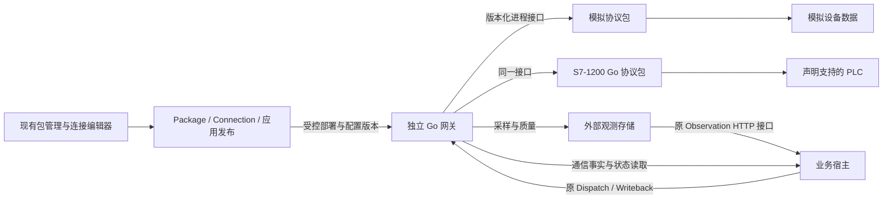

# ADR-0061 — 可插拔协议包：Go 驱动、独立网关与可配置接入

<a id="adr-0061"></a>

状态：已接受（2026-10-15，负责人指令）；**首轮协议运行时、可信包安装、统一配置及模拟业务接入已实现**，范围与证据见 §11；真机和完整供暖交付仍待完成 · 承接 ADR-0057 的能力包、ADR-0056 的依赖、ADR-0046 的交付 · 修订 ADR-0058、ADR-0059、ADR-0060 关于“具体协议不自行开发、不预留”的范围；**不改变观测外存、业务权威和设备控制回路的边界**

## 1. 要解决的问题

楼宇供暖需要接入不同设备，之后还有 RCS、WCS 和其他下游。协议数量很多，不能一次开发完，也不能每加一种协议就修改业务宿主、复制页面或重新做发布系统。

负责人本次确定的方向：协议按需开发、按包加载；技术实现采用 Go/Rust，首期统一 Go；研究 ThingsBoard Gateway、国产网关与已有通信库，再独立实现当前需要的小范围；S7 从常见的 S7-1200 开始，不承担所有历史型号和通信方式。先用模拟数据验证架构，再接真实设备。

本文作出五项选择：

1. **协议包属于技术能力包**，复用原 `Package` 安装、版本和依赖机制，不建立另一套包管理器。
2. **协议 I/O 在独立网关运行**。业务宿主处理定义、权限、规则和派发；网关处理设备连接与报文。
3. **首期驱动全部用 Go 原生可执行文件**，通过版本化进程接口加载。协议差异留在包里，不增加宿主的 S7/Modbus 分支。
4. **表单由包的类型化配置生成**。连接、设备、点位、命令沿现有入口配置，不为每个驱动写 React 页面。
5. **一个可交付原型验证整套方法**：模拟包与一个 S7-1200 读取子集共用安装、配置和运行接口；模拟通过与真机通过分别记录。

## 2. 现状与本次改动的边界

| 现有归属 | 已有能力 | 本 ADR 需要扩展的部分 |
|---|---|---|
| [`packages.go`](../../capabilities/server/packages.go) | 描述、预检、安装、升级、排空、退役、制品封存 | 增加可执行制品、目标平台、运行接口版本、驱动描述及确切版本依赖 |
| [`platform/dependencies.go`](../../capabilities/server/platform/dependencies.go) | `Definition` 的依赖与能力投影 | 连接所需协议包及其能力进入原依赖检查，不新建协议目录权威 |
| [`construction/connection.go`](../../capabilities/server/internal/construction/connection.go) | Connection、环境地址、密钥引用、检查与发布版本；种类为 http/odata/postgres | 原 Connection 增加协议包与网关绑定；编辑器从包描述生成配置 |
| [ADR-0058](0058-observations-and-timeseries.md#as-built) | 外部 HTTP Observation，窗口汇总及有界点读取；原始点不入业务日志 | 网关/外部存储实现该读取接口；原 Observation 补齐数据覆盖、质量与完成时间的明确语义 |
| [ADR-0059](0059-device-dispatch.md#as-built) | Dispatch、Writeback、稳定指令键、状态回读、未知结果与人工处理 | 原派发请求补充尝试身份与配置版本；网关转换具名命令，保留原派发权威 |
| [ADR-0013](0013-capability-fabric.md) | 受控编译、版本化制品与隔离执行；现有 Wasm 用于受限计算 | 可信原生驱动的独立进程，不冒充现有 Wasm 已经提供网络驱动能力 |

**这里的“外部”是运行与数据边界，不等于必须由别家公司开发。** 我们可以编写并交付网关和协议包，它们仍在业务宿主与 `contract/` 之外。行业包只装配设备、规则与页面；楼宇供暖不能出现在通用驱动实现里。

本 ADR 不把 ThingsBoard 整个平台引入依赖，不重做 TSDB、业务规则引擎、PLC 控制循环、急停或安全联锁，也不增加公共插件市场、集群调度或跨节点自动切换。

## 3. 运行结构与归属



| 职责 | 唯一归属 |
|---|---|
| 包的安装许可、确切版本、依赖及退役 | 原 Package owner；部署管理员提供可信发布目录 |
| 逻辑连接、点位含义、命令声明、环境绑定、发布 | 原 Connection 及应用工件；不另建一套可编辑网关业务配置 |
| 进程启动、连接配置交付、采样安排、资源限制、运行诊断 | 独立 Go 网关；只执行已发布的技术配置 |
| 握手、会话、地址解析、读写报文、批量访问与错误解码 | 协议包进程；协议专用连接策略留在包内 |
| 原始点、保留、遥测缓冲、迟到数据及窗口汇总 | 外部观测存储及其采集接入；网关不实现新的时序数据库 |
| 阈值、告警、审批、工单、派发状态与人工裁定 | 原规则、事务、Dispatch 和 Work owner |

首期一个网关服务一个部署租户，不跨租户复用驱动进程。一个 `(租户, 包 ID, 版本, 制品摘要)` 对应一个驱动进程，进程内有多个 Connection 会话；不按设备或点位各开进程。某个驱动退出只影响它的连接，业务宿主继续运行。

网关可与业务宿主部署在同一机器的独立进程，也可部署在能访问 PLC 的现场机器。平台通过原 HTTP 连接访问网关的受保护接口；首期要求该网络路径可达，**不另做反向隧道、MQTT 控制总线或远程装机系统**。进程隔离不是恶意代码沙箱；原生包只接受受控发布，机器权限由部署环境限制。

## 4. 包如何安装与加载

### 4.1 包内容

原 Package 描述用可选的 `runtime` 声明驱动。以下与当前 API 同形，省略未使用的设备字段：

```json
{
  "id": "protocol.s7-1200",
  "version": "0.1.0",
  "runtime": {
    "abi": "driver/v1",
    "targets": [{"os": "linux", "arch": "amd64", "artifact": "<binary digest>"}],
    "profiles": [{
      "id": "s7-1200-standard-db",
      "title": "S7-1200 standard DB (read only)",
      "operations": ["read", "sample"],
      "connectionFields": [{"name": "address", "type": "string", "required": true, "description": "PLC host:port"}]
    }]
  }
}
```

包包括：驱动二进制、完整内容摘要、运行接口版本、配置 Schema、类型与地址规则、支持的操作、设备兼容说明、英文与简体中文文案，以及必要的第三方声明。仅列出实际提供的构建目标和操作；没有二进制的系统、没有实现的协议或写入能力不得显示为可安装/可用。

**包版本、运行接口版本、配置版本、设备型号/固件是四个不同概念。** 不能用“包已安装”推导“这台 PLC 兼容”，也不能用 descriptor 的摘要代替二进制内容摘要。

配置 Schema 复用原类型系统与表单能力：字段类型、必填、默认值、枚举、范围、单位、分组、说明、敏感字段及简单条件显示。需要补的通用字段元数据在原 owner 扩展；不引入任意 JS、租户表达式脚本或驱动自带 React 页面。协议专用地址校验由同一个驱动的只读 `validate` 操作提供，不在前端重写报文规则。

### 4.2 安装、依赖与版本选择

1. 管理员将受控构建产物加入原部署包目录。现有 Package 安装动作检查内容、系统目标、接口版本与依赖；安装不授予设备写入或业务操作权限。
2. 扩展原制品存储保存不可变二进制；原安装记录引用描述与二进制摘要。网关只启动记录已许可且内容一致的制品，不从普通租户表单接受下载地址、命令行或可执行路径。
3. 连接声明确切的包 ID、版本、摘要与 profile；应用依赖检查使用同一份声明。沿 ADR-0056 的原依赖投影和 Package 预检扩展，不给工业协议另建 registry，也不复用代表跨应用协作的 `platform.Protocol`。
4. 首期只选确切版本，不提供自动升级或版本范围求解。现有依赖只记录包 ID、`latest` 使用字符串排序，**不能用于驱动自动选版**；驱动路径必须显式选定版本，后续若改公共版本比较也在原 owner 替换。

这里不新增业务 AssetKind。协议能力是原 Package 的贡献，Connection 是可发布的使用方。包未安装、版本不符、profile 不支持所需操作时，在原依赖检查中给出具体原因，禁止发布该绑定。

### 4.3 更新与停用

包的安装状态与内容版本独立。卸载后允许重新安装内容相同的原版，也允许显式切回保留版本；不要求为再次使用而升版。安装预检与实际决定均核对原封存描述，描述包含各目标二进制的摘要；同 ID、同版本不同内容仍拒绝，原内容无法验证时不猜测。卸载不删除原制品、应用数据或历史。

安装新版不改变已有连接；原连接可以继续使用其保留版本，新连接不能任意绑定退役版本。切换沿原 Connection 草稿与发布过程：停止该连接接收新派发 → 等待已发送操作得到结果或转交原 Dispatch 处理 → 关闭旧会话的写入口 → 启动新配置 → 读取确认后启用。普通遥测读取可重连；写入不得被切换过程重放。

在途指令保存原包版本、配置修订、命令映射与请求身份，新版不得解释旧请求。**保留旧制品不等于保留了回读能力**：原指令未结束时，网关同时保留旧修订的只读入口和所需会话，使用原设备/点地址映射。设备无法同时维持所需会话时推迟切换，直到原指令结束或有权人员明确结束其回读；不可悄悄让旧指令读新版映射。

回退是显式启用旧版本的新配置修订，不改写历史。旧制品在仍有引用时不可删除；恢复业务日志不启动旧驱动、不再访问设备。

首期一个连接只指定一个网关节点，不做写入主备自动漂移。不能确认原节点停止写入时，不在另一节点启用写入。运行代次用于拒绝旧会话的新请求和识别迟到答复，不宣称能撤回已经发到网络中的报文。

## 5. 驱动接口：稳定边界，小接口

首期采用 **JSON-RPC 2.0 over stdio**，版本为 `driver/v1`：标准输出只承载消息，标准错误承载诊断；请求有 ID、截止时间与消息大小限制，批量测量由 `read` 返回。网关统一安排轮询并向外部接收方输出采样，不增加通知订阅接口。大块原始数据不通过业务宿主中转。它是网关与驱动的边缘接口，不进入内核 Protobuf。

| 操作 | 含义 |
|---|---|
| `describe` | 返回与安装描述相符的接口版本、profiles、配置和支持操作 |
| `validate` | 不访问设备，检查配置、点地址与命令参数 |
| `open` / `close` | 用明确配置修订打开/关闭一个连接会话；凭据运行时提供 |
| `read` | 按具名点位批量读取；保留逐点类型、时间、质量与失败原因 |
| `start` / `stop` | 启停采样会话；网关统一安排轮询，驱动执行协议批量读取，首期没有订阅 |
| `execute` | 执行一个已声明的具名命令，返回发送事实；无该能力的包拒绝该操作 |

每个会话标识包含 Connection 身份、配置修订和运行代次；命令附原 Dispatch 的逻辑键、尝试身份与有效期。驱动不得自行访问业务数据库、提交动作、建告警或创建 Work 任务。

只读连接重建与失败读取可以重试；每次重试仍保留质量和采样时间。`execute` 的取消/超时只表示调用方不再等待，不能表示物理操作已经取消。网关保存配置期望值，驱动退出后可恢复采样，不能恢复重放命令。

**不采用 Go `plugin` 的 `.so`。** 它不能卸载，且要求宿主与插件的工具链和公共依赖保持一致，见 [Go 官方说明](https://pkg.go.dev/plugin)。原生进程接口允许包独立替换；首期不建设第二套 Rust SDK。以后若某个真实驱动需要 Rust，可实现同一消息接口，无须让业务层支持第二种语言。现有 Wasm 继续承担纯计算，不为驱动引入网络 host calls。

## 6. 配置与数据格式

### 6.1 四层配置，不让用户编辑网关 JSON

| 层 | 存什么 | 所属与交付 |
|---|---|---|
| 逻辑连接 | 需要哪个包/profile、点位与命令的逻辑名称、类型、单位与映射要求 | 原 Connection 定义与应用工件 |
| 环境绑定 | 网关地址、网关密钥引用、设备实际地址、设备凭据引用、现场点地址及部署参数 | 原环境绑定；不进入可移交应用工件 |
| 设备 | 一个协议会话中的具体设备、型号/固件声明及其点位集合 | Connection 下的配置，不新增业务权威 |
| 点位与命令 | 点位地址、类型、换算；命令允许访问的点、参数范围与回读要求 | 发布的类型化配置；现场地址可以由环境绑定补齐 |

业务中的“设备台账/楼宇/区域”仍是构建者定义的业务对象，通过稳定逻辑设备 ID 引用技术配置；不以 IP、DB 地址或显示名称作为业务主键。更换网关、城市或设备地址不要求修改业务页面和规则。

原 Connection 的 `Kind` 继续表示访问传输（如 HTTP），新增包绑定表示下游技术能力；“S7-1200”不伪装成 HTTP 的另一种数据格式。协议连接通过网关的原 HTTP 读写接口工作，业务宿主无需原生 S7 客户端。前端的连接选项统一由现有内置描述与已安装包贡献投影，删除每种协议的硬编码选项；保留有效的 HTTP/OData/Postgres 用途。

网关收到的是发布后的配置快照及修订，不是另一份可由现场 UI 独立修改的配置。设备密钥只通过受保护运行通道交付，包描述、导出文件与诊断不保存明文。地址或解释方式改变时产生新的配置修订，读取证据能够说明使用了哪一版映射。

### 6.2 采集侧统一样本

不直接把 ThingsBoard 的遥测键名作为平台业务字段。驱动向采集侧输出类型化样本，模拟包与真实协议使用同一格式，例如：

```json
{
  "device": "plant-01",
  "signal": "supply-temperature",
  "at": "2026-10-15T08:00:00Z",
  "receivedAt": "2026-10-15T08:00:00.120Z",
  "type": "decimal",
  "value": "58.4",
  "unit": "°C",
  "quality": "good",
  "source": {"connection": "heating-field", "revision": "r1", "generation": "g1", "sequence": "1042", "clock": "gateway"}
}
```

`at` 是采样时间；设备没有可信时钟时用网关采样时间，并保留时间来源标记。序号在一个来源代次内去重，不冒充全局顺序。断线后的旧值标为 stale/uncertain，失败值不能变成 0。整数和十进制使用字符串保留精度；浮点 NaN/Infinity 拒绝；布尔和枚举保留自身类型，不能偷偷变成数值。

换算只提供具名的类型解码、字节序、线性比例和偏移，不提供脚本引擎。缩放并不恢复设备浮点本来没有的精度。温度、流量等数值可进入 Observation 窗口；布尔、枚举等状态通过已声明的 Source 状态读取或原业务状态记录使用，**不声称现有数值窗口已经支持所有类型**。

### 6.3 接回已有 Source / Observation

设备清单和低频状态映射为原 Source；原始连续读数进入外部观测存储，数值查询继续使用 ADR-0058 的 `{device,signal,since,until,mode,limit}` 及原 `window`/`points` 形状。聚合由存储侧实现，平台不下载所有点后再求完整窗口。

协议绑定的 HTTP 路径由原 Connection 解析器生成，包含连接身份与确切配置修订：`/bindings/<connection>/revisions/<revision>/...`，不能由业务 Mapping 覆盖。Source、Observation 和 Writeback 共用这一解析；网关不得把旧修订重定向到当前修订。派发接受时冻结回读所用的连接/映射版本及环境绑定修订引用，不保存密钥。存储查询保留同样的来源修订，不把不同地址或解释方式的读数悄悄拼成一个窗口。原修订不可读时返回明确原因，派发保持 unknown。

单有 `WindowSummary` 不能证明窗口完整。**Observation 原读取 owner** 已增加有界结果元数据：可用起始时间、已确定不再补入数据的时间、是否截断和质量计数；原 API 类型与编辑器同步使用。协议来源强制要求数据保留范围覆盖请求、窗口已经完成、未被截断且质量合格；普通适配器通过 `requireComplete` 声明此条件。断线补传尚未结束的窗口明确显示未就绪。旧不可变发布保留原解释与证据范围，再次发布使用同一可配置条件，不反写旧版本，也不复制窗口求值器。

画面可以显示标明时间与质量的最近值；Dispatch 判定完成必须用声明的、足够新且质量合格的回读。保留已有读取权限，技术端口不能变成绕过业务授权的公共数据接口。

## 7. 写入：协议答复与业务完成分开

具名命令由发布配置限定点位、参数类型/范围、是否可安全重发及回读方式。使用者执行原业务动作，经原 Dispatch/Writeback 派发；连接编辑器不提供绕过权限的“任意地址写值”按钮。写权限需要包支持、连接启用及业务动作授权共同成立；只读试连不打开写入。

原 Writeback 的稳定逻辑键继续作为 `Idempotency-Key`。对协议包绑定，由原 Dispatch/Writeback owner 冻结并发送外层命令信封：`dispatch{runID,attemptID,businessKey,deadline,bindingRevision,packageDigest}` 与 `command{...}`。业务 Mapping 只生成 `command`，不能覆盖信封；普通 HTTP 集成的既有请求形状不变。`attemptID` 由原派发 owner 产生，同次尝试的 HTTP 重送保持一致，授权的新尝试使用新身份，不以一次 HTTP 请求编号充当尝试身份。网关技术收据按租户、runID 与 attemptID 定位，并校验业务键、配置与内容摘要。只传逻辑键的旧请求不自动获得新一轮设备写入许可。

网关必须区分四种通信事实：明确未发送、可能已发送、设备协议已答复、设备明确拒绝。HTTP 2xx、S7 写答复均不能直接设置业务 `completed`；完成仍归 ADR-0059 的状态回读或授权人工证据。仅“当前目标值相等”也不能证明不可重复命令已执行：读数须满足原命令的时间、关联和完成条件；无法证明就保持未知。

对实际写入，网关保存**最小技术收据**：指令键、尝试身份、请求内容摘要、发送可能性与已有答复。首次可能发送前先持久保存该身份；相同身份与内容只返回已有事实，不再次发送，内容不同则拒绝。重启后只有“可能发送”而无答复时返回 unknown，不自动补发。这不是第二业务队列：不自主排队执行、调度重试、裁定完成或创建任务，唯一派发状态仍归原 Dispatch。

不同尝试是否允许再次写入由原 Dispatch 决定；网关不得把新 HTTP 请求当作该许可。技术收据保留覆盖指令可重试的生命周期，不能过期删除后把旧键当新命令。危险写入的自动重试在 HTTP、网关和驱动三处都必须关闭；设备无去重能力时不承诺物理 exactly-once。

首个 S7 包只声明读取。写入方法先在模拟包验证技术收据、未知结果和回读，再由真实项目按明确命令逐项开放；未开放的方法不会出现在真实 S7 配置中。PLC 的控制循环、联锁、急停和现场允许条件始终由现场系统负责。

## 8. 前端如何使用

沿原 Control Panel 包管理、Data Connection/Connection 编辑器、应用发布和 Runs 组织；复用 `@platform/ui`、`@platform/app` 的表单、列表、草稿与错误显示，不创建独立网关控制台。

1. **安装包**：显示包用途、版本、运行目标、实际支持的 profiles 与验证范围。未安装的协议显示安装入口，不呈现可用的空表单。
2. **建连接**：选择已安装包和 profile，填写网关环境绑定，再配置设备；常用字段先显示，高级参数折叠。S7 的访问前提直接在相应字段旁说明。
3. **配点位**：表格批量编辑/导入点表，映射逻辑 ID、现场地址、数据类型、单位与采样周期。首期支持 CSV 和结构化 JSON；逐行展示错误及解码预览，不要求用户读报文。已有 Excel 点表可先导出 CSV，不新建一套表格解析器。
4. **只读确认**：复用 Connection 检查动作，显示驱动/配置版本、设备识别结果、样本时间、质量和具体问题。试读不写业务记录，也不偷偷开启连续采样。
5. **发布与关联**：预览配置差异、检查应用的包依赖，再启用采样；将逻辑点关联到 Observation，将具名命令关联到原 Dispatch 编辑器。
6. **查看问题**：现有连接和运行页显示离线、陈旧、地址错误、类型不符、未验证型号或窗口未就绪；从错误能回到对应配置行。业务用户看到设备/测点名称与处理办法，报文字段只放技术详情。

包字段与产品按钮均提供英文/简体中文；点名、楼名等业务数据不翻译。窄屏用同一份表单的分组编辑与横向点表，不复制一份手机配置逻辑。模拟来源持续显示“模拟数据”，测试按钮与实际启用采样的操作明确分开。

## 9. 首个协议范围与研究方法

### 9.1 先定义访问 profile，再写代码

第一个真实协议包目标是 **S7-1200 的一个具名访问 profile**，不是“支持西门子”。首轮实现 TCP 连接、所需握手与读取、标准 DB 的绝对地址、布尔/整数/REAL 等本轮点表需要的类型、合理的批量读取和逐点错误。设备写入、程序上下传、CPU 控制、串口、PPI/MPI、S7-200/300/400 以及其他历史兼容均不在首轮。

`s7-1200-standard-db` 使用传统 S7 访问方式；它不等于新一代安全通信，也不宣称读取优化 DB 或任意符号地址。具体 CPU 订货型号、固件、访问权限与 DB 设置组成兼容声明；**在没有设备信息与真机验证前，支持状态是模拟验证，不填造一个固件范围**。S7-1200 G2 单列验证，不由名称相近推断支持。[Siemens G2 官方文档](https://docs.tia.siemens.cloud/r/simatic_s7_1200_g2_manual_collection_enus_20/communication/s7-communication/put-and-get-write-and-read-from-a-remote-cpu)对 PUT/GET 启用和 DB 访问有明确条件；这些资料仍不能替代外部客户端互通验证。

后续 OPC UA、Modbus TCP、BACnet 或具体 RCS/WCS 只在真实点表/接口需要时开发一个包；支持声明包含访问方式和操作，不建立“一车协议”的占位清单。设备提供合适的标准、安全访问方式时按现场条件选择，不为复现旧库而坚持旧路径。

2026-10-15 负责人提供中睿项目需求与点表后，本轮增加 `modbus-tcp-abcd-read`：仅 TCP、功能码 01/02/03/04、BOOL/INT16/UINT16/INT32/UINT32/FLOAT32，32 位按点表声明的 1234（ABCD）顺序解释。地址显式使用区域及从 0 开始的偏移，寄存器位显式使用 `.0`–`.15`（最低位为 0）；不自动猜测 4xxxx 引用号或 S7 字节位与 Modbus 位的对应关系。沿 [Modbus 应用协议](https://www.modbus.org/file/secure/modbusprotocolspecification.pdf) 与 [TCP 实施指南](https://www.modbus.org/file/secure/messagingimplementationguide.pdf) 独立实现必要报文，不引入第三方运行框架。RTU、其他字节序、设备写入仍未开放。

### 9.2 参考什么，怎样转成我们的实现

| 来源 | 本次借鉴 | 不直接继承 |
|---|---|---|
| [ThingsBoard Gateway 官方架构](https://thingsboard.io/docs/iot-gateway/what-is-thingsboard-iot-gateway/) | 连接器、协议转换、遥测缓冲、平台连接的职责划分 | Python 运行框架、ThingsBoard 上行模型、全套设备目录和业务规则 |
| [IoTGateway](https://github.com/iioter/iotgateway) / [ThingsGateway](https://github.com/ThingsGateway/ThingsGateway) | 按需插件、通道/设备/点位配置、采集与转发分开 | .NET 运行时、独立业务控制台、脚本引擎和全部历史插件 |
| [HslCommunication 作者仓库](https://github.com/dathlin/HslCommunication) | 公开 API 的连接生命周期、类型化读写、地址表达与操作结果 | 当前完整库不是免费开源；不把旧 fork 的许可套到当前实现，也不假设所有源码可直接复制 |
| [Node-RED S7 作者仓库](https://github.com/st-one-io/node-red-contrib-s7)及设备厂商资料 | 必需的地址、访问条件、报文行为与测试思路 | Node.js/Node-RED 依赖、完整型号兼容及其特定许可下的代码 |
| [REA / Reverse Engineer Anything](https://github.com/morluto/rea) | 对需要解释的 .NET/原生程序或抓包，辅助查清特定行为 | 它不是协议库；分析结果不是官方协议规范，也不自动授予第三方代码使用权 |

“LT Board/LT Gateway”暂不能唯一识别；上表两个国产网关是已核实的候选，不能当成同一个项目。无需等待确认名称才推进架构。

实施按**一个明确问题**研究：先读设备/协议资料和可用源码 → 对照一次必要交互 → 形成最小输入输出例子 → 用 Go 独立实现 → 用同一报文例子及目标设备验证。源码已经公开时直接阅读；只有行为确实解释不清且有可分析材料时才用 REA，不反编译整个库来猜“所有协议”。复用代码须遵循其实际许可；不预设重写必然比成熟实现更小、更正确，也不把成熟实现的大小全归因于历史包袱。

## 10. 交付顺序、替换与完成条件

### 10.1 当前整块：模拟接入与协议插槽原型

这是 WorkQueue 当前供暖交付内部的一块，不另建队列，也不等真实点表才开始：

1. 扩展原 Package 制品/运行声明、Connection 绑定及同一依赖投影；建立最小 Go 网关与进程接口。
2. 交付独立的模拟协议包与小范围 S7-1200 Go 读取包。模拟包按确定种子与场景时间生成供暖数据，提供正常、温度异常、断线、陈旧值、命令结果不明等少量必要场景；场景数据归 ADR-0050 样本，不把供暖逻辑写进驱动 SDK。
3. 用同一配置表单安装、选择、导入点位、只读确认、发布；模拟样本接回原 Observation、规则、告警/任务与 Dispatch 回读。首个场景先用温度/流量/阀位等少量点；不同城市使用同一模板的不同环境绑定。
4. S7 包通过本地 S7 测试服务验证实际报文读取、错误和类型转换，不冒充真 PLC。真实点进入外部存储后才开放真实窗口；模拟器的确定性窗口明确属于模拟，不建一个生产内置 TSDB。

当前整块完成后统一做一次适用检查：改到的 Go owner、必要的 `make check`、Web 类型检查及一条浏览器使用路线；只为新增的重要错误行为保留少量测试，不为每个消息字段建测试体系。设计阶段仅检查文档链接与差异格式，不运行代码测试。

**原型的停止条件：**

- 增加/安装第二个包不修改业务宿主协议分支和前端专用页面，模拟与 S7 包走同一加载与配置路径。
- 界面完成“安装 → 配置 → 读数 → 发布 → 业务使用”，错误能定位字段；查看桌面与窄屏实际画面。
- 模拟异常通过已有规则产生业务结果，结果不明不自动重写，完成来自合格回读；连续采样不把原始点灌进租户日志。
- 在采样继续时切换一个包版本，业务宿主无须重新编译/重启；在途请求保留原版本身份，旧配置不会接收新写入。
- 两份模拟楼栋配置零代码差异；明确记录模拟、本地协议服务与尚未验证的真机三种证据。

### 10.2 真实接入

有首批真实点表后，只补所需 profile 和确切设备验证；S7 写入须有具名命令、参数限制、现场允许条件与回读，按原 Dispatch 接入。它不自动扩成第二批协议开发。真实上线、行业包和多城市交付仍按 ADR-0060 判定，原型完成不代表第一次真实交付完成。

### 10.3 同批替换什么

- 原连接编辑器的硬编码技术选项改为统一描述投影；不新增 S7 专用编辑器、独立网关数据库配置 UI 或第二发布按钮。
- 配置校验只有包 Schema 与同一驱动实现；旧的临时 JSON 入口若被该能力取代，在本块删除。
- 设备协议编解码只在包内；宿主若出现原型期直连分支，在正式包接入时删除，不保留“快速直连”和“正式包”两条路径。
- Source、Observation、Writeback、Dispatch、规则与任务继续使用原 owner；已有 HTTP 等连接的有效用途保留，旧不可变定义与历史仍可读，不改写历史。
- 现有 Package descriptor-only 包继续按原语义使用；原生执行需要显式 runtime 声明，不能把旧包自动提升为可执行代码。

## 11. As built

ADR-0064 保留原协议声明与发布语义，移除无协议对象的动作目录生成；有绑定的非法生命周期由原 Build 规则返回错误，不进入可信静态声明的 panic。事务状态目标先按原规则检查，Describe 失败明确返回；原协议发布/恢复及非法生命周期检查通过。

原 `Package` 已支持 `driver/v1`、目标系统/架构、profiles、类型化字段和可信原生制品。安装必须指定确切版本并封存所有声明目标的二进制，保留版本可用于原连接回读；同版本内容变化被拒绝。退役后可重装原版或安装新版本，显式切回保留版时当前/保留列表每版只出现一次，全部原映射继续可读；不能用安装跳过排空状态的版本切换检查。保存失败不暴露新安装，原请求重试、日志重放与快照恢复均保留旧版本解析。部署目录增加版本后原 Console 即时发现，移除目录版本不移除原安装记录或封存读取，不替换租户或重启业务宿主。构建入口为 `make packages`，使用方法见 [Apps](../Apps.md#协议包与模拟采集)。

[`driver/`](../../capabilities/server/driver/) 提供有界 stdio 调用与加载；[`gateway/`](../../capabilities/server/gateway/) 按包版本启动进程、按连接修订管理会话，在独立进程执行唯一采样循环。网关保存技术配置、当前修订与命令收据，原始采样输出为 NDJSON，仅保留有界最近值；它没有时序数据库、业务规则或第二业务队列。预览使用隔离只读会话，不启用采样，样本不写入 Connection 或业务日志。恢复技术配置不访问设备或重放命令。

已提供三个包：`protocol.simulator` 的 `simulator` profile 支持正常、异常、离线、陈旧和答复不明场景，初值、变化与固定时间由配置指定，驱动不含供暖对象/规则；`protocol.s7-1200` 的 `s7-1200-standard-db` 实现 TCP 握手、标准 DB 绝对地址和 BOOL/BYTE/WORD/INT/DWORD/DINT/REAL 的批量读取与逐点错误，**没有写入**；`protocol.modbus-tcp` 的 `modbus-tcp-abcd-read` 按 §9.1 读取四个区域、连续声明的有界批次及显式寄存器位，校验应答身份和长度，设备拒绝、非有限值或断线保留为无有效值的错误。模拟器可按种子与场景生成数值窗口；S7 与 Modbus 仅提供最近读数，历史窗口明确要求外部存储。

Modbus 的风柜/DDC/机房十个点沿实际工作簿的地址、类型、单位与缩放建立配置，见 `deploy/examples/hvac/`；本地单元编号、地址和原始读数是模拟值，不能当作客户设备清单。它复用原安装、Schema、点表导入、预览、检查与发布，宿主和前端没有新增 Modbus 分支。根包原 S7 单例已替换为共享的 S7/Modbus 真实二进制用例，保留原 S7 检查；构建脚本用一份驱动清单生成包，没有第二包管理器。

十点响应暴露原 `guarded` HTTP 发送函数在响应头返回时就取消上下文，导致尚未读完的响应中断；已删除这次提前取消，继续由原 HTTP Client 超时覆盖整个读取。协议读取分别报告读取失败和真实超限，保留原 1 MiB 限制，没有为通过点表放宽大小或网络访问条件。

原 Connection 持有确切包、profile、配置与环境绑定。可移交定义保留逻辑设备/点位/命令，剥离网关地址、密钥、设备设置和现场点地址；目标环境按同一蓝图校验。Source、Observation、Writeback 和 Dispatch 共用修订路径；Observation 的 `latest` 模式让普通成员按原记录权限读取当前数值测点，不要求设备提供历史窗口，也不启动持续采样。构建器从连接现有点表选择测点并沿用单位和路径，不再重复填写协议细节。旧派发继续读取原映射，旧修订拒绝新写入。派发身份由原 owner 填写，网关在可能发送前持久保存最小收据；未知结果不自动再发，完成由原合格回读判定。协议 Observation 使用同一覆盖/质量检查，仅紧凑窗口结果入账。

前端删除 Connection 的硬编码种类表，由内置描述与已安装包共同提供选项；同一表单编辑设备、点表和具名命令，支持 CSV/JSON 导入、字段错误与只读预览。原包卡片提供确切版本选择；沿原保存、检查和候选发布，不新增专用 S7 页面或发布入口。新增产品文案提供英文/简体中文。预览与发布统一使用原密钥读取，修复有效环境变量密钥被发布误拒的问题。

当前打包版本为 `0.1.4`；旧版本描述和二进制继续保留，同版本不同内容仍拒绝覆盖。`make packages` 已生成新版本与两个分批生产定义包；既有驱动运行证据保持下述范围，版本递增不改变协议 ABI 或设备支持。必要检查范围：`make check`、相关 Go owner、真实驱动二进制安装/运行与 `protocol-packages` 浏览器路线；桌面与 390 宽度画面已查看。模拟业务检查覆盖两份配置、异常产生原业务结果、原始点不入接受结果、答复不明后新鲜状态回读；同一宿主持续采样时安装并切换新包版本，新旧修订分别读出原映射、运行代次改变、旧修订新写入被拒。S7 与 Modbus 检查使用本地 TCP 服务。真实 CPU/固件、S7-1200 G2、生产 TSDB 及客户多城市上线均**尚未验证**；供暖行业包、版本化样本与页面的模拟交付归 ADR-0060 As built，本节不替代其完成条件。
