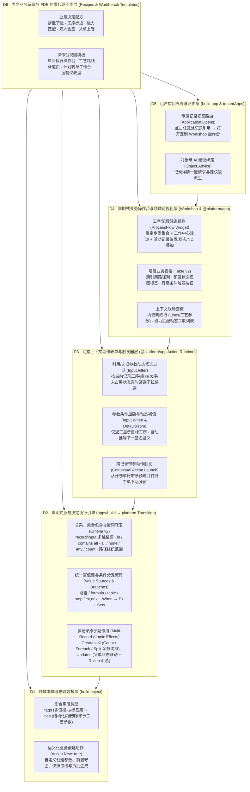

# ADR-0098：全栈声明式业务语义与零代码行业应用等价重建体系

**意图：** 让 Platform 从“运行预先用 Go 和 React 编写好的原生业务应用的系统”，进化为“根据可版本化、可验证的应用定义，从数据模型、后端业务决定、动态交互表单到前端领域操作台与流程可视化，全栈自动构造并执行正确业务行为的系统”。把业务规则与操作界面逻辑的定义权从原生源码转移到平台一等资产上，让 FDE 乃至零代码背景的业务玩家，在不接触任何后端 Go 代码或前端 React 代码的前提下，从头到尾构建出完整的企业级应用，并以**全栈零代码等价重建原生 MES（`apps/mes/server` + `web/packages/mes`）**作为唯一终极证明。

**状态：** 已落地（2026-10-12，B1–B6 核心全栈语义与 `TestBuilderMESEquivalence` 等价重建证明已实施并通过验证；边界见 §5 As built）。

**基线：** `8f602ac515e6a7bacabc4f0bf7e04bc347d12e22`（ADR-0097 W4 收口后）。

**承接与边界：** 承接 ADR-0034/0035/0036/0037/0040（租户定义对象、页面、应用、动作与关联）、ADR-0046（Workshop 页面工作台）、ADR-0052/0053/0054（Foundry 对齐的 Shell 与构建者 IDE）、ADR-0062/0064/0076（决策表、公式与业务核）、ADR-0086/0087/0088（流程泳道画布与 MES 工艺主数据）及 ADR-0096/0097（统一表单输入与唯一接受结果提交管线）。保持内核契约（`contract/`）零领域词汇；不在宿主或浏览器执行任意租户脚本（ADR-0044）；所有声明式后端规则编译为 `platform.Entity` / `platform.Lifecycle` / `platform.Transition`，所有声明式前端交互与视图编译为 `@platform/app` 与 `@platform/ui` 的受控组件与运行时契约。

---

## 1. 全链路瓶颈诊断：为什么今天用户无法“不写一行代码从头干到尾”？

要让 FDE 或业余玩家真正不碰代码从零搭出完整应用，不能只解决后端状态机，必须同时消灭**两处原生源码依赖**：
1. 消灭 `apps/<id>/server/*.go` 中的**手写后端业务规则、跨对象守卫与多记录事务代码**；
2. 消灭 `web/packages/<id>/src/*.tsx` 中的**手写前端操作台、动态筛选动作弹窗、工艺泳道进度图、跨表关联列与专属记录详情路由代码**。

对照原生制造应用的服务端（`apps/mes/server/{mes,actions,erp,equipment}.go`，约 1,300 行 Go）与客户端（`web/packages/mes/src/index.tsx`，431 行 React/TS），当前平台在**从头到尾构建完整应用**的全链路上存在六大断层：

### 断层一：领域本体与创建建模层（Ontology & Custom Creation）
| 原生 MES 能力 | 当前 `build` 的限制 | 为什么支撑不了从头构建？ |
|---|---|---|
| **多值能力标签与内嵌明细结构**：设备持有 `Capabilities []string`（如 `["assembly", "torque"]`），工序声明 `Requires []string` 与内嵌参数表 `Parameters []Parameter{name, type, unit, target, min, max}`；ERP 单据含内嵌行 `Lines []Line`。 | `buildapi.Field` 仅支持 10 种单值标量/引用类型，**不支持 `tags`（多值字符串集合）与 `lines`（结构化内嵌明细行）**（尽管底层 `platform.Entity` 与前端 `GeneratedForm` 早已支持 `tags` 与 `lines`）。 | 构建者连“一台设备具备多项能力”、“一道工序包含多个设定值/上下限参数”或“一张单据包含多行明细”都无法在对象模型上直接声明。 |
| **语义化业务创建动作（`New: true`）**：`mes.order.release` 是创建 `mes.order` 的动作，操作员只填 `{product, quantity, sfcs, planned, place}`，由动作自动校验、快照工艺版本、填充初始状态并拆批生成子 SFC。 | `build` 只有系统死板生成的 `build.<obj>.create`（表单固定罗列全部非只读字段）；自定义 `buildapi.Action` 强制要求 `len(From) > 0`，**不允许定义 `From: []`（`New: true`）的业务创建/下达动作**。 | 用户创建业务单据时被迫面对数据库全字段裸表单，无法定义“下达工单”、“开立工单”、“发起申请”等带参数收敛、前置校验和连带生成的创建入口。 |

### 断层二：后端业务决定与领域不变量执行层（Backend Business Decision Engine）
| 原生 MES 能力 | 当前 `build` 的限制 | 为什么支撑不了从头构建？ |
|---|---|---|
| **跨对象、能力包含与集合量词守卫**： ① `canDo`：`input.resource.workCenter = record.operation.workCenter` 且 `record.operation.requires ⊆ input.resource.capabilities`； ② `fits`：无其他工单占用同一 `input.planned`（唯一性）； ③ `reworkable`：返工目标工序属于本批次工艺版本且工序号 `<=` 当前工序号； ④ `allowed`：操作员所属产线（`SiteStructure`）覆盖 `sfc → operation → workCenter → line`。 | `Condition` 仅支持单字段与字面量或另一字段做 `=, !=, <, <=, >, >=, empty, not empty` 标量比较；不支持 `input.<ref>.<path>` 跨引用读取、不支持 `in / not in / contains all / contains any` 集合算子、不支持关联集合量词（`all / none / any / count`）、也不支持按关联路径判断动作级组织单元范围。 | 一旦遇到“设备能力是否满足工序要求”、“计划单是否已被占用”、“所有子批次是否已完工”、“操作员是否属于该工位所属产线”，声明式规则立刻失效。 |
| **富值源与条件分支流转**： ① 下达时从 `input.product.routing` 读取最新工艺路线版本与首工序号冻结到 SFC； ② `complete` 判断是否存在下一工序：有则推进 `operation` 并回 `queued`，无则进 `done`； ③ `sign` 达成会签后按 `rework / scrap / use-as-is` 分支流转。 | `Set.From` 仅支持 `input.<name>`、`$me`、`$now`、`=<literal>`（不能读 `record.<path>` 或 `input.<ref>.<path>`，不能用 `formula` 或 `table` 决策表，不能算 `step:first/next`）；`Action.To` 只能写死单一状态或直接取 `ToInput`。 | 动作无法根据业务上下文（如“是否已是最后一道工序”）自动决定下一个状态，也无法从关联主数据、公式或决策表计算字段值。 |
| **多记录原子副作用与父子联动上卷**： ① `release` 按 `input.sfcs` 动态拆批创建 N 条 SFC，数量整除均分、余数归前序批次（10 拆 3 批 → `4, 3, 3`）； ② `finishOrder`：当最后一个子 SFC 进入 `done/scrapped` 时，在**同一决策**内将父 `Order.status` 置为 `completed` 并汇总 `yield` 与 `scrap`，随即触发 ERP 确认 Flow。 | `Action.Creates` 每项只能静态创建 1 条记录，无动态条数 `Count`、无余数均摊 `split`、无按模板展开 `Foreach`；子记录动作**完全无法更新关联父记录或触发父记录状态跃迁与字段汇总上卷**。 | 主从单据拆分、按工艺路线展开工序、子项完工自动驱动父单完工并汇总产量等核心企业逻辑无法闭环。 |
| **职责分离多人会签（21 CFR Part 11 Quorum）**： `sign` 在 `hold` 状态下要求 2 名不同质检员（`by != $me`）分别以 `reviewed` 和 `approved` 对同一处置方案签名，满 2 人后才放行。 | `ActionApproval` 仅支持动作执行前的固定角色审批流，不支持在业务记录上累积结构化签名并按法定人数（Quorum）与职责分离规则触发状态流转。 | 合规会签、双人复核放行只能手写 Go 代码维护切片。 |

### 断层三：前端动作表单与动态上下文交互层（Context-Aware Action Forms & Triggers）
为什么 `web/packages/mes/src/index.tsx` 被迫手写了 4 个自定义 `<Dialog><EntityForm .../></Dialog>`，而不用平台自动生成的 `ActionDialog`？
| 原生 MES 前端表单逻辑（`web/packages/mes`） | 当前 `@platform/app` `PayloadFields` / `ActionDialog` 的限制 | 为什么支撑不了从头构建？ |
|---|---|---|
| **引用下拉框的上下文动态候选过滤**： ① 开工弹窗的 `resource` 下拉框：**只列出能加工当前 SFC 所在工序的可用设备（`capable`）**，而不是全厂所有设备； ② 签字处置弹窗的 `reworkOperation` 下拉框：**只列出当前批次工艺路线中工序号 `<= 当前工序` 的工序**； ③ 下达工单弹窗的 `planned` 下拉框：**只列出未完结且尚未被其他工单占用的计划工单**。 | `Input` 的 `reference` 类型在前端一律渲染为无条件全表检索的 `RecordPicker`，**不支持声明相对于当前 `record.<path>` 或其他 `input.<name>` 的候选过滤规则（`Input.Filter`）**。 | 没有动态候选过滤，操作员在开工或返工时看到的是全量无关数据，只能盲选后点提交等后端报错，操作体验完全不可接受。 |
| **表单字段的条件显隐、动态默认值与跨参数校验**： ① 签字处置弹窗中，仅当 `action === "rework"` 时才需要选择 `reworkOperation`； ② `meaning` 根据当前记录是否已有 `reviewed` 签名自动默认选 `approved` 或 `reviewed`； ③ 下达弹窗校验 `sfcs <= quantity`（参数间比较已有 `Before/Inclusive`，但缺基于 `record.<path>` 的动态上下界与默认值）。 | `buildapi.Field` 有 `When`，但动作参数 `buildapi.Input` **没有 `When`（条件显隐/必填）**，也没有基于当前 `record.<path>` 推导初值的动态默认值（`DefaultFrom`）。 | 复杂动作弹窗无法根据所选分支隐藏无关参数，也无法智能预填默认值。 |
| **从上游记录行一键带参触发另一对象的动作**： 在 `PlannedOrders` 列表中点击某行计划工单的 `Release` 按钮，弹出 `mes.order.release` 表单，自动将计划单的 `product`、`quantity`、`erpId` 填入并默认 `sfcs = min(4, quantity)`；且已关联车间工单的行自动隐藏 `Release` 按钮。 | Workshop 的表格与按钮只能对当前选中记录执行本对象的无参/固定默认参数动作，**不支持跨对象带参动作触发（Contextual Action Trigger）与行级按钮条件显隐**。 | 用户无法做出“从上游计划单/待办行一键转单下达”的连贯操作流。 |

### 断层四：前端业务操作台与领域可视化层（Declarative Operational UI & Process Visualization）
为什么 `web/packages/mes/src/index.tsx` 要手写 `RoutingFlow`、`SFCDetail`、`SFCTable`、`Craft`、`PlannedOrders` 五个 React 组件？
| 原生 MES 前端视图逻辑（`web/packages/mes`） | 当前 Workshop 页面与组件的限制 | 为什么支撑不了从头构建？ |
|---|---|---|
| **工艺路线泳道流转图（`RoutingFlow`）**： 使用 `@platform/ui` 的 `<FlowSteps>`，以工作中心（`workCenter`）为泳道、以工序为节点画出完整工艺路线；在 `SFCDetail` 中还**叠加显示当前批次停留在哪道工序（高亮 `current`）、哪些工序已完工（绿色 `past`）、当前是否挂起/报废、以及各工序上的不合格记录（`NC`）**。 | `@platform/ui` 已有 `<FlowSteps>`，但 Workshop **没有将其封装为可绑定“有序步骤集合 + 泳道字段 + 当前活动记录位置/状态/子项叠加”的声明式页面组件（`ProcessFlow` Widget）**。 | 只要业务需要展示“工艺路线泳道图”或“单据/项目阶段流转图并高亮当前记录所在位置”，构建者就束手无策。 |
| **表格跨引用路径列、关联状态列与快速视图切换**： ① `SFCTable` 直接显示通过 `routing + operation` 算出的工序名与工作中心名，且顶栏提供 `Waiting or in work / On hold / Done or scrapped / All` 预设视图下拉切换； ② `PlannedOrders` 表格展示反向关联的车间工单号与 ERP 确认状态徽标。 | Workshop `Table` 只能配置本对象的直接字段，**不支持跨引用路径展示列（Lookup/Path Columns，如 `operation.name`、`operation.workCenter.name`）**，也不支持在表格上直接配置多状态预设过滤视图切换器（View Presets）。 | 列表页满屏只能显示裸外键 ID，操作员为了看清工序和工作中心名字不得不逐条点开详情；切换“在制/挂起/已完工”要配复杂的外部变量。 |
| **基于当前记录动态指针的上下文子面板**： `SFCDetail` 根据 `sfc.operation`（当前所在工序）动态展示该工序的「工艺参数面板（自动按 `setpoint/range/limit/note` 格式化数值与单位）」和「当前工步可用设备面板」，并在 `state === "hold"` 时显示「会签记录面板」。 | 页面详情组件不支持渲染内嵌 `lines` 结构化表格（含参数规格格式），且子面板难以直接按“当前记录的某引用字段指向的目标记录（`record.operation`）”加上能力匹配条件做上下文联动。 | 车间操作员打开批次详情时，看不到“当前这一步要求保持什么温度/压力参数”和“哪台设备能干这一步”。 |

### 断层五：租户应用外壳、专属记录详情路由与 AI 绑定层（Application Shell & Record Routing）
| 原生代码应用能力（`defineApp`） | 当前租户应用（`build.app` / `tenantApps.tsx`）的限制 | 为什么支撑不了从头构建？ |
|---|---|---|
| **专属记录详情视图路由（`opens`）**： `defineApp` 声明 `opens: { "mes.order": "mes-order", "mes.sfc": "sfc" }`，无论从表格行点击、关联链接跳转、全局搜索还是收件箱点击一条 `mes.sfc`，都会打开专属的 `SFCDetail` 车间操作台。 | `tenantApps.tsx` 生成的 `AppUI` 没有 `opens` 映射！点击任何租户对象记录，一律跳回系统默认的单调字段列表页，**无法路由到构建者在 Workshop 中为该对象专门设计的详情操作台页面**。 | 构建者就算在 Workshop 里拼好了漂亮的页面，一旦用户在系统里点击记录链接，还是会掉回简陋的默认属性页，应用体验是割裂的。 |
| **记录级 AI 建议绑定（`advice`）与应用仪表盘（`dashboards`）**： `mes.order` 与 `crm.opportunity` 在详情页直接集成 AI 审查建议卡片；应用导航自带多图表运营仪表盘。 | `build.object` 无法在对象定义上直接绑定默认 AI 建议函数（`Advice`），使得通用记录详情页无法自动呈现 AI 建议卡片。 | AI 函数与记录详情页脱节，需要手工在每张页面去绑复杂的 AI 组件端口。 |

### 断层六：面向业余玩家与 FDE 的端到端零代码创作体验（Recipe-Driven Authoring）
- 即便底层提供了上述全部原语，如果让一名业余玩家或 FDE 手工在 Ontology、Action Types、Queries、Workshop、Automate、Releases 六个模块之间逐个配置几十条路径表达式、集合量词、页面变量和查询计划，学习曲线依然过于陡峭。
- 必须提供**面向业务意图的“决定配方（Decision Recipes）”与“操作台一键生成模板（Workbench Templates）”**，让用户用业务语言选配方、填槽位，由平台自动展开为经过严格静态校验的定义资产。

---

## 2. 全栈目标架构：六层一体的业务语义表达与执行体系（D1–D6）

### D1. 领域本体与创建建模扩展（Ontology v2）

1. **新增 `tags` 与 `lines` 字段类型（`buildapi.Field` → `platform.Entity`）**：
   - `tags`（多值字符串集合，对应 Go `[]string` 与 struct tag `type:"tags"`）：用于表达设备的 `capabilities`、工序要求的 `requires`、标签集合等，天然支持集合包含运算（`contains all` / `contains any`）与前端多值标签输入/展示。
   - `lines`（结构化内嵌明细行，对应 Go 子结构体切片与 struct tag `type:"lines"`）：`buildapi.Field` 新增 `Columns []LineColumn{Name, Title, Type, Choices, Required}`，编译时由 `reflect.SliceOf(reflect.StructOf(...))` 动态构造强类型切片字段。直接支撑工序的工艺参数表（`Parameters`：名称、类型 `setpoint/range/limit/note`、单位、目标值、上下限）、单据行项目（`Lines`）等主从内嵌结构，复用前端已有的 `GeneratedForm` 与详情表格渲染。
2. **支持语义化业务创建动作（`Action.New: true` / `From: []`）**：
   - 允许在 `buildapi.Action` 上声明 `New bool`（此时 `From` 为空，`To` 为创建后的初始生命周期状态，默认首状态）：
   - 编译为 `platform.Action{Schema: "build.<obj>.<action>", Target: "build.<obj>", New: true, ...}` 并接入账本与生命周期：
     - 调用者提交该动作时，要求目标记录尚未存在（`expectedRevision == 0`）；
     - 执行该动作专属的 `Inputs` 校验、`Conditions` 守卫（如校验 `planned` 计划单未被占用）、`Sets` 字段推导（如将 `input.product.routing` 的当前版本快照写入新记录，未显式映射的字段取空值或由动作填充）、`Branches` 分支，以及 `Creates`（如同时拆批创建 N 条子 `SFC`）、`Posts`、`Journal`；
     - 在列表页顶栏（`NewActions`）与页面 `CreateForm` / 按钮动作中作为一等创建入口呈现；当对象声明了自定义创建动作时，可选择保留或按角色收窄默认裸 `create` 动作。

### D2. 声明式业务决定执行引擎（Decision Engine v2）

全部在 `build` 发布期做完备静态类型检查（`checkProcess`），编译为 `platform.Transition`（及 `New` 创建动作处理器），在 `Do` 阶段于私有暂存视图内求值校验、在 `After` 阶段写入同一 `ChangeRecord`（`record-batch` 原子落盘与纯应用重放）：

1. **关系、集合包含与量词不变量守卫（Criteria v2）**：
   - **操作数扩展**：`Condition.Field` 与 `ValueField` 支持 `record.<path>`（本记录及多跳引用路径）与 `input.<name>.<path>`（当 `input.<name>` 为 `reference` 时跨对象读取目标记录字段，如 `input.resource.workCenter`、`input.planned.quantity`）。
   - **集合算子**：扩展 `Operators` 支持 `in`、`not in`、`contains all`、`contains any`（支持 `tags` 字段、逗号分隔集合与关联字段之间的包含/交集判定，直接表达 `input.resource.capabilities contains all record.operation.requires`）。
   - **关联集合量词断言（`Condition.Quantifier`）**：
     - 支持 `all`（全称）、`none`（唯一/互斥）、`any`（存在）、`count`（数量满足 `Operator` + `Value`）；
     - 集合范围 `Collection` 可选本记录/关联记录的反向关系（如 `record.sfcs`、`record.order.sfcs`、`record.signatures`）或目标对象类型（如 `build.order`），配合子过滤条件 `Where []Condition`（可引用外层 `record.*`、`input.*`、`$me`）；
     - 直接覆盖：计划单唯一占用（`none of build.order where planned = input.planned and id != record.id`）、签署人职责分离（`none of record.signatures where by = $me or (action = input.action and meaning = input.meaning)`）、子批全部完结（`all of record.order.sfcs where state in (done, scrapped)`）。
   - **按引用路径解析的组织单元范围守卫（`Action.UnitField` / `ObjectScope.Unit` 路径化）**：
     - 允许 `ObjectScope.Unit` 与动作级 `UnitField` 声明引用路径（如 `operation.workCenter.line` 或 `place`），运行期自动解析该路径下的组织单元 ID 并校验 `Caller.Units(structure, now)`。
2. **统一富值源与条件分支状态流转（Unified Value Sources & Guarded Branches）**：
   - **统一值源（`From`）**：在 `Set`、`Create`、`Update`、`Post`、`Journal` 中统一支持：
     - `input.<name>`、`input.<ref>.<path>`、`record.<path>`、`$me`、`$now`、`=<literal>`；
     - `formula:<expr>`：内联算术表达式（支持引用 `record.<field>` 与 `input.<name>`）；
     - `table:<tableName>.<outputCol>`：同步调用已发布的 `build.table` 决策表求值；
     - `step:first(<collection>,<orderField>)` 与 `step:next(<collection>,<orderField>,<currentField>)`：在有序关联集合（如工艺路线下的工序集合，按 `number` 升序）中定位第一道工序或当前工序的下一道工序。
   - **条件分支流转（`Action.Branches []ActionBranch`）**：
     - 每条分支声明 `{When []Condition, To string, Sets []Set}`，按顺序匹配首条满足 `When` 的分支决定目标状态 `To` 与附加字段赋值 `Sets`；未命中时回退到动作默认 `To` 与 `Sets`。
     - 直接覆盖 `sfc.complete`（若 `step:next` 非空则 `To: "queued"` 并推进 `operation`；否则 `To: "done"`）与 `sfc.sign`（未满 2 人留在 `hold`；满 2 人按 `rework / scrap / use-as-is` 分支流转）。
3. **多记录原子副作用：批量拆分创建与关联父记录聚合上卷（Multi-Record Atomic Effects）**：
   - **批量/拆分与模板创建（`Create` v2）**：
     - 新增 `Count string`（动态条数来源，如 `input.sfcs` 或 `=3`，上限 64）与 `Foreach string`（遍历关联模板集合，如工艺路线的工序列表）；
     - 内置循环上下文值源 `$index`（1..N）、`$count`（N）、`$item.<field>`，以及整数余数均摊原语 `split:<totalSource>:<countSource>`（第 `i` 批数量 = `total / count + (i <= total % count ? 1 : 0)`，精确无损拆分工单数量）；
     - 支持可读确定性子记录 ID 模板（如 `{parent.id}-{001..N}`）。
   - **关联记录条件更新与聚合上卷（`Action.Updates []UpdateEffect`）**：
     - 允许动作在同一决策内沿引用字段（`Via string`，如 `order`）对目标关联记录执行条件更新：`{Via, When []Condition, To string, Sets []Set}`；
     - `When` 与 `Sets` 在当前记录及新建子记录已就地更新后求值（因此在最后一个子 `SFC` 变为 `done` 的那一刻，`all of target.sfcs where state in (done, scrapped)` 立即为真！）；
     - `Sets` 支持关联子集合聚合原语：`rollup:sum(<relation>.<field> where <cond>)` 与 `rollup:count(<relation> where <cond>)`（直接算出父工单的 `yield` 与 `scrap`）；
     - 更新后的父记录通过 `Caller.Put(r, target)` 落入同一 `ChangeRecord`，并正常触发绑定在该父对象状态上的 Automate Flow（如 ERP 确认流）与 Writeback！

### D3. 动态上下文感知的动作表单与跨记录触发层（Context-Aware Action Forms & Triggers）

让平台自动生成的 `ActionDialog` 与 `InlineActionForm`（`web/packages/app/src/actions/actions.tsx`）直接具备原生手写表单的全部交互智能：

1. **参数条件显隐与必填（`Input.When`）**：
   - `buildapi.Input` 与 `platform.Field` 新增 `When string`（格式与对象字段一致：`otherInput=val1,val2` 或 `record.<field>=val`）；
   - 前端 `PayloadFields` 在条件不满足时自动隐藏该输入框并跳过必填校验；后端 `InputIssues` / `take` 同步按相同规则校验（例如仅当 `action=rework` 时才要求选择 `reworkOperation`）。
2. **参数上下文动态默认值（`Input.DefaultFrom`）**：
   - `buildapi.Input` 新增 `DefaultFrom string`（支持 `record.<path>`、`=<literal>`、`formula:<expr>`，或基于当前记录子集合的默认值表达式）；
   - 打开 `ActionDialog` / `InlineActionForm` 时自动根据目标记录与上下文填入初值（用户仍可修改）。
3. **引用与选项参数的动态候选过滤（`Input.Filter []Condition`）**：
   - `buildapi.Input`（当 `Type == "reference"`）新增可选 `Filter []Condition`（编译到 `platform.Field.Filter`）：
   - 过滤条件中可引用当前目标记录的路径 `record.<path>` 以及表单中已填写的其他参数 `input.<name>`；
   - 前端 `RecordPicker` 在打开下拉列表时，根据当前 `record` 与 `values` 将 `Filter` 求值为查询条件与集合包含过滤（例如：
     - 开工选设备 `resource`：过滤 `workCenter = record.operation.workCenter` 且 `capabilities contains all record.operation.requires`；
     - 返工选工序 `reworkOperation`：过滤 `routing = record.routing` 且 `number <= record.operation.number`；
     - 下达工单选计划单 `planned`：过滤 `state not in (sent, confirmed)` 且未被其他工单引用）；
   - 前后端同源：前端下拉只展示合法候选，后端 `take` 执行同一套守卫，彻底消除“前端随便选、后端点提交才报错”的割裂体验。
4. **跨记录带参动作触发（Contextual Action Launch）**：
   - 页面表格（`Table`）与卡片（`RecordCard` / `Button`）支持配置“行级/上下文动作触发器（`RowAction`）”：选择目标动作（可为当前对象的动作，或另一对象的 `New` 创建动作如 `build.order.release`），并声明字段映射（将当前行的 `id`, `product`, `quantity` 映射为目标动作弹窗的初始参数 `initial`），以及行级按钮启用/显示条件（如 `record.released empty` 时才显示 `Release` 按钮）。

### D4. 声明式业务操作台与领域可视化层（Declarative Operational UI & Process Visualization）

不写一行 React，即可在 Workshop 中拼出与 `web/packages/mes/src/index.tsx` 品质一致的工业级操作界面：

1. **声明式工序/流程泳道图组件（`ProcessFlow` / `RoutingFlow` Widget）**：
   - 在 `platform/page_*`、`@platform/app/src/widgets/` 与 Workshop 组件库中新增一等组件 **`ProcessFlow`（工序与流程泳道图）**，底层直接复用 `@platform/ui` 的 `<FlowSteps>`：
   - **设计器配置项（Inspector）**：
     - `Steps query window`：绑定步骤对象查询窗口（如按 `number` 排序的 `build.operation` 集合）；
     - `Step number / identity field`、`Step title field`、`Lane field`（如 `workCenter`，自动按工作中心生成泳道并解析标题）；
     - **活动记录叠加绑定（可选，`Active record binding`）**：绑定当前页面或浮层选中的业务记录（如 `SFC`），指定 `Current step field`（如 `sfc.operation`）、`State field`（如 `sfc.state`，自动映射在制/挂起/完工/报废色调与终态节点）以及可选的异常标记字段（如 `ncs`）；
   - **效果**：既能作为纯工艺路线设计浏览图（如 MES `Craft` 页），也能在批次详情页实时高亮当前批次所在工步、已完成工步与质量异常标记！
2. **增强业务表格（`Table` v2：跨引用路径列、视图预设标签与行级动作）**：
   - **跨引用展示列（Lookup / Path Columns）**：表格列支持选择一跳或多跳引用字段的展示属性（如 `operation.name`、`operation.workCenter.name`、`planned.number`），由运行时批量解析引用摘要并缓存展示，告别满屏裸 ID；
   - **顶栏视图预设切换器（`Table.ViewPresets`）**：表格检查器支持配置 1–8 个命名状态筛选预设（如「待工与在制 `state in (queued, active)`」、「质量挂起 `state = hold`」、「已完工/报废 `state in (done, scrapped)`」、「全部」），在表头渲染分段或下拉切换器，无需手工搭建外部变量与查询计划；
   - **行级动作按钮（`Table.RowActions`）**：在表格末列渲染受条件与权限控制的动作按钮（如计划单行上的 `Release`、停机行上的 `Set reason`），点击即弹出带参预填的 `ActionDialog`。
3. **内嵌明细行（`Lines`）与上下文联动面板**：
   - `Detail` / `RecordView` 与新增的 **`RecordLines`（内嵌明细表）** 组件原生渲染对象的 `lines` 类型字段；当列包含工艺参数规格（`type: setpoint/range/limit/note`, `target`, `min`, `max`, `unit`）时自动格式化为可读规格文本（如 `680 °C – 720 °C · 目标 700 °C`）；
   - 页面查询计划（`Query plans`）的条件参数支持直接绑定 `Record property`（如当前选中 `SFC` 的 `operation` 或 `operation.workCenter`）以及 `contains all` 条件，使详情页右侧无需写代码即可放置「当前工序参数面板」与「当前工序可用设备面板」。

### D5. 租户应用外壳、专属记录详情路由与 AI 绑定层（Application Shell & Record Routing）

消除租户应用（`build.app`）与原生代码应用（`defineApp`）在工作区 Shell 中的二等公民待遇：

1. **应用级专属记录视图路由（`Application.Opens`）**：
   - `buildapi.Application` 与 `platform.Application` 新增 `Opens map[string]string`（键为对象类型如 `build.sfc`、`build.order`，值为本应用内接收该对象记录输入的 Workshop 页面名称）；
   - 在 `web/apps/workspace/src/tenantApps.tsx` 与 `@platform/app` 的 `useOpenRecord` 中接通：当用户在当前应用（或全局引用跳转）中点击一条 `build.sfc` 记录时，自动打开绑定了该记录输入的 Workshop 专属操作台页面（并传入 `record` 页面接口参数），而不是落回简陋的默认记录页！
2. **对象级 AI 建议声明（`Object.Advice`）与应用首页仪表盘**：
   - `buildapi.Object` 新增可选 `Advice *ObjectAdvice{Function string, Fields []string}`，将已发布的 `build.function` 类型化 AI 函数绑定到该对象类型上；通用 `RecordDetail` 与 `RecordView` 自动为有权限的角色提供一键请求 AI 建议与源权限保护展示。

### D6. 面向业务玩家与 FDE 的配方化零代码创作体验（Recipe-Driven Authoring & Templates）

为了让非程序员也能顺畅走完从建模、配规则到搭界面的全流程：

1. **动作决定配方库（Action Decision Recipes）**：
   在 `ActionTypeEditor` 中提供一键插入的业务决定配方向导，用户只需在填空式句子中选择字段与对象，自动生成底层 `Conditions`、`Branches`、`Sets`、`Creates`、`Updates` 与 `Input.Filter`：
   - **配方 1 · 拆批/生单下达（Split & Release）**：校验上游单据未被占用 → 快照关联工艺/模板版本 → 按输入批次数均分数量（余数前置）创建子批次；
   - **配方 2 · 能力匹配与开工（Capability-Checked Start）**：下拉框自动过滤满足当前工步所需能力的可用资源 → 校验并绑定资源 → 状态转入执行中；
   - **配方 3 · 有序工序步进与末步完单（Step Progression & Rollup）**：若有下一道工序则推进工序号并回排队态，若为末道工序则进完工态；当父单下全部子批均已结束时，自动将父单置为已完工并汇总合格数与报废数；
   - **配方 4 · 双人职责分离会签（21 CFR Part 11 Quorum Disposition）**：校验同一人/同一签名含义不重复 → 记录电子签名 → 满 N 人同意同一处置方案后按返工（限制在已达工序内）/报废/让步分支流转。
2. **操作台页面模板（Operational Workbench Templates）**：
   在 Workshop 新建页面时提供「车间批次执行操作台（含工序泳道图 + 工艺参数 + 动态动作栏）」、「工艺路线泳道设计视图」、「计划对账与一键转单表」模板，一键生成完整布局与变量绑定。

---

## 3. 原生 MES 全栈零代码等价映射表（后端 + 前端完整闭环）

| 业务模块 | 原生实现（`apps/mes/server` + `web/packages/mes`） | 全栈零代码 `build` 等价定义（Objects + Actions + Workshop Pages + Flows） | 覆盖层级 |
|---|---|---|---|
| **1. 工艺主数据与泳道视图 (`Craft`)** | Go 内存种子 `Products / Routings / Operations / WorkCenters / Resources` + `canDo` 计算 + React `Craft` 页与 `<RoutingFlow>` | 5 个 `build.object`（`operation` 含 `requires: tags` 与 `parameters: lines`；`resource` 含 `capabilities: tags`）+ Workshop「工艺路线页」（顶部工艺选择器 + `ProcessFlow` 泳道图组件 + 工序参数与可用设备表格） | D1 (`tags`, `lines`) + D4 (`ProcessFlow`, `Table` v2) |
| **2. 计划工单对账与一键下达 (`PlannedOrders` & `ShopOrders`)** | Go `mes.order.release`（校验 `fits`、拆批均分数量、固定工艺版本）+ React `PlannedOrders` 表（关联显示已下达工单与 ERP 状态、行按钮预填弹窗） | `order` 对象上的 `release` 自定义创建动作（`New: true`：`none` 量词校验 `planned` 唯一、快照 `product.routing`、`Creates` 按 `Count: input.sfcs` + `split` 拆批）+ Workshop「计划工单页」（`Table` 跨引用列 + 行级 `Release` 按钮带参触发 `order.release`） | D1 (`Action.New`) + D2 (量词守卫、路径取值、`Creates` 拆批) + D3/D4 (行级带参动作触发、关联列) |
| **3. 车间批次队列与质量挂起视图 (`SFCTable` / `Holds`)** | React `SFCTable`（跨表算工序名/工作中心名、顶栏 4 档状态下拉切换、点击行在旁侧打开 `SFCDetail`） | Workshop「批次执行列表页」：`Table` 配置跨引用列（`operation.name`、`operation.workCenter.name`）与 4 个 `ViewPresets`（待工在制 / 挂起 / 已完工 / 全部）；`build.app` 配置 `opens: { "build.sfc": "sfc-detail" }` | D4 (`Table` 路径列与 `ViewPresets`) + D5 (`Application.Opens`) |
| **4. 批次执行操作台 (`SFCDetail`：开工、报工、异常记录)** | Go `start`（`canDo` 能力校验）、`complete`（推进下工序或 `done` + `finishOrder` 父单完结）+ React `SFCDetail`（仅列可用设备的 `resource` 下拉、当前工序参数卡、可用设备卡、叠加实时状态的 `RoutingFlow`） | Workshop「SFC 操作台页」：绑定页面输入记录 `sfc`；左侧详情卡与动作栏（`start` 的 `resource` 参数带 `Input.Filter` 动态过滤可用设备；`complete` 由 `Branches` 自动步进并通过 `Updates` 联动父 `order` 完工与 `yield/scrap` 汇总）；右侧 `RecordLines` 展示当前工序 `parameters`、关联列表展示可用设备；底部 `ProcessFlow` 实时高亮当前工序与 `NC` | D2 (`Branches`, `step:next`, `Updates` 上卷) + D3 (`Input.Filter`) + D4 (`ProcessFlow` 叠加、`RecordLines`) + D5 (`Opens`) |
| **5. 双人电子签名处置 (`mes.sfc.sign`)** | Go `sign`（校验签署人不重复、含义不重复、`reworkable` 工序不超前，满 2 人按 `rework/scrap/use-as-is` 流转）+ React 签字弹窗（自动默认下一 `meaning`、仅列出已达工序的 `reworkOperation` 下拉） | `sfc.sign` 动作：`none` 量词守卫校验签署人与含义唯一、`reworkOperation.number <= record.operation.number`；`Input.When`（`action=rework` 时显示 `reworkOperation`）、`Input.Filter`（仅列当前路线 `<= 当前工序号` 的工序）、`Input.DefaultFrom`（自动切换 `reviewed/approved`）；创建签名子记录，满 2 条（`count >= 2`）时按 `Branches` 流转并在末件完结时联动父 `order` | D2 (量词守卫、条件分支) + D3 (`Input.When`, `Input.Filter`, `Input.DefaultFrom`) + D6 (会签配方) |
| **6. ERP 生产确认与异常重发闭环 (`erp-confirmation`)** | Go `finishOrder` → `confirmation` Flow → AI `erp-fixer` Agent → 主管审批 → `mes.order.reconfirm` | 父 `order` 被 D2 `Updates` 自动置为 `completed` 后，自动触发绑定在 `build.order` 上的 `build.process`（Automate Flow）+ `build.writeback` 回写 ERP + 失败时调用 `build.agent` 提议并经 `work` 审批后重发 | D2 (`Updates` 触发下游 Flow) + 既有 ADR-0044/0072/0077 |

---

## 4. 实施分块与交付顺序（WorkQueue B1 → B6）

遵循 AGENTS.md“一次做完一个可交付的整块，再做下一块”的原则，按自底向上的依赖关系切分为六个整块：

| 块号 | 交付块名称 | 涵盖设计章节 | 核心交付物与验收测试 |
|---|---|---|---|
| **B1** | **领域本体扩展与动作决定核** （Ontology v2 + Decision Core） | D1 + D2（前半） | ① `buildapi.Field` 支持 `tags`（多值集合）与 `lines`（结构化内嵌明细行）；`Action` 支持 `New: true`（自定义创建动作）； ② `Condition` 支持 `record.<path>`、`input.<ref>.<path>`、`in / not in / contains all / contains any` 及关联集合量词 `all / none / any / count`； ③ 统一值源支持路径、`formula:<expr>`、`table:<name>.<col>`、`step:first/next`；新增 `Action.Branches` 条件分支流转； ④ 更新 `ObjectTypeEditor` / `ActionTypeEditor`、`host.ts` 与中英文词典；通过 `TestActionDecisionCore`（含 `CheckReplay`）与 `make check`。 |
| **B2** | **多记录原子副作用、会签与路径范围** （Multi-Record Effects, Quorum & Scope） | D2（后半） | ① `Action.Creates` 支持动态条数 `Count`、`Foreach`、`$index`/`$count` 与 `split:<total>:<count>` 余数均摊原语； ② 新增 `Action.Updates` 支持在同一决策内按量词守卫更新关联父/目标记录的状态与 `rollup:sum/count` 汇总字段，并触发目标记录的下游 Flow； ③ 支持按引用路径解析的动作级组织单元范围守卫（`Caller.Units`）；更新 `ActionTypeEditor`；通过 `TestActionMultiRecordEffects`（含 `CheckReplay`）与 `make check`。 |
| **B3** | **动态上下文动作表单与带参触发** （Context-Aware Action Forms & Triggers） | D3 | ① `buildapi.Input` 与 `platform.Field` 支持 `When`（参数条件显隐/必填）、`DefaultFrom`（基于当前记录/公式的动态初值）与 `Filter`（引用参数相对于 `record.<path>` 和 `input.<name>` 的动态候选过滤，含能力包含、工序顺序与唯一性过滤）； ② `@platform/app` 的 `PayloadFields` / `ActionDialog` / `InlineActionForm` 接通动态候选过滤、条件显隐与动态初值； ③ 支持表格行/按钮跨对象带参预填触发目标动作（含行级条件显隐）；通过后端与前端单测及 `make check`。 |
| **B4** | **声明式业务操作台与工序泳道可视化** （Declarative Operational UI & Process Flow） | D4 | ① 新增声明式 `ProcessFlow`（工序与流程泳道图）页面组件（底层复用 `<FlowSteps>`），支持绑定步骤集合、工作中心泳道与当前活动记录在途位置/状态/异常叠加； ② `Table` 支持跨引用路径列（Lookup Columns）与顶栏预设状态视图切换器（`ViewPresets`）； ③ 新增/扩展内嵌明细行展示（`RecordLines`，含工艺参数 `setpoint/range/limit/note` 格式化）与基于当前记录引用字段的动态关联面板；通过页面契约测试与 `make check`。 |
| **B5** | **应用专属记录视图路由、AI 绑定与创作配方** （App Routing, AI Advice & Authoring Recipes） | D5 + D6 | ① `build.app` 支持声明 `opens`（点击记录引用自动打开应用内装配的专属 Workshop 操作台页面），在 `tenantApps.tsx` 与 `useOpenRecord` 接通；`build.object` 支持声明 `advice`； ② 在 `ActionTypeEditor` 与 `Workshop` 中内置面向业余玩家的四大业务决定配方（拆批下达、能力匹配开工、工序步进与父单上卷、双人会签放行）与操作台页面模板；通过 `make check`。 |
| **B6** | **全栈零代码 MES 等价重建与端到端证明** （Full-Stack Zero-Code MES Equivalence Proof） | §3 全栈闭环 | 不写一行 Go 或 React 业务代码，完全用 `build` 定义构造并发布完整 MES 应用（涵盖后端全部领域不变量 + 前端工艺泳道页、计划单对账转单页、批次列表页、SFC 执行操作台、动态开工/返工弹窗、双人签名处置与 ERP 确认闭环），通过 `TestBuilderMESEquivalence`（含 `CheckReplay`、候选激活与恢复）与前端路线验证。 |

---

## 5. As built（2026-10-12）

1. **领域本体与创建建模扩展（D1）**：
   - `buildapi.Field` 与 `apps/build` 已支持 `tags`（多值字符串切片 `[]string`）与 `lines`（结构化内嵌明细行 `Columns []LineColumn`，动态生成子结构体切片并通过 `platform.Describe` 投影 `FieldInfo.Fields`）；`process.tsx` 提供内嵌明细行字段列编辑器。
   - `buildapi.Action` 与 `platform.Transition` 已支持 `New: true`（`len(From) == 0` 的语义化业务创建动作），在 `platform/ledger.go` 与 `platform/entity.go` 中作为一等创建动作生成并校验冲突、执行 `Do` 守卫与字段推导、并在 `After` 同批次创建关联子记录。
2. **声明式业务决定执行引擎（D2）**：
   - **关系、集合包含与量词守卫（`apps/build/actions.go`、`decision.go`）**：`Operators` 扩展支持 `in`、`not in`、`contains all`、`contains any`；`Condition` 支持多跳路径 `record.<path>` 与引用参数路径 `input.<ref>.<path>`，以及关联集合/内嵌明细集合量词 `Quantifier`（`all`、`none`、`any`、`count`）与动作级组织单元路径范围 `UnitField`。
   - **统一富值源与条件分支流转**：`evalSource` 统一支持 `input.<name>`、`input.<ref>.<path>`、`record.<path>`、`$me`、`$now`、`$index`、`$count`、`$item.<field>`、`=<literal>`（含 `=` 清空字符串/切片/明细行）、`append:<k=v,...>`（向 `lines`/`tags` 追加记录）、`formula:<expr>`、`table:<name>.<col>`、`step:first(...)`、`step:next(...)`、`split:<total>:<count>`（整数余数前置均摊）与 `rollup:sum/count`；`Action.Branches` 按顺序匹配首个满足 `When` 的分支决定目标状态 `To` 与附加赋值 `Sets`。
   - **多记录原子副作用（`apps/build/creates.go`）**：`Create` 支持动态条数 `Count` 与集合遍历 `Foreach`（确定性编号 `{parent}-{001..N}`）；新增 `Action.Updates`（`UpdateEffect`）在同一决策内按量词守卫（叠加当前记录与新建子记录的最新内存状态）更新关联父/目标记录的状态与 `rollup:sum/count` 汇总字段。
3. **动态上下文动作表单、工序泳道流转图与应用专属记录路由（D3–D6）**：
   - `buildapi.Input` 与 `platform.Field` 新增 `When`（参数条件显隐与条件必填）、`DefaultFrom`（基于字面量或 `record.<field>` 的动态初值）与 `Filter`（引用参数相对于当前记录与输入的动态候选过滤）；`@platform/app` 的 `PayloadFields` / `DeclaredActionForm` 与 `@platform/ui` 的 `RecordLookup`（`predicate`）已接通前后端同源过滤与显隐。
   - `@platform/ui` 的 `RecordPage` 新增 `RecordStepFlow`（复用 `<FlowSteps>`），对含关联有序步骤的工艺路线记录（如 `build.routing`）或含 `routing` + `operation` 的在途执行记录（如 `build.sfc`）自动按工作中心泳道绘制工序流转图，实时高亮当前工步、已完成工步、挂起/报废状态与 `NC` 异常标记。
   - `buildapi.Application`、`platform.Application`、`tenantApps.tsx` 与 `chrome.tsx` 已接通 `Opens`（按对象类型路由到应用内定制页面）；`ActionTypeEditor`（`action-type.tsx`）新增条件分支、量词守卫、关联父记录更新及四大预置业务决定配方（拆批生单下达、能力匹配守卫、工序步进与父单汇总完结、双人职责分离会签）。
4. **验证证据**：
   - `capabilities/server/apps/build`: `TestActionDecisionCoreTagsLinesBranchesAndFormulas` 及全包测试通过；
   - `capabilities/server`: `TestBuilderMESEquivalence`（零 Go 业务代码完整构建并验证 MES 主数据、计划单唯一占用 `fits`、10 拆 3 批余数均摊 `4,3,3`、`canDo` 工作中心与 `contains all` 设备能力匹配、`step:next` 工序步进、NC 挂起、21 CFR Part 11 双人异义电子签名返工与报废、末件完结自动触发父工单 `completed` 与 `yield=7, scrap=3` 汇总、以及四快照点 `CheckReplay`）、`TestAPIContract`、`TestLanguages` 全部通过；
   - `web`: `host.ts` 与 `catalog` 同步生成，16 个工作区包 `tsc` 类型检查、i18n 扫描测试、`boundaries.sh` 与 `escapes.sh` 全部通过。未在浏览器观察。
