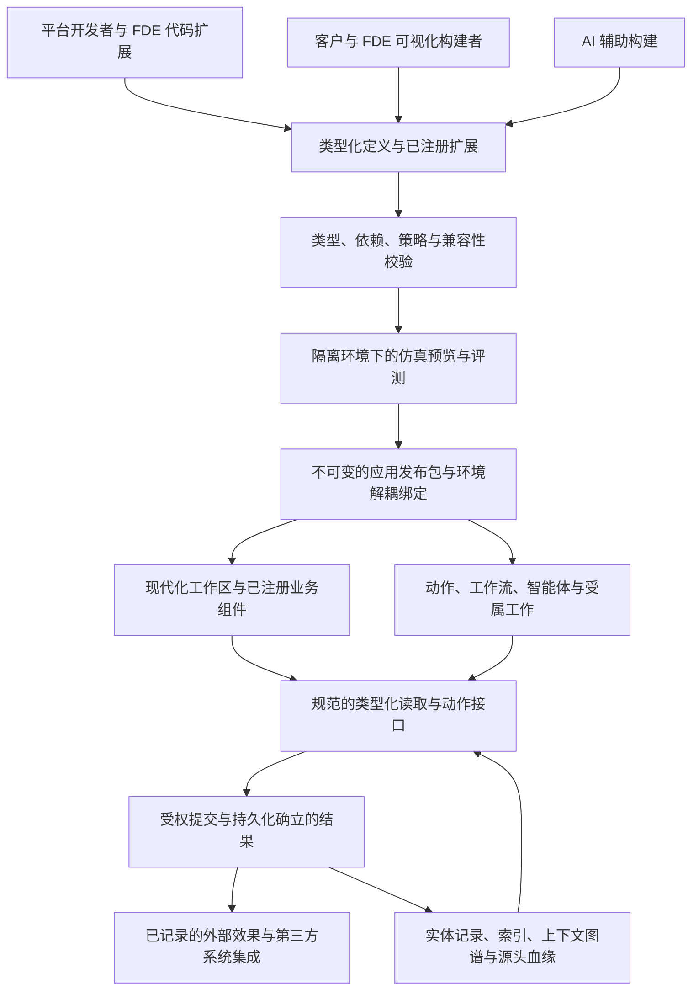

# 平台架构

业务平台的规范说明文档。具有持久成本的决策记录在 [ADR/](ADR/) 中；当前工作记录在 [WorkQueue.md](WorkQueue.md)；负责人的意图记录在 [Intent.md](Intent.md)。代码是既成事实；本文件分开描述当前实现与目标，差距由工作队列安排整改，不把目标写成现状。

请与 [Intent.md](Intent.md) 一同阅读本文档。文档分工与现行主题入口见 [ADR-0062](ADR/0062-platform-consolidation.md)：本文负责架构与能力摘要，施工状态唯一归 WorkQueue。§2.4 是已实现能力地图，§2.9 说明 ADR 承诺的支持边界；§10 只保留仍被 ADR 引用的目标边界（§10.1 采纳范围、§10.3 不变式、§10.4 生命周期、§10.6 验收维度）；年度阶段规划已删除，历史沿 Git 查询。应用构建方向归 ADR-0038，四层包归 ADR-0057，第一次真实交付归 ADR-0060。

## 1. 目标

主线：**构建、编排、运行和演进业务软件**。应用定义各自的对象、关系、规则和动作，并贡献 UI 与运行时工作；软件由它们编排而成；当产品、流程、结构或业务本身发生变化时，能力得以添加、修改、替换或淘汰，而数据、历史、权限和正在进行的工作保持连续。内核概念和共享能力凭借它们对该主线的贡献而确立其地位。

多租户**业务应用构建与运行平台，具备服务端与边缘/客户端运行时**。它支持多用户组织级应用（其中服务端为权威），以及支持离线工作的边缘客户端。CRM、MES、ERP、PMS、HCM 和 CSM 是参考应用，按 ADR-0053 在等价替代与历史责任明确后退出。第一次真实交付是 ADR-0060 的楼宇供暖，MES 保留为第二验证场景；原有参考应用不决定当前开发顺序。

平台并不固化组织或应用当下的形态。它提供应用走向其*下一形态*所需的能力——新产品、新流程、新结构、新运营模型，乃至不同的主营业务——而无需重写底座。业务领域注定会发生重大变化；唯有当发现真正缺失的跨领域通用能力时，内核才应变更。

产品面向 FDE 交付与客户自主构建：统一的类型化模型支撑对象、页面、工作流与 AI 构建，专业算法沿受控代码扩展。完整生命周期是目标；已实现部分与尚未验证范围分别见 §2 与各 ADR 的 As built，内核保持不含领域词汇。

## 2. 产品模型

**当前实现**。权威状态新写入统一为私有决定、接受结果和纯应用；App 账本及 Runtime 角色是正式契约，存储方式不再决定提交语义。类型化定义、包生命周期、不可变候选和旧格式恢复继续保留。实现与验证边界归 ADR-0037，原结果恢复不变量归 ADR-0010；可信 owner 生命周期、六类集成定义及一次接受的环境交付已实现；宿主生产实现已改为具名消费者角色。

### 2.1 分层

| 层级 | 承载内容 | 所在位置 | 变更时机 |
|---|---|---|---|
| **内核 (Kernel)** | 语言中立契约 K1–K9：身份标识、事实、决策、权威归属、租户隔离、模式版本、连接器、工作所有权（§4） | `contract/`（规范、测试向量、Go） | 内核假说被修订时（规范与测试向量先行） |
| **宿主运行时 (Host runtime)** | 编排、路由、日志与重放、快照、记录存储、受属工作、效果分发、模型调用；实现 `platform.Runtime` | `platformserver` | 平台扩展机制时 |
| **应用 API (App API)** | 应用所见表面：`Member`、`Caller`、`Manifest`、各项声明（实体、生命周期、动作、读取、工作流、智能体、作业、设置、效果类别）及 `Ledger`。应用仅通过 `Runtime` 访问宿主 | `platformserver/platform`；UI 层为 `@platform/app` | 应用需要宿主已具备的能力时 |
| **平台级应用 (Platform apps)** | 作为应用运行的跨行业通用能力：`ai`、`build`、`core`、`enterprise`、`files`、`flow`、`knowledge`、`relations`、`work` | `capabilities/server/apps/*`；Console/Agent 等宿主职责仍在根包 | 当前需求需要扩展对应归属时 |
| **协议 (Protocols)** | 应用提供和消费的版本化接口，附带一致性测试 | `protocols/` | 出现第二个提供方或消费方时 |
| **原生参考应用 (Apps)** | 用行业规则、实体、工作流与 UI 验证平台；客户应用沿行业包/应用包构建与交付 | `apps/` 与对应原生 Web 包；退出条件见 ADR-0053 | 等价构建产物具备并保留历史责任后退出 |

当前代码声明与租户类型化定义并存；操作员还配置设置、绑定、端点及受权模型。应用/协议、内核和宿主反向依赖均沿原检查入口守门；宿主生产实现不导入具体平台应用，身份/Agent 状态由原 owner 提供具名角色，平台应用只接收所需宿主消费者角色。内核仍不含领域词汇；宿主角色边界归 ADR-0037。模型是一项工具，而非必须强行塞入每个文件的分类法：当实践表明边界有误时，通过 ADR 变更模型。必须成立的性质是：**当下层能力不随某个领域的演进而变更**。

归属裁决问题：在不同的行业中它是否仍然成立？在同一行业内转型后是否依然成立？它是“必须如此”还是“若干实现方式之一”？谁有权编写它、谁有权发布它、哪项不变式约束着它、以及哪项既有能力负责执行它？

#### 当前结构核验与整改归属

[ADR-0037](ADR/0037-submission-assets-and-host-boundaries.md) 的提交管线现已覆盖实际新写入口：不再用动作/工作名单、匿名 Caller 能力或存储配置选择直接修改路径。私有状态和保存点由正式 owner 契约治理。可信 `AssetRegistry/AssetLifecycleOwner` 已统一候选生命周期；原 owner 提供 typed 描述符、依赖、绑定、私有 bootstrap/安装及纯恢复。宿主消费正式角色，Attach 后在完整声明检查成功时 Ready；单写者和锁外准备/回锁再校验保持。计数与基线裁决在 ADR，不以文件、字段或接口数量验收。

资产共同模型已经是 `AssetKind/AssetRef/ReleaseAsset/Candidate`；对象、页面、Flow 与 Connection/Source/Dataset/Pipeline/Writeback/Matching 复用可信 owner 生命周期；各 kind 的支持操作和迁移边界仍不同。共同交付协调由原发布 owner 承接，类型化定义和执行仍由原 owner 负责。代码 Package、租户定义资产、环境绑定及运行数据分别治理；资产注册不能自动证明产品成熟度或生成业务菜单。

### 2.2 整体协作方式

```text
 编排      解决方案 (Go，每个宿主一个) ─▶ 租户 ─▶ 各应用，每个为一个 Manifest：
             实体类型 · 生命周期 · 动作 · 读取 · 工作流 · 智能体 · 作业 · 设置 · 效果类别
             应用仅通过协议相遇（提供方 ◀─ 消费方），绝不直接相识

 写入      调用者：人员 · 服务账户 · 智能体 · 连接器 · MCP 或 A2A 客户端
             │ 提交 (submission，在目标上的动作) 或输入 (input，连接器页面、应答、模型步骤)
             ▼
           接收：认证 ─▶ 目录与角色 ─▶ 策略 (K6) ─▶ 需审批？（由 `work` 暂留）
             ─▶ 私有规则/状态/意图 ─▶ 接受结果入账 ─▶ 纯应用 ─▶ 返回
             历史读取：保留旧输入/结果解码，不产生旧业务输入新写

 工作      记录/事件/意图 ─▶ 工作流 · 智能体的等待 · 订阅方
                          └─▶ 效果分发（Webhook、邮件、A2A；已声明的不可逆智能体效果被暂留）
                          └─▶ 通知 · 任务 · 时间线链接

 读取      记录 ─▶ 通用读取 · 聚合 · 上下文图谱 · 搜索 · 仪表盘
           派生的、可重建的状态：投影（PostgreSQL） · 知识段落与向量 · 快照

 人员      成员可有多个有效角色与授予；带有日期的组织结构和单位范围限定其视野和审批者
 智能体    已声明的主体；每次运行的步骤、草稿、引用与人员反馈信号均被保留；
           评估以空跑形式重新执行已标记信号的运行；记忆是人员保留或遗忘的记录
```

所有运行期权威新写先在私有视图验证并封存，再按原存储边界接受，最后应用返回的结果。Submit/Input、审批/协议、Work/Effect、Agent/模型计量、Compute/连续来源以及发布/组合/宿主管理均走这一顺序；内存、Record、AcceptResult 只选择存储。缺必需参与能力明确拒绝，单记录/批次按能否完整表达决定选择编码，恢复应用已保存映像。读/校验 Input、初始组合声明与可重建缓存保留各自职责；历史日志仍按其原解码语义读取。入口、预算、历史及证据边界见 ADR-0037，完整产品交付和运行容量仍须实际验收。

这些概念归入五个平面。每个平面拥有一个所有者。

| 平面 | 概念 | 所有者 |
|---|---|---|
| 编排 (Composition) | 解决方案、租户、应用、清单、协议、绑定、设置 | 代码（解决方案、应用）；绑定与设置属于控制台决策 |
| 真理 (Truth) | 提交、输入、决策、事实、日志分录、效果结果、用量 | 对目标数据类别拥有权威的应用（K5）；宿主记入日志 |
| 读取 (Reads) | 记录、历史、聚合、上下文、搜索、投影、段落、快照 | 宿主，从真理中派生 |
| 人员与工作 (People and work) | 成员、角色、单元、结构、审批请求、任务、通知、已存视图 | `platform`、`enterprise`、`work` |
| 智能体 (Agents) | 智能体、运行、步骤、草稿、信号、评估、记忆、文档、对话抄录 | `agent`、`knowledge`、`ai` |

### 2.3 数据归宿

| 类别 | 包含内容 | 存储位置 | 重建方式 | 丢失成本 |
|---|---|---|---|---|
| **真理 (Truth)** | 每项被接受的顶级输入：提交、连接器页面、分发与作业结果、智能体步骤及其知识搜索结果、附带应答的效果结果、模型用量、启动的工作流版本 | PostgreSQL 日志，每个租户一个，故障即停 (fail-stop) | — | 一切；备份保存该日志 |
| **派生状态 (Derived state)** | 记录及其历史、内核日志、受属工作与队列、效果意图、通知、工作流实例、智能体运行、记忆 | 内存；快照 (ADR-0024) | 已支持的结果族直接应用已保存映像；其他旧入口仍通过相同代码重放 | 启动时间 |
| **派生索引 (Derived indexes)** | 投影 `tenant_<id>`（每个实体类型的类型化数据表）、按段落哈希索引的知识向量 | 位于日志旁的 PostgreSQL 中 | 启动时重建；向量作为受属工作重新生成嵌入 | 重建时间；嵌入模型成本 |
| **外部且有保留期 (Outside, with retention)** | 模型调用的完整对话抄录（默认保留 30 天）；密钥（按名称，位于部署环境中） | PostgreSQL 数据表；环境变量 | 不重建 | 旧模型调用的完整文本 |
| **易失性状态 (Volatile)** | 心跳、连接器上次拒绝原因、端点健康状态；个人读取审计（最近 5,000 条条目）。**注意**：所有新作业/分发尝试通过 `work-result` 保存 generation 与下次执行时间；旧历史无变化的作业可能没有分录 | 内存 | 新工作从已接受结果恢复；旧历史按原语义读取 | 运维诊断和未记入日志的旧式作业状态 |
| **代码 (Code)** | 声明：实体类型、动作、生命周期、工作流、智能体、协议、指令 | Go 和 TypeScript，随二进制文件版本化 | — | — |

**原始遥测数据留在外部存储**。业务记录和事实仍归各自权威；连续 Flow 以原消费游标和窗口处理受控来源（ADR-0016 §13.5），外部时序读取、窗口与最新值归 ADR-0058。业务决策仅保存其采用的有界观察结果与来源证据，恢复不重新读取外部点位；可重算的原始点和中间计算不成为另一份业务真理。

### 2.4 能力地图（产品支持与成熟度唯一入口）

本节是**产品能力与支持成熟度的唯一维护入口**。产品类别、支持成熟度与验收证据是三个不同维度：代码存在不代表可交付，自动测试不代表用户体验或生产验收。每项能力按以下口径，不推断更高等级：

- **产品类别**：平台基础、可选平台能力、行业应用/业务包、验证探针。
- **支持成熟度**：`已实现`（代码/接口存在）；`有界支持`（只承诺明确列出的场景与约束）；`待任务验收`（工程路径存在，但实际角色任务或负责人体验未验收）；`未完成/不支持`（必要实现未闭合或不在承诺中）。同一能力可同时有实现、有界支持和待验收边界。
- **证据类型**：代码/契约、自动行为、跨应用路线、实际角色走查、部署/恢复演练、生产证据分别标示；一种证据不能替代另一种。

本节是产品层支持口径的唯一入口；下方能力目录索引实现归属与代码入口，详细决策及 As-built 限制归对应 ADR，工作顺序归 WorkQueue，测试证据归 Testing 与 Apps。不得在这些位置复制第二套产品成熟度表。内核语义见 §4。

| 产品责任域 / 类别 | 主要用户 | 能力归属与必要依赖 | 当前支持成熟度与证据 | 明确边界 / 本项目需要收口的结果 |
|---|---|---|---|---|
| D1 工作区与业务使用 / 平台基础 | 业务使用者、FDE、治理与运行人员 | Workspace Shell 与 UI Kit；各原生应用及租户应用仍拥有自身业务语义 | Shell、门户、角色投影和若干跨应用路线已实现；完整任务体验待真实角色走查（ADR-0018、ADR-0016 §14、Testing） | 按选定酒店及制造任务验证对象上下文、反馈、拒绝和恢复；不重做全部界面 |
| D2 业务语义与企业模型 / 平台基础 + 行业归属 | 构建者、业务领域所有者 | `platform` 公共契约；`core` 共享业务主数据；`enterprise` 企业模型；交易记录由相应行业应用拥有（ADR-0020、ADR-0022） | 共享对象、Interface 查询、企业生命周期/使用检查、Build 企业引用与显式来源预览导入已有有界实现；完整行业或 UAF 模型不在支持声明内 | `platform.member`、Core 业务资料、企业人员/岗位/组织/地点及行业记录保持不同权威；可选引用不自动复制人员，来源切片不授予角色、不跨租户写入 |
| D3 数据连接与集成 / 可选平台能力 | Integrator、FDE、运维人员 | Build 的 Connection/Source/Dataset/Pipeline/Writeback/Matching；Host 密钥及外部效果 owner（ADR-0023、ADR-0024、ADR-0022、ADR-0025、ADR-0037） | 六类 typed 定义已进入候选/环境交付，酒店与制造首次交付、v2 升级、故障及恢复通过内存/真实 PostgreSQL/race 场景 | 目标重新绑定本地 ready Connection、凭据及执行成员；数据、游标、历史、回执不移植。不支持的输入/输出身份迁移明确拒绝；完整行业与产品体验另验 |
| D4 应用构建与共享交互 / 平台基础 | FDE、客户构建者、业务操作者 | Build 定义 owner；`@platform/app`、`@platform/ui` 共享编辑与呈现（ADR-0047、ADR-0036、ADR-0048、ADR-0049） | 共享输入、Inspector buffer、拒绝与重试机制已整合；应用上下文的五工作区、业务概念分组、声明依赖跳转和原候选/运行投影已接通；模型绑定、声明集合、共享动作规则、多跳字段及权限状态通过有界自动行为/浏览器路线；真实构建者体验待验收 | 复用既有输入、草稿与历史；规则与页面诊断归原发布 owner；当前确定性引导复用原表单，开放式 AI 建模未声明完成 |
| D5 业务执行与协作 / 平台基础 + 可选能力 | 操作者、审批者、流程构建者 | 原 Action/Lifecycle owner；`work` 管任务/审批，`flow` 管流程实例，Compute 管计算（ADR-0007、ADR-0013、ADR-0016） | 动作、Work、常规 Flow 已实现；持续 Flow 的受控 PostgreSQL 游标、空闲 slide/grace、固定 Compute entry、周期 checkpoint 及被替换制品清理意图已有有界实现。ADR-0016 §13.5/§14 记录真实 PostgreSQL owner 测试与两行业来源/worker/重启/备份/全日志重建的本地演练；ADR-0037 整块交付已重跑这些本地路线。ADR-0037 的 W4 批次已接通固定 Wasm 七节点、mean/reading 业务动作、最多八分区、只读 Flow 输出、版本化死信重放及有界保留/退役/孤儿扫描；实际验证范围见 ADR-0037 §7，负责人体验与更广故障/容量仍独立验收 | 保持唯一执行 owner；按 WorkQueue 收口，不由单个窗口/worker通道测试冒充完整持续链 |
| D6 AI 与知识 / 可选平台能力 | 构建者、业务操作者、AI 治理者 | `ai`、`agent`、`knowledge` 及 AI Function 所属应用；复用原授权、预算、Work/Effect（ADR-0054、ADR-0008） | 模型接入、预算、运行与评测机制已有实现；ADR-0037 的 W4 批次已使用配置的 OpenRouter/Nemotron 执行受权知识→分类确认→回复草稿→人工拒绝任务，成本/权限/质量范围见 SRS §7.1；不外推为通用 AI 质量通过 | 只在选定任务实际使用 AI 时闭合对应链路；不扩建通用评测平台或模型市场 |
| D7 应用与扩展交付 / 平台基础 | FDE、Publisher、Host Admin | Build 可信 owner 生命周期、候选/激活；Host Console 环境绑定；可信代码 Package 是不同机制（ADR-0011、ADR-0016、ADR-0037、ADR-0045） | 不可变闭包、私有 bootstrap、一次接受的激活/晋级、记录迁移及有界升级已实现；原发布工作台已接迁移审阅/分批操作/取消和保存的进度，只读别名随新字段更新，字段退役保留读取，动作退役分批默认拒绝待审批请求，旧 Flow 按封存动作经别名/受审转换写入当前记录，审批可绑定旧版本或显式重定向，迁移计划走原资产生命周期，对象提取与旧 Flow 目标写入已接通 | 首次 Property/Link/Query/Function 仅第 1 版或已有所需 family；Compute 仍需匹配 compiled target。ADR-0045 的六类变更逐例已验证三行两批、文件重开与旧 Flow 续接，另有连续迁移、两级委托审批/重定向及故障重试和浏览器证据；客户扩展按原包版本/形状保留，升级检查同名字段与不兼容并暂停，显式迁移解决，原生 Core 包升级的文件日志/快照与浏览器路线已有证据；发布期 schema family、客户端内容身份及原键恢复已接通；同族旧版接受、跨族拒绝/刷新与输入保留已有证据；两行业实际二进制已通过 OIDC/PostgreSQL/RustFS 的迁移、快照重启、备份恢复与完整日志重建；ADR-0045 有界验收已完成，完整 Docker 链与 SRS 整体验收另验 |
| D8 治理与运行维护 / 平台基础 | Tenant Admin、Auditor、Publisher、Host Operator | `platform`、Host Console、Runs、授权及各数据 owner（ADR-0016、ADR-0027） | 成员/角色、包生命周期、运行与部分恢复有实现；权限读取边界与运行证据并非全链路统一 | 动作授权、行范围、字段遮蔽和派生读取须分别证明；容量、保留、RTO/RPO 及资源清理须按承诺运行范围明确 |
| D9 行业应用与业务包 / 行业包 + 验证探针 | FDE、行业业务人员 | `apps/*` 及 `protocols/`、`solutions/`；业务语义留在行业 owner | 酒店与制造提供受控组合和集成探针，不等于完整行业产品 | 本项目完成两行业选定任务；不默认扩建完整 ERP/MES、排产或 MES 工艺深度 |

#### 实现归属与代码入口索引

实现能力按 D1–D9 继承上方同一条产品责任域的支持成熟度与验收声明；本表只回答"这项能力归谁、代码在哪里"。能力边界、未完成范围与证据**只在对应 ADR 的 As built 写一次**，本表不复述，也不因代码入口存在而提升成熟度。

| 能力 | 归属 | 入口 / 证据 |
|---|---|---|
| 能力 | 产品域 | 归属 | 当前摘要（含能力边界） | 入口 / 证据 |
|---|---|---|---|---|
| 身份标识与重定向 (K1) | 内核 | kernel.Identity |
| 事实、观察与断言 (K2, K3) | 内核 | kernel.FactLog |
| 决策 (K4) | 内核 | kernel.ChangeLog |
| K4 幂等性有界证明 (ADR-0012) | 内核研发工具 | contract/lean, scripts/verify.sh formal；[ADR-0012](ADR/0012-first-kernel-proof.md) |
| 权威归属与发件箱 (K5) | 内核 | kernel.Authorities |
| 租户隔离与策略 (K6) | 内核 | kernel.Receiver |
| 模式版本演进 (K7) | 内核 | kernel.SchemaRegistry, Learn |
| 连接器 (K8) | 内核 | kernel.Connectors |
| 工作所有权 (K9) | 内核 | kernel.Works |
| 编排与路由 | 宿主运行时 | NewTenant, checkManifest |
| 日志、重放与快照 | 宿主运行时 | Journal, Tenant.Replay |
| 记录存储与通用读取 (ADR-0046) | 应用 API、宿主运行时 | platform.Entity, Caller.Put；[ADR-0046](ADR/0046-application-artifact-and-runtime.md#adr-0046) |
| 编号序列 (ADR-0026) | 应用 API、宿主运行时 | platform.Sequence, Caller.Next；[ADR-0026](ADR/0026-business-core.md#adr-0026) |
| 聚合与投影 (ADR-0024) | 宿主运行时 | /v1/aggregates, -project；[ADR-0024](ADR/0024-datasets-and-pipelines.md#adr-0024) |
| 动作目录 | 应用 API、宿主运行时 | platform.Action, /v1/actions |
| 已安装定义与有界页面 | 应用 API、宿主运行时、`@platform/app`、`@platform/ui` | platform.AssetRef, Manifest.Pages；[ADR-0020](ADR/0020-shared-ontology.md#adr-0020)、[ADR-0047](ADR/0047-application-studio.md#adr-0047) |
| 发布候选审查与活跃闭包（ADR-0011 20a–20b） | 应用 API、平台应用 `build`、宿主、`@pkg/build` | platform.Candidate, Build.DraftReleaseAssets；[ADR-0011](ADR/0011-minimal-definition-release.md) |
| 具名查询 (ADR-0047 21c) | 应用 API、宿主运行时、共享页面与智能体工具 | platform.NamedQuery, Tenant.RunQuery；[ADR-0047](ADR/0047-application-studio.md#adr-0047) |
| Projects / 共享资源总览 | 平台应用 `build`、`@pkg/build` | `StudioOverview`；[ADR-0047](ADR/0047-application-studio.md#adr-0047) |
| 租户原生流程编写 | 平台应用 `build`、`flow`、`work`、宿主 | build.Process/TestPlan；[ADR-0013](ADR/0013-capability-fabric.md) |
| 固定数据候选测试 (ADR-0047 21d) | 宿主、平台应用 `build`、共享 UI | build.TestPlan, Tenant.SimulateCandidate；[ADR-0047](ADR/0047-application-studio.md#adr-0047) |
| 租户交付的应用 (ADR-0046) | 平台应用 `build`、宿主运行时、`web/apps/workspace` | platform.Application, Tenant.InstallApplication；[ADR-0046](ADR/0046-application-artifact-and-runtime.md#adr-0046) |
| 由组件布局的页面 (ADR-0048、ADR-0047) | `@platform/app`、`@platform/ui`、平台应用 `build`、宿主运行时 | platform.Section, Tenant.checkSections；[ADR-0047](ADR/0047-application-studio.md#adr-0047) |
| 租户编排的页面 (ADR-0048 15b) | 平台应用 `build`、宿主运行时、`@pkg/build`、`@platform/ui` | build.page, Tenant.InstallPage；[ADR-0048](ADR/0048-model-driven-ui.md#adr-0048) |
| 租户定义的对象 (ADR-0048) | 平台应用 `build`、宿主运行时、`@pkg/build` | apps/build, Tenant.Install；[ADR-0048](ADR/0048-model-driven-ui.md#adr-0048) |
| 租户定义的状态与动作 (ADR-0044 18a, ADR-0047 21a) | 平台应用 `build`、`@pkg/build`、账本生命周期 | build.State, build.Action；[ADR-0044](ADR/0044-one-authorization-engine.md#adr-0044), [ADR-0047](ADR/0047-application-studio.md#adr-0047) |
| 租户定义的访问控制 (ADR-0044 18b) | 平台应用 `build`、宿主运行时（`Scope`、`Standard`、账本） | build.Access, checkAccess；[ADR-0044](ADR/0044-one-authorization-engine.md#adr-0044) |
| 租户动作的审批 (ADR-0044 18c) | 平台应用 `build` 编译定义；平台应用 `work` 拥有请求、任务与决策 | build.ActionApproval, checkProcess；[ADR-0044](ADR/0044-one-authorization-engine.md#adr-0044) |
| 读取与读取授权 | 宿主运行时 | Tenant.Read, Tenant.admits |
| 派生内容声明其来源 (ADR-0009, #130) | 应用 API、宿主运行时 | platform.Derivation, Entity.Derived；[ADR-0009](ADR/0009-derived-content-declares-its-sources.md) |
| 应用包账本 (Package ledger) | 应用 API | platform.Ledger |
| 受属工作：分发与作业 (ADR-0027、ADR-0007) | 宿主运行时 | Manifest.Jobs, Tenant.Work；[ADR-0027](ADR/0027-tenancy-and-authorization.md#adr-0027), [ADR-0007](ADR/0007-one-runtime-for-durable-work.md) |
| 托管连接器 | 宿主运行时 | Tenant.Connect, Caller.Deliver |
| 外部效果 (ADR-0004、ADR-0009) | 宿主运行时 | Tenant.Dispatch, Caller.Emit；[ADR-0004](ADR/0004-outbound-effects.md) |
| 部署 | 宿主运行时 | Deployment, Deployment.Seed |
| 身份提供商 | 宿主运行时 | OIDC |
| 多语言支持 (ADR-0005) | 应用 API、宿主运行时、Web | platform.Languages, languages.go；[ADR-0005](ADR/0005-meaning-languages-api-contract.md) |
| 含义与词汇表 (ADR-0005) | 应用 API、平台应用 `knowledge` | Entity.Description, help；[ADR-0005](ADR/0005-meaning-languages-api-contract.md) |
| 宿主 API 契约 (ADR-0005) | 宿主运行时 | api.go, /v1/openapi.json；[ADR-0005](ADR/0005-meaning-languages-api-contract.md) |
| 开发者工具套件 (ADR-0005) | 应用 API、宿主运行时 | docs/Apps.md, cmd/new-app；[ADR-0005](ADR/0005-meaning-languages-api-contract.md) |
| 智能体对外门户 | 宿主运行时 | POST /mcp, /a2a/<tenant>/<agent> |
| 控制台 | 平台应用 `platform` | console.go |
| 共享主数据与接口 (ADR-0020) | 平台应用 `core`、宿主运行时 | capabilities/server/apps/core, platform.CheckInterfaces；[ADR-0020](ADR/0020-shared-ontology.md) |
| 企业模型 (ADR-0022) | 平台应用 `enterprise` | capabilities/server/apps/enterprise, Caller.Enterprise()；[ADR-0022](ADR/0022-enterprise-modeling-layer.md)、[ADR-0034](ADR/0034-sealed-standard-interfaces.md) |
| 关联、时间线、评论与关注者 | 平台应用 `relations` | capabilities/server/apps/relations, Caller.Link |
| 字段安全性与个人数据 (ADR-0038) | 应用 API、宿主运行时 | FieldInfo.Read, Write；[ADR-0038](ADR/0038-build-the-capability-to-build.md#adr-0038) |
| 文件管理 (ADR-0038) | 平台应用 `files`、宿主 | capabilities/server/apps/files, capabilities/server/filestore.go；[ADR-0038](ADR/0038-build-the-capability-to-build.md#adr-0038) |
| 导入与导出 (ADR-0038) | 宿主运行时、`@platform/app` | POST /v1/import/{type}, GET /v1/export/{type}；[ADR-0038](ADR/0038-build-the-capability-to-build.md#adr-0038) |
| 图谱呈现 (#122, ADR-0047 第一批次) | `@platform/ui`、`build` 中的语义适配器 | CanvasFrame, Graph；[ADR-0047](ADR/0047-application-studio.md#adr-0047) |
| 通知系统 | 宿主、`platform` 中的读取状态 | Caller.Notify |
| 生命周期、审批、任务、收件箱 (ADR-0007) | 应用 API、平台应用 `work` | platform.Lifecycle, platform.Approval；[ADR-0007](ADR/0007-one-runtime-for-durable-work.md#adr-0007) |
| 工作流 | 应用 API、平台应用 `flow` | platform.Flow；[ADR-0013](ADR/0013-capability-fabric.md) |
| AI 提供商与模型 (ADR-0008) | 平台应用 `ai` | capabilities/server/apps/ai/ai.go, aicall.go；[ADR-0008](ADR/0008-ai-control-plane.md#adr-0008), [ADR-0008](ADR/0008-ai-control-plane.md) |
| 类型化 AI 函数 (ADR-0054 24b–24c 部分实现) | 应用 API、宿主 AI 模型效果路径 | platform.AIFunction, Caller.RequestFunction；[ADR-0054](ADR/0054-ai-and-human-in-applications.md#adr-0054) |
| AI 与人工装配（ADR-0054） | 原函数/智能体、Build 事务、Work、AI 账目 | [ADR-0054 As built](ADR/0054-ai-and-human-in-applications.md#5-as-built) |
| 专业模型视图（ADR-0049） | 原页面契约、Build、宿主模型读取与 UI/App | [ADR-0049 As built](ADR/0049-professional-components.md#5-as-built)；未新增 UI 组件，未退役原生 MES；独立作者配置和负责人走查待验收 |
| 应用设计台（ADR-0047） | Build、Shell、UI/App、原编辑/发布 owner | [ADR-0047 As built](ADR/0047-application-studio.md#5-as-built)；真实构建者体验待验收 |
| 业务规则语言（ADR-0040） | 应用 API、Build、页面运行时 | [ADR-0040 As built](ADR/0040-one-rule-language.md#5-as-built) |
| 业务约束（ADR-0041） | 对象定义、宿主私有提交、Build | [ADR-0041 As built](ADR/0041-business-constraints.md#6-as-built) |
| 业务版本与时间（ADR-0042） | 对象定义、Build、记录 owner | [ADR-0042 As built](ADR/0042-business-version-and-time.md#as-built) |
| 记录集与关系事务（ADR-0043） | 对象定义、Build、记录 owner | [ADR-0043 As built](ADR/0043-record-sets-and-relations.md#as-built) |
| 归属授权判定（ADR-0044） | 应用 API、authz、宿主记录 owner、治理页 | [ADR-0044 As built](ADR/0044-one-authorization-engine.md#as-built)；仅支持声明出处与有界遍历，不实现 related |
| 能力装配与代码计算 | 应用 API、宿主、Build、FileStore、独立 Go worker | platform.Operation/ValueSchema、build.code；[ADR-0013 §12](ADR/0013-capability-fabric.md#12-实际构建边界) |
| 智能体 (ADR-0054、ADR-0009) | 应用 API、平台应用 `agent` | platform.Agent, agent*.go；[ADR-0054](ADR/0054-ai-and-human-in-applications.md#adr-0054) |
| 知识库 (ADR-0009) | 平台应用 `knowledge` | knowledge.go, index.postings；[ADR-0009](ADR/0009-derived-content-declares-its-sources.md#adr-0009) |
| 协议 (ADR-0006) | 协议 | platform.Protocol, Caller.Probe；[ADR-0006](ADR/0006-decisions-across-apps.md#adr-0006) |
| UI 库 | Web | @platform/ui |
| 统一输入（ADR-0036 A–D） | 应用 API、宿主、共享 UI/App/Build | InputConstraints、DateRangeInput、ErrorBody；[ADR-0036 §9](ADR/0036-unified-form-input-and-inspector-editing.md#9-as-built) |
| Workshop 页面编辑器（ADR-0015 §5–§6，持续实施） | 应用 API、Build、共享 UI | platform/pageui、PageDocument、EditorWorkbench、app/semantic；[ADR-0015 §14](ADR/0015-application-studio-fusion.md#14-代价审阅点与当前实现边界) |
| 业务观测（ADR-0015，F1e58） | 共享 UI | @platform/ui ObservationTable/ObservationStatistics/ObservationTimeSeries/ObservationAvailability；[ADR-0015 §6.78](ADR/0015-application-studio-fusion.md#678-业务观测宽表窗口统计与真实时间序列) |
| 固定页面内容与受控嵌入（ADR-0015，F1e59） | 原页面/宿主/前端边缘、UI Kit、Build | [ADR-0015 §6.79](ADR/0015-application-studio-fusion.md#679-受控嵌入与组合页面) |
| 记录 AI 呈现与会话（ADR-0015，F1e60） | 原 AI/函数宿主、应用 API、UI Kit、Build | [ADR-0015 §6.80](ADR/0015-application-studio-fusion.md#680-三种原生-ai-呈现与受控会话) |
| 原表单默认值与三处动作装配（ADR-0015，F1e63e2） | 应用 API、Build、Go | [ADR-0015 §6.88](ADR/0015-application-studio-fusion.md#688-原动作参数默认值与三个表单) |
| 受控动作参数与条件守卫（ADR-0015，F1e63e1） | Build、原Lifecycle/Caller | [ADR-0015 §6.87](ADR/0015-application-studio-fusion.md#687-默认动作的原宿主规则与参数装配) |
| 默认页面/抽屉集合与关联装配（ADR-0015，F1e63d） | Build、应用 API | [ADR-0015 §6.86](ADR/0015-application-studio-fusion.md#686-默认页面与抽屉的集合关联和状态消费者) |
| 默认浮层与共享AI上下文（ADR-0015，F1e63c） | UI Kit、应用 API、Build、Go | [ADR-0015 §6.85](ADR/0015-application-studio-fusion.md#685-原默认浮层呈现与共享-ai-上下文) |
| 原Operations表格与KPI呈现（ADR-0015，F1e63b） | UI Kit、应用 API、Build | [ADR-0015 §6.84](ADR/0015-application-studio-fusion.md#684-默认四个-kpi-与资产表格的呈现配置) |
| 模块原应用共享映射（ADR-0015，F1e63a） | Build、应用 API、Go | [ADR-0015 §6.83](ADR/0015-application-studio-fusion.md#683-默认-module-的原应用共享绑定) |
| 原集合构建与装配（ADR-0015，F1e62） | UI Kit、应用 API、Build | [ADR-0015 §6.82](ADR/0015-application-studio-fusion.md#682-集合构建器与完整谓词装配) |
| 共享空间呈现与附件标注（ADR-0015，F1e61） | UI Kit、Files、应用 API | [ADR-0015 §6.81](ADR/0015-application-studio-fusion.md#681-记录地图附件标注与原生-3d-场景) |
| Platform Catalog (ADR-0014) | UI/app/build owner、Web 目录 | web/apps/catalog、scripts/catalog.mjs；[ADR-0014 §11](ADR/0014-platform-catalog.md#11-当前实现边界) |
| 工作区与 UI 应用 API (ADR-0019、ADR-0016) | Web | @platform/app, web/apps/workspace；[ADR-0016 §14](ADR/0016-platform-composition-and-workspaces.md#14-当前实现边界) |
| 边缘客户端与登录 | Web | @platform/kernel |
| 设置中心 | Web | @pkg/platform |
| 应用 UI 包 | Web | @pkg/<id>, crm |

### 2.5 术语与归属权

容易混淆的概念：
- **应用 (App)** 在宿主契约中是一项权威能力单元，具有 Go 清单与账本；平台级应用的实际名单见 §2.1。构建者的 `Application` 是资源引用与交付边界，不因门户或资源树分组增加一个写入权威。**参考应用 (Reference apps)** 位于 `apps/`（原 `slices/`）；它们和 `solutions/*` 的宿主组合都不能直接称为行业包。ADR-0057、ADR-0006 的旧 Package 用词须按其静态原生上下文阅读，现行四层内容分类归 ADR-0057。
- **解决方案 (Solution)** 是针对某个特定宿主的一组应用编排，按其行业命名：`solutions/hospitality`、`solutions/manufacturing`；独立应用可在其开发宿主 `cmd/<id>-server` 上单独运行 (ADR-0016)。
- **事件 (Event)** 是已接受的决策在外部观察者眼中的形态。业务领域自身的术语“事件”（例如设备停机事件）不是此概念。

#### 资产与运行责任

共享和应用专属描述的是引用范围，不改变实际 owner。一个资产可以被多个应用引用；移出一方应用不会把它的定义、数据或权限交给另一方。Application Studio 从原获权定义提供已发布非导航资源，成员按完整 `AssetRef` 显示；没有本地草稿的资源进入保留应用上下文的只读详情，查看原版本、声明能力和依赖。引用不转移编辑或执行权限，只有共享资源的应用也沿同一候选交付。各能力仍按下面的现有路径编辑、发布和退役：

| 内容 | 定义与编辑 | 引用与交付 | 运行与退役 |
|---|---|---|---|
| 原生对象、动作、协议与能力 | 原代码 App 的 Manifest 与类型化声明；受 `platform` 契约约束 | 作为原 owner 的不可变先决条件进入候选；不由 Build 重新编译成租户对象 | 原 App/宿主执行；历史版本与数据读取责任保留 |
| 构建者定义的对象、页面、规则、流程、函数与集成 | Build 原草稿与专用编辑器；共享 UI 和应用 API 只负责呈现与调用 | `AssetRegistry` 按 App/kind 转交原 `AssetLifecycleOwner`；原候选统一封存、检查和接受安装 | 定义、权限与执行归原 owner；退役沿版本和在途工作规则，不直接删历史 |
| 应用定义与应用工件 | `Application.Resources` 保存原资产引用；Application Studio 编辑原草稿 | `ApplicationArtifact` 投影原候选及依赖、权限、环境要求；不保存第二套定义 | `ApplicationRuntimeOf/ApplicationRuns` 汇总各 owner 状态，不拥有第二套运行记录或执行器 |
| 行业包与技术能力包 | 原 Package 描述与确切版本；行业判断在 Blueprint，协议实现按 ADR-0061 声明原生制品 | Console 管安装状态；Blueprint 经 `CreatePackageDrafts` 创建 Build 草稿，再由原发布流程接受 | 安装包不等于发布客户应用；卸载/保留按依赖与历史使用判断，协议运行归独立网关 |
| 环境配置与凭据 | 目标环境的 Connection、密钥与受控绑定编辑器 | `AssetEnvironmentBinding` 指向目标 owner 记录，候选不携带凭据、源游标或运行数据 | 接入与派发沿原 owner；目标环境重新检查绑定与主体，不以资产共享扩大权限 |
| 业务记录、Dataset 版本、工作与效果 | 业务动作、来源接入或各运行 owner 产生，不当作可随意编辑的定义资产 | 数据迁移沿原迁移计划；发布定义不复制来源数据、游标或回执 | 记录归其账本，Flow/Work/Compute/Effect 各司其职；保存结果恢复，原始遥测留在外部存储 |

开发者先查本节与原 owner 的声明：已有职责直接复用，缺少表达就在该 owner 扩展；只有既有契约无法表达的新通用语义才立新 ADR。共享能力入口和版本详情使用同一授权引擎，全部当前角色与显式拒绝同时生效，历史声明不保留已经撤销的读取资格。

| 术语 | 含义 | 归属方 | 持久化形态 |
|---|---|---|---|
| **动作 (Action)** | 应用提供的声明式操作：模式、目标类型、角色、说明 | 应用的清单 (`Catalog`) | 代码 |
| **提交 (Submission)** | 在实体上执行某动作的请求 | 调用者 | — |
| **决策 (Decision)** | 被接受的提交：目标权威应用账本中的 K4 变更记录；拒绝另有不产生变更的持久答复 | 该应用的必需 `Ledger`；拒绝答复由宿主保存 | 所有新写统一暂存、接受与纯应用；完整内容决定单记录/批次编码，旧 `submission` 仅按历史义务读取 |
| **输入 (Input)** | 非提交类的顶级输入条目：连接器的批次或页面 | 声明该输入的应用 | 日志分录 `<input name>`；心跳不记入日志 |
| **事实 (Fact)** | 来源处真实发生的事情：**观察 (observation)**（亲眼目睹，如机器状态或 ERP 应答）或**断言 (claim)**（由来源声称，如计划工单） | 应用的事实日志 (K2) | 从记录该事实的输入或结果中重建 |
| **实体类型 (Entity type)** | 应用声明的 Go 结构体：字段、视野、生命周期、种子数据 | 应用 | 代码 |
| **记录 (Record)** | 单个实体的当前字段、版本与历史 | 由应用账本裁决，由宿主保存 | 从决策中重建 |
| **固定测试计划 (Fixed test plan)** | 应用/对象/流程/函数草稿或封存候选、固定成员/时间/样本/读取与动作步骤，以及接受或拒绝预期；不存测试状态或对后续草稿的通过承诺 | 平台应用 `build` | `build.testplan` 标准记录，经已有接受结果与快照恢复 |
| **应用样本 (Sample set)** | 构建者准备的合成对象记录与引用，随应用候选保留版本；试跑输入修改仅在显式保存时回流 | 平台应用 `build` | `build.sample-set` / `sample-set`，沿原 asset lifecycle；最多八类 / 每类 100 条 / 合计 256 KiB |
| **构建中试跑 (Draft trial)** | 原应用可达草稿闭包、最多三名真实成员的独立试跑，逐步展示原规则、Layers、约束和事务变化 | 宿主原 candidate simulation 与各执行 owner | 空内存租户，无生产数据复制或权威变更；场景保存为原 TestPlan（ADR-0050） |
| **类型化 AI 函数 (Typed AI function)** | 具名、受权、有预算的单记录推断声明；输出是类型化建议，不授予业务动作权限 | 应用 API 定义声明，代码应用拥有函数，宿主 AI 路径执行 | 代码或 Build 发布版本；完整声明与接受时输入/来源/模型绑定保存在模型效果意图，回答/Reply/用量保存在同一已接受结果 |
| **函数调用记录 (Function call record)** | 独立保存已发布函数的请求主体、源记录、阶段、严格校验后的建议或拒绝和接受时绑定；不修改源业务记录 | 平台应用 `build` | `build.function-call` 标准记录及已接受模型效果/Reply；`Entity.Derived` 按当前来源视野收窄结果 |
| **生命周期 (Lifecycle)** | 实体类型上的状态与迁移；每次迁移为一个动作 | 应用 | 代码 |
| **节点目录 / 画布 (Node catalog / canvas)** | 从 owner 能力投影的节点与类型化端口，节点与边是视图/适配器 | `@platform/ui` 共用 BlockCanvas；资产 owner 拥有定义/校验/执行 | Process 保存布局元数据；布局不进入语义摘要、不决定执行次序 |
| **审批请求 (Approval request)** | 暂留的提交，直至各级审批人达成一致；最后一级审批通过后以申请人身份执行之 | `work` | 决策 |
| **任务 (Task)** | 分配给成员、角色或单元的工作，附带截止时间与回答操作 | `work`，由审批、工作流、智能体与应用开启 | 决策 |
| **事件 (Event)** | 提交后被接受的决策，以其动作模式或协议事件命名（`<protocol>#<event>`） | 宿主 | 从决策中重建 |
| **订阅 (Subscription)** | 应用对其自身决策或所消费协议事件声明的关注 | 应用的清单 | 代码 |
| **分发 (Delivery)** | 为单个订阅者排队的单个事件，作为受属工作尝试执行，按订阅者保序 | 宿主（分发类型的 `Task`） | 已选择的 `AcceptedWorker` 保存 `work-result`；其他旧分发重放 `delivery` 输入 |
| **作业 (Job)** | 应用声明并以 `app:<id>` 身份运行的定时工作 | 由应用声明，由宿主运行 | 已选择的 `AcceptedWorker` 保存 `work-result`，包括无业务写入的 generation/到期时间；其余旧路径仅在有决定或通知时记录 `job` |
| **工作 (Work)** | 对分发或作业的 K9 所有权：所有者、世代、状态 | 宿主，通过 `kernel.Works` | 通过重放重建；作业计数器属于易失性数据 |
| **工作流 (Flow)** | 已声明的长时间运行流程；**实例 (instance)** 是带有标记点、撤销栈与追踪信息的记录 | 由应用声明，由 `flow` 执行 | 代码；实例属于决策 |
| **连接器 (Connector)** | 入站源：一个 K8 描述符，其 ID 即为其登录所代表的成员 | 由部署环境连接，由宿主持有，由 `platform` 开关控制 | 游标与开关状态可重建；心跳与最近拒绝属于易失性数据 |
| **端点 (Endpoint)** | 出站目的地：Webhook、邮件服务器或外部 A2A 智能体 | `platform` 决策，由宿主持有 | 决策 |
| **效果类别 (Effect kind)** | 应用声明其发出的出站消息 (`Manifest.Emits`) | 应用的清单 | 代码 |
| **效果 (Effect)** | 针对单个端点的单个意图，源于事件、`Caller.Emit`、模型请求或通知；其键即为其 ID。当智能体引发不可逆类别时暂留等待人工确认 | 宿主 | 受限接受结果保存意图；旧输入重新生成意图；审批与废弃属于决策；尝试结果仍为 `effect` |
| **结果应答 (Answer)** | 端点针对应用效果返回的内容；应用将其记录为一项观察 | 应用 (`Answerer`) | 日志分录 `effect` |
| **通知 (Notification)** | 发送给成员的消息，在输入发生当日解析 | 由应用创建 (`Caller.Notify`)，由宿主存储；已读状态属于 `platform` 决策 | 从其输入中重建 |
| **设置 (Setting)** | 应用声明的类型化配置值 | 由应用声明；数值由 `platform` 决策设定 | 决策 |
| **提供商 (Provider)**、**模型 (Model)** | 模型来源，以及为全员或 AI 用户启用的某个具体模型 | `ai` 决策 | 决策 |
| **用量 (Usage)** | 单次模型调用的计量读数：成员、模型、Token、成本、延迟、结果 | 宿主，由 `ai` 应用记账 | 日志分录 `usage` |
| **智能体 (Agent)** | 已声明的主体 `agent:<app>.<name>`：指令、工具、预算、防护栏、接管人 | 应用 | 代码；通过设置经由 A2A 对外发布 |
| **运行 (Run)** | 智能体的单个目标求解过程：附带推导理由的步骤、草稿、引用、已消耗预算、最终结果 | `agent` | 日志分录 `agent`，决策 `agent.run.*` |
| **反馈信号 (Signal)** | 人工对智能体工作的反馈：已确认、已修改、已驳回、已批准、已丢弃、已撤销 | `agent` | 决策 |
| **评估 (Evaluation)** | 使用候选模型对已有反馈信号的运行进行空跑复现，与人工接受的结果进行比对 | `agent` | 日志分录 `agent` |
| **记忆 (Memory)** | 智能体保留的关于某人或针对全部运行的简要事实；除非人工决定保留，否则会自动过期 | `agent` | 决策 |
| **文档 (Document)**、**段落 (Passage)** | 知识库文本及其切分出的片段；向量属于派生数据 | `knowledge` | 决策；向量由其派生 |
| **术语 (Term)** | 租户词汇表中的词汇：在当前租户的含义、同义词、所引用的声明；叠置于模型之上，绝不修改模型本身 | `knowledge` | 决策 |
| **对话抄录 (Transcript)** | 模型调用的完整请求与应答文本 | 宿主，位于日志之外 | 受保留期设置控制 |
| **Tenant / 租户** | Host 上的持久安全/数据隔离范围；业务组织、项目、环境名本身都不创建租户边界 | Host/平台租户管理；租户业务对象由各应用 owner 裁决 | Tenant ID、成员、日志与派生状态；规则见 [ADR-0027 §1、§2](ADR/0027-tenancy-and-authorization.md) 与 [ADR-0016 §4.1](ADR/0016-platform-composition-and-workspaces.md#41-管理范围构建关系交付版本分开) |
| **Member / Grant / Role / Permission** | Member 是租户内已解析的人员/服务/Agent 主体；Grant 把某应用的命名 Role 授予成员（可带单位/结构/生效期）；Permission 是 owner 声明的动作/读取能力。Policy 与行/字段/来源 scope 是独立判定，不可由角色标签、菜单可见性或登录身份代替 | `platform` 管理成员/授予；各 `platform.App` 清单声明其动作、读取和内置角色；宿主对真实请求重验 | 成员、授予、Role/Policy/Team 配置；能力与限制按 [ADR-0027 As-built](ADR/0027-tenancy-and-authorization.md) 为准，尤其不得把未实现的 `related` ReBAC 谓词宣称为已交付 |
| **Host / 宿主** | 运行多个 Tenant 的运行时/部署实例；负责路由、持久化、身份接入和受控 I/O，不拥有行业业务语义 | Go host 与部署/解决方案装配 | 配置、日志及受支持快照；见 [ADR-0016](ADR/0016-platform-composition-and-workspaces.md#adr-0016)、[ADR-0027](ADR/0027-tenancy-and-authorization.md) |
| **Owner / 后端能力主人** | `platform.App` 的唯一能力/数据权威 ID；由它声明目标类型、动作和读取并裁决本域语义。Host 持久化与调度不转移该权威；Application/项目/页面的引用也不转移 owner 或授权 | 各原生/平台应用包，见 §2.4 的归属域和入口 | owner 声明/类型注册来自 Manifest 与组合结果；见 [ADR-0016](ADR/0016-platform-composition-and-workspaces.md#adr-0016)、[ADR-0016](ADR/0016-platform-composition-and-workspaces.md#adr-0016) |
| **Environment / 环境** | 交付目标与配置/凭据绑定；不是 tenant，也不因 UI 下拉选项就成为隔离边界 | Host Console + 应用/集成 owner；应用发布与晋级沿原发布 owner | 环境绑定记录；外部密钥不进入可移植候选内容；见 [ADR-0016 §4.1、§6.3](ADR/0016-platform-composition-and-workspaces.md)、[ADR-0011](ADR/0011-minimal-definition-release.md) |
| **Workspace / 工作区** | 一个 Shell 中的当前身份、租户、应用与任务上下文；不是业务数据 owner 或独立发布单元 | Web Workspace Shell；具体业务 owner 仍是进入的应用 | 导航/视图身份与本地布局；见 [ADR-0018](ADR/0018-foundry-aligned-platform-experience.md) |
| **Project / 构建项目** | Build 的任务组织与关联草稿上下文；首期不形成资产编辑 ACL，归项目不授予或收窄原 owner 权限；不是独立 tenant/发布边界 | Build 的项目工作区/关联投影；资源 owner 保留编辑、读取与发布授权 | 当前由应用/资源关系组织，不另造授权账本；见 [ADR-0016 §4.1–§4.2、§11](ADR/0016-platform-composition-and-workspaces.md) |
| **Application / 用户应用** | 面向岗位的稳定业务入口，来源可为原生 `platform.App` UI 或租户受控定义；`build.app` / `platform.Application` 从原候选闭包交付受支持的模型/规则/页面/流程/函数/智能体/评测集/集成与容量声明，允许无页面应用；原生 Flow 由其编译 owner 提供固定声明，代码依赖由目标已安装的可信 owner 验证（ADR-0046）。入口/资源引用不转移依赖 owner 的权威或权限 | 原生声明由代码 owner 提供；租户应用根由 `build` 持有，引用资源、运行与恢复仍归原 owner | 应用运行面与记录诊断由原 owner 投影，联合候选/封存依赖闭包只适用于已支持 profile；见 [ADR-0046 As built](ADR/0046-application-artifact-and-runtime.md#5-实际构建as-built)、 [ADR-0016 §4.2](ADR/0016-platform-composition-and-workspaces.md)、[ADR-0046](ADR/0046-application-artifact-and-runtime.md#adr-0046)、[ADR-0011](ADR/0011-minimal-definition-release.md#adr-0011) |
| **Package / 能力包** | 可信代码或受控定义的版本化分发/贡献单元；按声明预检、兼容安装、升级、排空、退役；不等于任意在线代码热插拔，也不替代租户定义候选/发布 | Host package manager（`capabilities/server/packages.go`） | 包版本、制品摘要、贡献和租户安装/保留状态；见 [ADR-0016 §4.2、§10.3、§14](ADR/0016-platform-composition-and-workspaces.md) |
| **Process / Flow / Flow instance** | `build.process` 是构建器定义记录；发布时编译到 `platform.Flow`；运行中的 `FlowInstance` 持有固定版本、主体、Token/帧与结果。持续 Flow 仍由同一 `flow` owner 推进，不是新调度器 | `build` 定义，`flow` 执行，动作/Work/Compute 各守自身 owner | 已发布定义/候选与 instance 决策历史；见 [ADR-0013](ADR/0013-capability-fabric.md)、[ADR-0016 §13.5](ADR/0016-platform-composition-and-workspaces.md#135-当前边界) |
| **Candidate / Release / Active / Binding** | 草稿是可变作者态；候选是可审查的选定闭包；Release 是封存内容；Active 是租户最后激活指针；运行实例绑定自己的启动版本；Environment binding 是另一个部署目标配置。彼此不可互代 | Build/原发布与激活 owner；Host Console 承担受支持晋级 | 不可变候选/发布、激活指针、实例版本和环境配置分别留证；见 [ADR-0011 As built](ADR/0011-minimal-definition-release.md)、[ADR-0011](ADR/0011-minimal-definition-release.md#adr-0011) |
| **Connection / Source / Integration asset** | Build 拥有 Connection/Source/Dataset/Pipeline/Writeback/Matching 的 typed 定义；候选固定配置与逻辑依赖，本地地址/密钥绑定和运行数据各自保留 | Build + Host 密钥/来源/效果 owner；可信 AssetLifecycleOwner 协调生命周期 | 原 AssetRef/ReleaseAsset/Candidate 闭包及 owner 安装映像；同名同 kind ready Connection 与目标执行成员重新验证，旧在途沿固定版本，见 ADR-0011、ADR-0037 |

归属权规则：宿主持有共享运行时状态；`platform` 应用裁决管理员所做的每一次变更，各个领域裁决各自的目标类型；应用仅裁决属于自身数据类别的内容，通过 `Caller` 访问平台，应用彼此之间仅通过协议交互。

### 2.6 外部效果：生命周期与重放

```text
  智能体 + 不可逆类别 ──▶ 暂留 (held) ──批准 (人工决策)──▶ 待处理 (pending)
决策或应用输入 ──发出 (emit)──▶ 待处理 (pending) ──尝试──▶ 已分发 (delivered)
                                   ▲    │            ▶ 已拒绝 (4xx 除 408/429 外；私网地址；非法协议)
                           重试    │    └─ 5xx、408、429、超时、网络错误 ─▶ 重试中 ──(12次尝试)──▶ 失败
                         (决策)    │                                                     │
                                   └────────────── 失败 / 已拒绝 ◀────────────────────────┘
  暂留、待处理或重试中 ──废弃 (决策)──▶ 已废弃      端点被移除 ─▶ 其未决效果全部废弃
```

1. **创建**。在输入内部：
   - `emit` 将订阅了某决策对应事件的端点转化为效果。ID 为 `<tenant>:<app>:<change id>:<endpoint>`。
   - `Caller.Emit` 将应用发出的已绑定类别效果转化为效果。ID 为 `<tenant>:<app>:<kind>:<key>:<endpoint>`。当类别为不可逆且调用者为 AI 智能体时，该效果被暂留，并通知管理员。智能体的 `emit:<kind>` 工具执行相同逻辑并等待应答。
   - `Caller.Notify` 将发送给具备邮箱地址的成员的通知转化为邮件，发送给承载该应用的每个邮件端点。ID 为 `<tenant>:notice:<notification>:<endpoint>`。

   效果本身没有独立的日志分录。它是引发它的输入的一部分，重放时会以相同的 ID 重新生成。
2. **尝试**。`Dispatch` 获取每个端点到期效果的队列头部（按端点保序；被暂留的效果在顺序之外等待），并在租户锁之外发送。
   - Webhook 按照 Standard Webhooks 规范签名，`webhook-id` 和 `Idempotency-Key` 均设为该效果的 ID。
   - 邮件通过 SMTP 发送（支持时采用 STARTTLS），以效果 ID 作为其 Message-ID。
   - A2A 消息是发送给端点对应智能体的 `SendMessage`；任务的最终结果即为应答。
   - 除非端点明确允许，否则在连接建立时拒绝私有网络地址。
   - 在日志重放期间绝不调用 Dispatch。
3. **结果**。在启用接受结果的宿主中，每次尝试以一条 `effect-result` 封套入账，原子保存效果状态、应用回调的受支持记录/子决策、通知/意图和模型请求的用量；旧宿主仍写入 `effect` 分录。封套记录执行结果（delivered、rejected、retry 或 unknown）、详细信息、所发送报文主体的摘要，对于应用效果还包括应答数据（JSON，最大 64 KiB）。重试会设定下次执行时间：从 5 秒指数退避倍增至 1 小时，附带源自 ID 的抖动；自上次手动重试以来尝试达到 12 次后，该效果标记为失败。
   HTTP 无答复保存 `unknown`，不能盲目重试或废弃；回执处理拒绝保存 `CallbackError` 并在治理界面可见。构建器事务可声明多方确认、部分处置、业务截止、源回读与独立补偿；进度归 `build.confirmation`，截止/完成归原受属工作，源读取在锁外并在接受内复核修订/权限。具体 profile 与恢复边界归 [ADR-0051 As built](ADR/0051-cross-system-coordination.md#5-as-built)。
4. **结果应答**。对于应用发出的效果，一旦完结，宿主在私有视图中调用应用的 `Answer` 接口并传入结果；提交成功后仅从保存的结果应用回调观察与子决策。旧 `effect` 历史仍重新调用当时的应答代码，尚未获得相同保证。
5. **幂等性**。至少一次分发：尝试与写入日志分录之间的系统崩溃会导致效果保持待处理状态；重启后会使用相同的 ID 再次发送；接收方按 ID 保证仅保留一份。
6. **审批、手动重试与废弃**属于 `platform` 决策。只有人类才能批准被暂留的效果；无论智能体拥有何种角色，其发起的审批都会被拒绝。批准或废弃智能体运行引发的效果，构成对该次运行的一项反馈信号。
7. **重放**从输入中重建意图，应用所有记录在案的结果，并将应答回传给应用。重放过程中绝不发起任何外部调用：`CheckReplay` 在检测到任何出站调用时均会导致测试失败。重放完成后，宿主在正常运行时使用原有的 ID 发送仍处于待处理状态的效果。

业务拒绝与纠正（[ADR-0055](ADR/0055-refusal-and-correction.md#5-as-built)）：事务/步骤可声明 block、可见 flag 与同主体 route；拒绝答复与成功处置事实分别随原 refusal/record-batch 保存，纠正来源纳入原请求身份，运行面读取同一份审计证据。原样重试保留原键，改值是关联的新意图；历史原值仍服从当前行/字段/来源权限。权限门禁与模型约束继续归原 owner，没有第二套异常引擎。

设备派发（[ADR-0059](ADR/0059-device-dispatch.md#as-built)）在同一机制内区分发送与完成：具名指令和状态回读归 `build.dispatch`，专用 Writeback 不订阅普通动作，不把 HTTP 成功当作设备完成。不能安全重发的指令发送前先接受开始尝试，发送中断后保留 `unknown`，恢复和效果控制台都不自动再发；状态回读及带证据的人工裁定负责后续处理。控制回路、安全联锁与急停始终归设备本地。

协议能力包（[ADR-0061](ADR/0061-pluggable-protocol-packages.md)）扩展原 Package 分发可信 Go 二进制，在独立网关按版本运行；原 Connection 配置设备与点表，协议字段来自包描述。Source/Observation/Dispatch 保持原归属，地址与凭据留在环境绑定；命令身份和最小技术收据防止同次尝试重复发送，旧修订可继续只读回查。现有模拟包、S7-1200 标准 DB 只读子集与 Modbus TCP ABCD 只读包；实际点表格式已用于本地模拟，真实设备/固件与生产 TSDB 尚未交付。

行业定义包（[ADR-0057](ADR/0057-packages-and-assembly.md#as-built)）由同一 Package 分发受控 `blueprint`，包含应用根、原 owner 的定义、样本/版本化业务测试计划与构建说明。构建者从确切安装版本创建原草稿，再配置环境、验证和发布；不自动建立业务记录或授予权限。模拟供暖首版和两城市配置归 [ADR-0060](ADR/0060-first-real-delivery.md#as-built)，真实客户交付及独立接手仍未验证。

### 2.7 各类日志分录的重放语义

| 分录类别 | 写入时机 | 重放时的行为 |
|---|---|---|
| `accepted-result` | 所有 Submit、审批/协议、Work/Effect、记录型 Input、Compute/连续来源、Agent/用量、发布/组合及宿主管理新写先封存完整结果。record-batch 格式 1/2 保留原历史/增量规则，3 增加按组件控制映像，4 同批保存实际外部应答的直接观测行；Input/Work/Effect/usage/agent/host/composite/release 保留各自类型化封套与键空间。内存、Record、AcceptResult 只选择存储，不选择业务保证；原 1 MiB 结果及发布/制品预算保留 | 严格校验版本、摘要、身份、原收据和全部前驱，再纯应用记录、owner 私有状态、通知/观察、工作/效果/模型意图、用量及控制映像；发布保存不可变定义映像、指针与原幂等答案。恢复不重新执行规则、模型、工具或外部回调，拒绝只返回原答复。旧格式继续读取，范围与证据见 ADR-0037 §7 |
| `submission` | 仅保留旧历史读取；新顶级决定保存接受结果 | 运行相同的应用规则而不重新鉴权；重新将其事件排队；重新生成 Webhook 效果 |
| `<input>`（旧连接器批次或页面） | 仅保留历史读取；`Tenant.Input` 的新记录型输入在内存、Record 和 AcceptResult 三种存储模式均必须接入 `input-result`，拒绝也复用保存的无变更答复 | 历史分录仍运行当前的应用代码（包含游标校验），尚未完成版本化历史迁移；已接受事实保留，新拒绝不留下私有事实或成功投递标记，LastError 诊断由保存的拒绝恢复 |
| `delivery` | 为订阅者尝试分发事件的每一次 | 再次尝试，必须达到完全相同的结果，否则重放终止 |
| `job` | 产生了决策或通知的作业运行 | 在记录的时间再次运行，必须达到完全相同的结果 |
| `agent` | 仅保留旧历史；新步骤/工具/计量保存 agent-result | 应用记录的选择——工具被再次使用，其动作被再次决策——绝不调用模型、生成嵌入或执行搜索 |
| （任何分录，带有 `versions`） | 在处理该分录期间启动的工作流实例 | 在记录的版本上启动它，无论代码在此之后发生了何种声明变更 |
| `effect` | 旧宿主的外部效果尝试；正式宿主使用上述 `effect-result` | 旧分录应用记录的结果，并重新执行应用应答代码；绝不实际对外发送 |
| `usage` | 仅保留旧历史；直接 Chat/评估/Embedding 的新计量保存 usage-result，模型出站用量并入 effect-result，Agent 步骤计量并入 agent-result | 应用计量读数；绝不实际调用模型 |

移除日志中已存在的动作模式、输入或效果类别需要执行数据迁移：否则重放过程会遭遇无代码能够接纳的分录。

**快照** (ADR-0024) 在不改变重放语义的前提下缩短重放耗时：在特定日志位置保存租户的状态，仅对写入它的代码（二进制文件及其应用版本）有效，启动时恢复快照，随后仅重放后续日志分录。其他版本的代码会忽略该快照并完整重放整个日志。隔离租户在权威日志修复后可由其管理员原地重建新代际；验证成功后替换隔离代际并修复派生快照，损坏的权威日志仍拒绝恢复（ADR-0010，#135 受限路径）。

### 2.8 不变式及其守卫检查

这些检查覆盖当前的输入重放模型。它们不证明任意代码/声明变更后的正确性、完全的权限闭包或进程级租户隔离。目标不变式见 §10.3 及 ADR-0038。

| 不变式 | 守卫检查 |
|---|---|
| 重放能够重现一致性快照覆盖的持久状态，且不发起任何外部调用；在日志任意位置生成快照、恢复并重放剩余分录同样成立。易失性诊断数据（如个人读取审计）除外 | 宿主、MES、PMS、CRM、HCM 及酒店解决方案测试中的 `platformserver.CheckReplay`（每个测试均验证四个快照点）；演练环境的重启与恢复演练 |
| 重放绝不调用模型、生成嵌入或发起搜索 | 当重放发起模型调用时宿主测试报错失败（`TestAgents`、知识库测试） |
| 宿主无法履行的清单在编排时即被拒绝：未描述的动作、类型错误的设置、缺失执行间隔的作业、重复的效果类别、未声明的公开读取、工作流与智能体引用不存在的步骤或工具、引用无早期应用提供的协议 | `checkManifest` 和 `NewTenant`，由每次编排的测试执行 |
| 没有任何应用依赖另一个应用；协议不依赖任何应用；应用与协议仅导入应用 API，绝不导入宿主运行时 | `scripts/boundaries.sh`（验证步骤 `app-boundaries`） |
| 业务规则以输入发生时的时间划定视野范围，确保重放做出完全一致的决策 | `Caller.Units(structure, now)`；组织架构测试 |
| 每位调用者仅获得其角色所允许的动作；智能体执行的操作绝不超越其所代理的人员 | 目录测试、`TestAgents`、环境演练 |
| 每项被接受的顶级输入在向外部应答前，均严格记入日志一次 | 宿主测试与演练（重启与恢复） |
| 内核词汇始终保持无领域术语 | 验证步骤 `contract-vocabulary` |

资产衔接由 [ADR-0056](ADR/0056-blocks-and-dependencies.md) 的一份描述提供：完整 owner 定义自动生成 `Requires`、`Provides` 与版本，候选集合、血缘、反向影响与能力发现共用 `DependencyGraph`。页面/应用/查询和 Build 发布不再各自维护依赖列表。`pure`、`effect`、`authoritative` 决定调用位置，实际权限继续由原 owner 检查；工作区的图、设计台使用关系与能力选择器读取后端投影。历史发布内容保持原字节，运行证据使用原诊断入口。

外部观测（[ADR-0058](ADR/0058-observations-and-timeseries.md)）复用连接环境、Build 不可变资产与同一规则语言：只读外部汇总/有界点列，阈值与趋势产生原动作的紧凑输入。原始点不进入租户日志、业务记录或快照，恢复不访问观测服务；明确启用的自动判定复用原锁外来源循环与发布者当前权限。真实采集器、TSDB 与其保留策略仍由部署环境提供。

### 2.9 已接受 ADR 的未完成承诺

接受设计不等于实现完成。当前实现/剩余保证只在各 [ADR](ADR/) 的 As built，近期顺序只在 [WorkQueue](WorkQueue.md)；未排期承诺不自动开工。旧限制的修订和取代关系保留于 ADR 的状态/前向说明，不另维护完成状态表。

## 3. 运行时与语言

```text
服务端运行时 (Go，参考实现)
  租户隔离 · 主体/策略 · 变更记录 · 身份标识/重定向 · 断言与裁决
  同步端点 · 服务端权威应用 · 工作流 · 智能体 · 连接器 · 外部效果 · 审计/运维
  Rust 仅用于经过实测证明收益的场景（求解器、撮合算法、文本指纹生成、网络协议栈）
        ▲  内核契约：语言中立的模式 + 语义规则 + 一致性测试向量
边缘 / 客户端运行时
  Web (TypeScript, React, @platform/ui)：每个宿主对外提供的工作区
  桌面端 (Tauri/Rust)：PMS 前台台式机，离线运行，附带 Rust K5 发件箱
  边缘网关 (候选 Rust/Go)：现场设备、PLC、传感器、离线物理网点
```

**内核是契约，而非代码库** ([ADR-0001](ADR/0001-kernel-as-contract.md))。它由模式、语义规则和一致性测试向量共同定义；Go 首先实现它。一个运行时要么完整实现该契约并通过完全相同的测试向量，要么在其边界上向其映射。跨语言边界仅在确有充分理由时才设立——绝不在四个端并行重复实现所有逻辑。边缘客户端原生实现该契约，而非共享一个 Rust 边缘核心库 ([ADR-0002](ADR/0002-no-shared-edge-core-yet.md))；Swift 的实现已随 Music 产品的下线而删除 ([ADR-0016](ADR/0016-platform-composition-and-workspaces.md#adr-0016) D5)。

内核契约涵盖边缘端与服务端为了交换决策所必须达成一致的规范。宿主的 HTTP API——动作、实体、记录、收件箱、上下文、搜索、知识库——是所有 Web 客户端、系统集成者和智能体使用的接口；其契约从宿主的 Go 类型自动生成为位于 `/v1/openapi.json` 的 OpenAPI 3.1 规范，Web 边缘端的 TypeScript 类型均由此规范生成 (ADR-0005 D7)。

## 4. 内核——当前定义（验证中的假说）

每一项均为可证伪的科学陈述。状态标记：**H** 假说 (hypothesis) · **2D** 在两个不同高压业务领域中经过验证且无特例 · **E** 经受住了演进演练的考验 · **S** 稳定 (stable，变更必须通过 ADR)。唯有标记为 S 的条目处于冻结状态；降级或删除某个条目同样是工程认知的进步。证据存在于代码、测试与工作队列中。

| # | 陈述 | 证伪条件 | 状态 |
|---|---|---|---|
| [K1 身份标识](../contract/spec/K1-identity.md) | 实体拥有平台分配的、不透明且稳定的全局唯一 ID；引用均为类型化的 ID；外部业务 ID 是断言而非身份本身；合并/拆分通过重定向表保持旧 ID 始终可解析 | 某个领域必须在 ID 中编码特定含义；重定向无法表达拆分场景；跨运行时引用需要领域专属知识才能完成解析 | **2D**（Music 重定向；制造领域的 SFC 与派生停机实体；创建规则 I10） |
| [K2 事实种类](../contract/spec/K2-K3-facts.md) | 持久化业务数据分为：**观察 (observation)**（仅追加，来源即权威）、**断言 (claim)**（多方共存，待裁决）、**决策 (decision)**（需权威归属，可能被拒绝，仅能通过新决策撤销）或**派生数据 (derived)**（可重新计算） | 出现了无法归入上述四类的业务数据，或需要第五种冲突解决语义 | **2D**（酒店渠道观察；制造状态批次、ERP 断言、派生停机） |
| [K3 来源出处](../contract/spec/K2-K3-facts.md) | 每项观察/断言/决策均记录来源（主体凭据或连接器）、发生时间以及置信度/权威依据 | 即使进行批处理，记录来源出处的开销在高频观察场景下依然不可接受 | **2D**（每 600 个样本批次记录一次来源已足够） |
| [K4 变更记录](../contract/spec/K4-change-record.md) | 每项被接受的决策均产生一个信封：变更 ID、租户、主体凭据、权威归属、目标引用、模式版本、生效时间、记录时间、因果关系/关联标识、幂等键。保留完整历史；事件与订阅均构建于其上 | 正确性要求该信封无法表达的跨变更原子性；审计保留要求与数据删除/隐私合规职责发生不可调和的冲突 | **E**（Music 数据修正，酒店客房预订；历经演练 E1、E2 及阶段 1–5 未受改动）。跨权威的全局原子性已被明确拒绝：一项决策仅变更单个应用，随后异步向其他应用提出请求 (ADR-0006) |
| [K5 权威归属与同步](../contract/spec/K5-authority.md) | 权威归属（设备端 / 租户服务端 / 外部系统 / 协商）按数据类别声明；同步行为由其直接推导；权威支持在线迁移 | 某个数据类别必须同时具备两个对等权威；推导的同步逻辑必须依赖按领域的特例代码 | **2D**（酒店与制造业的服务端权威，Music 的设备权威）；演练 E2 增加了 A10 采纳机制 (ADR-0003) |
| [K6 租户隔离与策略](../contract/spec/K6-tenancy-policy.md) | 租户是强隔离边界（数据、密钥、配置、配额、审计），而非组织架构模式。每项决策记录其操作主体；授权是一次可审计的统一策略评估（主体、动作、目标、上下文）。组织层级属于领域数据。个人空间是退化的单人租户 | 策略评估必须深度理解领域层级结构；个人单体应用必须背负沉重的企业租户开销 | **E**（酒店角色、制造产线；演练 E2 中的家庭角色；组织架构明确保持在内核之外，ADR-0022） |
| [K7 模式版本演进](../contract/spec/K7-schema-evolution.md) | 所有存储或传输的有效负载均附带版本与升级路径；实体类型可通过 K1 重定向进行拆分/合并；旧客户端与新服务端可以无缝共存（扩展 → 迁移 → 收缩） | 某次业务演进演练必须依赖全局停机的数据迁移 | H |
| [K8 连接器](../contract/spec/K8-connectors.md) | 外部系统通过单一描述符接入：能力集、身份映射 (K1)、同步游标、健康/认证状态；具体传输协议保留在能力/领域层 | 能力集需要的参数无法通过集合表达；推送源与轮询源必须拆分为两种完全不同的描述符 | H（推送网关与轮询 ERP 在统一描述符中表达；酒店渠道在 #98 中迁移至该机制） |
| [K9 工作所有权](../contract/spec/K9-work-ownership.md) | 长时间运行的工作具备明确所有者、取消机制、过期结果作废与可恢复检查点；关闭所有者绝不会静默回滚已提交的决策 | 服务端工作流与客户端前台任务无法共享这套语义 | H（宿主受属工作使用世代标识；检查点未被使用；客户端逻辑在 MSRU 的 `FeatureHost` 中） |

阶段 1–5 在没有改动内核的前提下构建了记录、生命周期、分析、工作流与智能体；Go 内核仅增加了用于快照的恢复函数，未引入任何新规则。明确**不属于**内核的范围：跨时间的容量分配、工作流引擎、资金流转、组织层级树、UI 外壳与路由系统、图计算工具包、多媒体播放。动作目录被所有应用和客户端广泛使用；一旦 TypeScript 之外的客户端明确需要它，它便成为内核契约的晋升候选（规范与测试向量先行）。

### 内核契约

内核由六大部分定义，全部位于 `contract/` 目录下。任何一部分均不可互相替代：模式仅阐明数据结构长什么样，绝不定义其业务含义。

| 组成部分 | 解决的问题 | 表现形式 |
|---|---|---|
| 数据契约 | 数据长什么样？ | `contract/proto` 中的 Protobuf 定义，由 `buf lint` 校验 |
| 语义规则 | 数据的业务含义是什么；什么才是合法的？ | 带有明确编号的规则条款 (MUST/MUST NOT)，附带每项违反所返回的精确错误码，见 [contract/spec/](../contract/spec/README.md) |
| 错误规范 | 所有运行时是否以完全相同的方式拒绝非法操作？ | 统一的错误代码全集，见 [contract/spec/errors.md](../contract/spec/errors.md)；仅错误代码属于契约本身 |
| 兼容性法则 | 如何在不破坏旧客户端或历史数据的前提下演进？ | 下文所述的具体兼容性规则 |
| 一致性与证明 | 实现如何与指定规则对应？ | `contract/vectors` 的语言中立向量由 Go 参考实现运行，Rust 与 TypeScript 运行 K5；选定 K4 分支的有界 Lean 模型及未证明前提见 [证明映射](../contract/lean/README.md)。向量通过不等于完整实现精化证明 |
| 范畴边界 | 哪些内容绝不属于内核；谁有权变更它？ | 本节、§4 晋升规则、各项 ADR |

**版本规范**。模式包、规范和测试向量共享统一标识符：当核心概念仍处于假说阶段时采用 `v1alpha1`（允许破坏性变更，但每次变更必须逐项列出），一旦概念彻底稳定则晋升为 `v1`（任何破坏性变更必须升级大版本号并撰写专项 ADR）。

**兼容性规则**。字段编号和枚举值绝不复用；废弃的字段编号予以保留 (reserved)。若某项变更导致任何既有测试向量失败、改变了既有错误码的返回时机、或在模式未变的情况下改变了字段的原有语义，则该变更视为破坏性变更 (breaking)。新增可选字段、新增错误代码或为先前未明确规定的行为补充测试向量属于次要变更 (minor)。读取端必须保留未知字段。

**一致性验证**。某项实现若能完整通过某个概念对应的全部测试向量，则视作其在该版本下与该概念完全一致。向量文件格式：`{contract, concept, vectors: [{id, rules, given, steps: [{<operation>, expect}], expectLog?}]}`。模式对象使用 Protobuf JSON 字段名并进行严格解析。由实现内部动态生成的值采用间接引用（`"$step:N"` 代表第 N 步生成的变更 ID；`sameAs: N` 代表第 N 步的重放结果）。权威时钟在每一步显式指定（`at`），以确保结果绝对确定。

**当前覆盖度** (`v1alpha1`)：K1 至 K9 全部具备形式化规范条款与 Go 参考实现完整通过的测试向量；边缘端实现已通过 K5。规范中记录的未闭合边界：协商权威 (K5)；跨权威的原子事务组已被正式拒绝 (K4, ADR-0006)；除错误码之外的详细拒绝原因 (F-23)；跨日志因果关联维持派生键与关联 ID 方案 (F-22)。

### 跨领域的业务事实种类

| 事实种类 | CRM | MES | ERP | PMS |
|---|---|---|---|---|
| 观察 (Observation) | 外部记录的邮件往来或通话记录 | 传感器读数、设备运行状态、计数器数值、ERP 的应答 | 银行对账单明细、收货入库时清点的实物数量 | 外部渠道发来的原始预订报文 |
| 断言 (Claim) | 来自第三方数据富化服务的线索企业信息 | 来自 ERP 的计划工单、供应商批次检验数据 | 供应商发票、供应商价格清单或交期承诺 | OTA 平台的住客档案、渠道挂牌价格 |
| 决策 (Decision) | 新建商机、推进商机赢单或输单 | 下达工单、开工与完工 SFC、发起不合格品处置 | 审批采购订单、过账日记账分录、下达生产订单 | 确认/排房/取消客房预订 |
| 派生数据 (Derived) | 销售管道总值、业绩预测 | 设备停机时间、OEE 指标、在制品 (WIP) 统计 | 会计科目余额、当前可用库存、MRP 计算出的计划订单 | 房态可用性、经营报表 |

## 5. 权威归属、同步与提交

正式 PostgreSQL 部署沿原接受事务共同保存日志、幂等答复、租户位置、当前记录与历史增量。Go 按需读取当前记录并保留本次私有变化；记录历史、原收据和答复按需读取。记录与定义使用同一次协调读取的 SQL 视图，查询先用 SQL 索引缩小候选，再执行原业务及权限规则。快照兼容性按显式宿主/归属方格式及启动组合判断，投影保留表和历史。已转换租户从 SQL 检查点与接受结果后缀恢复，逐项比较而不先装载全部当前记录；旧格式保留原恢复路径；当前规模与边界归 [ADR-0063](ADR/0063-postgresql-runtime-state.md)。

- **设备端权威**（人员保存在自己本地设备上的数据，例如离线草稿；Music 的曲库在 2026-09-26 前证明了这一点）：本地变更立即生效应用；服务端作为从属副本与备份。
- **服务端权威**（客房预订、制造工单）：边缘端提交*操作意图 (intents)*；UI 界面在操作被接受或拒绝前展示挂起中状态。
- **观察数据**在其来源处即具备不可置疑的权威性，绝不产生“业务冲突”——它们仅以追加方式记录，后续可能被判定为不准确或无效。
- **权威迁移**（个人 → 共享、设备 → 服务端、外部系统 → 平台内部）必须能够在不重构业务领域模型的前提下完成。制造工厂证明了这一点 (ADR-0026)：其原有的 ERP 连接器与效果分发无缝转变为统一协议的提供者（ERP 应用或外部 ERP 适配器），而未对工厂既有规则做任何修改。

服务端权威意图的提交状态机：`pending → sending → confirmed | conflict | rejected | unknown`。状态 `unknown`（网络超时、连接断开）使用**相同的操作 ID 与参数**自动发起重试；出现业务冲突 (conflict) 或被拒绝 (rejected) 时保留草稿状态，绝不发起自动重试；用户修改后发起的重试视为一项全新的操作。瞬时网络错误与业务逻辑冲突绝不共享无限重试队列。切换租户或账号会彻底隔离队列与结果；旧身份的操作结果绝不展示给新登录的身份。增量同步机制必须健壮处理游标过期、分页一致性、墓碑标记 (tombstones)、权限撤销以及重复事件；服务端推送仅作为刷新建议提示，绝不作为唯一的数据来源。

## 6. 类型化代码与受管定义

平台代码实现底层核心机制与扩展接口。FDE 代码提供复杂的行业专属算法与高阶组件。客户定义通过受管编排组合已注册的对象、关系、动作、页面、条件约束、工作流与 AI 能力。单纯出现一个判断条件、引用关系或有界循环，绝不构成将开发人员强行赶去写 Go 语言代码的理由。恰恰相反，这正是严格明确其数据类型、求值语义、计算开销上限、授权范围与版本管理的理由。

所有构建路径均基于统一的、经过校验的定义模型，并共享完全相同的底层运行时能力 (§10.3)。代码支撑的扩展函数对外暴露严格类型化的输入/输出、所需能力集与外部效果边界；序列化的业务定义引用这些强类型函数，绝不直接序列化任意无约束的 Go 闭包代码。声明式规则绝不能逾越动作本身的业务不变式约束、权限检查或外部效果边界。纯计算表达式必须有界且无副作用；持久化的等待与重试机制必须收敛归属于工作流/受属工作。本平台绝不承诺支持无限制的外部 JavaScript、裸 SQL 或租户插件的任意执行。

[Apps.md](Apps.md) 中现有的开发者构建路径保持完全可执行。现有编辑器、可信资产生命周期、候选发布与定义持久化按已实现 profile 使用，边界归 ADR-0011、ADR-0037。运行时的迁移演进必须在声明的退出标准达成后，彻底淘汰旧有的竞争路径。编写权限、发布权限与最终的业务执行权限必须严格清晰分离，并在各自独立的边界上接受强校验。

## 7. 按关注点划分的立场

| 关注点 | 平台层（内核、宿主、平台级应用） | 应用层 |
|---|---|---|
| 状态与持久化 | 身份标识、变更信封、版本控制、记录存储、数据迁移职责；底层存储引擎具备可替换性 | 实体类型、业务规则、所保留的事实 |
| 寻址 / 路由 | 跨运行时可解析的稳定引用（带重定向表）；工作区内部的实体路由 | 应用内部的视图组织与页面导航 |
| 权限控制 | 主体凭据、按角色划分的动作目录、源自组织架构的记录视野、策略切入点、审计追踪 | 声明的角色、执行拒绝裁决的具体规则 |
| 业务流程 | 受属工作、生命周期、审批链、任务流、流程引擎、流程取消、故障恢复 | 具体的生命周期状态机与业务工作流定义 |
| 业务事件 | 变更记录是唯一不变式；因果关系/关联标识；作为受属工作的可靠分发 | 哪些工作流被触发启动或等待哪些特定事件 |
| 外部集成 | 连接器描述符、外部端点、出站效果、MCP、A2A | 领域协议（OTA 渠道、ERP 报文、OPC UA/MQTT） |
| 人工智能 (AI) | 提供商适配、用量计量、智能体底座、知识库引擎、记忆系统、离线评估体系 | 智能体的业务提示词、可用工具集与防护栏规则 |
| 时间概念 | 生效时间 (valid time) 与 记录时间 (recorded time) 的严格区分 | 业务日历、班次安排、酒店间夜、生产节拍 (takt) |

任何面向企业组织部署的底线运行要求：跨租户非法访问绝对被拒绝；重复提交的操作绝不生效两次；版本并发冲突绝不导致数据静默覆盖；本地草稿在离线或重启后完好存活；备份数据绝对可成功恢复，恢复流程必须经过日常演练；旧版本客户端通过“扩展/迁移/收缩”机制与新服务端保持良好兼容；权限撤销立即生效；日志包含端到端关联 ID 且绝不泄漏敏感业务机密。主从复制与网络同步绝不是备份。运行底线上当前尚未彻底闭合的事项：在令牌依然有效期间的实时权限撤销、日志的全面结构化、以及身份提供商运行时数据的自动备份。

## 8. 验证策略

应用是平台的验证载体，不是真理来源。跨领域复用检查是否出现补丁/重复路径，演进验证组织/流程/版本变化后能否保持身份、权限、在途工作和客户扩展；行业细节只做到探针需要的程度。

自动回归覆盖契约、授权、业务结果、幂等、版本和恢复，编排保留 CheckReplay；关键浏览器主路径核对规范入口接通。外观、一般交互与完整操作手感用截图及负责人走查，不做尺寸/样式断言或每批全设备矩阵。证据方法只在 [Testing](Testing.md)，阶段成果按 §10.6 判断。

核心边界：人工决策实体用不透明 ID；外部效果归顶级输入并在租户锁外派发；声明、协议及规范主人跨行业复用。历史演进试验过程保留 Git，不作为下一步队列。

### 参考应用的工业参照系

参考应用均严格依照各自行业中最成熟的标杆软件建模，绝不凭空捏造概念，确保所有架构摩擦力均真实源自真实的业务本质。但内核依然绝不直接借用这些系统的专有行业词汇。

| 业务领域 | 标杆系统参考 | 应用遵循的核心业务概念 |
|---|---|---|
| PMS (酒店管理) | Oracle OPERA Cloud, Mews; SiteMinder 风格的渠道直连管理器 (OTA/HTNG) | 按房型和间夜划分的库存控制（带超售限额配额）；客房预订生命周期；价格代码方案；住客档案；账单 Folio；附带外部确认号的渠道报文分发（含消息去重）。已构建：带超售的库存管理、创建/修改/取消预订、渠道直连分发 |
| 制造 (MES) | Siemens Opcenter Execution, SAP ME / Digital Manufacturing | 批次或单件 SFC 穿行于由设备工位构成的工艺路线、每工步开工/完工采集、工序数据收集、不合格品处置判定、暂挂/解挂、全链路物料追溯、设备资源状态、符合 21 CFR Part 11 的电子签名、向 ERP 确认生产订单执行 |
| CSM (客户服务) | ServiceNow ITSM 与 CSM | 按照服务优先级驱动的服务等级协议 (SLA) 工单、智能分诊、服务知识库、工单升级流转 |

**摩擦力**（特例补丁、绕行后门、代码重复、别扭映射、抽象泄漏、缺失能力）在应用开发活跃期简要记录在工作队列中，并闭环收敛为应用级改进、平台能力演进或带有专项 ADR 的内核变更。已解决的事项从队列中删除；沉淀下的持久结论合并至本文档。

## 9. 长期风险

1. **四种语言并行开发**具有极高的真实维护成本；每额外引入一种语言，其收益必须能够击败重新实现一次契约的高昂代价。
2. **目前尚未有真实的外部企业组织在生产中运行该平台**。PMS 是合成的，MES 是基于规范推演的；真实客户的使用对假设的证伪力度将远超任何内部演练。
3. **ERP 的庞大复杂度可能吞噬整体规划**。它是所有目标应用中最庞大深邃的一个；必须坚决让其保持轻量。它对平台的价值在于带来资金流、复式记账、会计期间控制和生产订单下达的强架构压力，而非广袤的边缘特性。
4. **构建语言过度膨胀无界的风险**。类型化编排需要足够的表达力来承载真实工作，并依靠代码扩展支撑复杂算法。引入多套表达式引擎、未经校验的脚本或权限边界割裂的配置体系，将摧毁平台的可维护性。
5. **服务端实现绝不等于内核本身**；将其混为一谈会把平台强行重新绑定到单一的特定部署形态上。
6. **宿主与平台应用按正式职责协作。** 平台应用名单见 §2.1；宿主不直接依赖具体应用包，而是消费 ADR-0037 的具名角色，平台应用只接收所需的宿主角色。Agent 执行与 Console 的宿主职责保留，不因整理目录转移其权威；早期 `org` 名称和发现接口不再概括当前结构。
7. **文档内容漂移滞后**。在本次梳理之前，相同的状态在五个不同地方维护，且全部发生了陈旧滞后。每项事实必须有且仅有一个唯一归宿（本文档头部的权威声明）；每次代码批次必须伴随文档更新一同收尾（AGENTS.md 规则 8）。
8. **在单机环境下验证的局部性风险**曾经是核心短板，直到 CI 落地 (#112)；Docker 全组件演练目前仍仅在负责人的 Mac 上运行，计时规模测试已按 ADR-0030 删除；发布工作流仅在版本标签或手动发布时运行。
9. **智能体严重依赖平台不可控的外部基础模型**。反馈信号机制与离线评测体系是核心守卫；调用配额与速率限制守卫在每次调用必经的唯一关口 (ADR-0008 12a)。
10. **能力抽象泄漏与业务过度拟合** (2026-09-27)。由人类或 AI 逐个任务编写代码时往往走阻力最小的捷径：应用手工拼凑一个 UI 库已有的表格，或者自建私有的面板、时间线或签名组件，系统直到同一种事物出现两套不同行为时才会暴露问题；通过应用做测试很容易退化为单纯测试应用本身的业务深度。防御措施：每项能力明确单一归属方与唯一规范路径（AGENTS.md 规则 11，`scripts/escapes.sh`，其已知豁免白名单只减不增，#129），应用仅作为探针角色（规则 12），测试步骤必须清晰陈述其所验证的平台底层保证 (docs/Testing.md)。
11. **详尽的能力清单可能掩盖一个不可用的实体产品**。组件与自动生成的页面只是底层机制存在的证据。构建器闭环、前端质感与客户成功交付，必须通过真实观察到的用户任务与显式验收来确立。
12. **规划范畴可能超出证据积累与团队带宽**。目前尚无真实的客户生产部署或独立的 FDE 交付团队确立时间、吞吐量或复用率指标。各阶段推进周期是规划时间窗口；在人力受限时必须优先保卫完整的产品增量。
13. **授权与恢复的现行边界。** #130 的来源读取与撤权问题已有修复；统一授权实现与九类入口的检查范围归 ADR-0044 As built，任意原生业务算法的来源声明仍不能由这些检查自动证明。F-44 描述旧输入日志重跑与代码耦合的历史风险；新写入已按 ADR-0010、ADR-0037 保存接受结果并纯恢复，旧格式的读取责任保留。真实规模下的延迟、生产恢复与隔离仍须按声明范围验证，不能以旧输入模型概括当前实现。

## 10. 未来方向

**已接受的设计方向，2026-09-27；原规划周期 2026 年 10 月 – 2027 年 9 月。** 本节保留长期目标与理由，[ADR-0038](ADR/0038-build-the-capability-to-build.md#adr-0038) 记录初始决定；它不是覆盖后续 ADR 的另一份最高要求。现行主题按 ADR-0062 的入口与取代范围阅读，实现见 §2.4 和对应 As built，施工状态唯一归 WorkQueue。

**现行产品口径：** 平台提供构建业务应用的能力（ADR-0038），包的职责见 ADR-0057，首次供暖交付见 ADR-0060，整个项目收敛见 ADR-0062。原生应用按 ADR-0053 逐步退出；依赖与不可动边界仍沿原决定，实际顺序只归 WorkQueue。内部工程证据与客户交付证据分别记录。

### 10.1 目标终点、构建者与参考产品

最终目标是打造这样一个业务平台：FDE（前线部署工程师）能够在其上连接行业既有系统、清晰表达其业务含义与规则、拼装出高品质的操作级 UI、注入受管的 AI 智能体，并交付出客户能够安全自行演进修改的企业级应用。三层构建体系共享统一底座：平台开发者编写通用底层能力；FDE 编排并扩展特定行业解决方案；客户侧构建者在受控范围内编排允许的模型、页面、流程与 AI 逻辑。AI 通过相同的开放 API 协助各个层级的构建工作。业务操作人员获得清晰易懂的现代化业务软件，而无需面对平台底层的晦涩实现概念。

**产品形态与功能切分完整对标 Palantir Foundry/AIP（2026-10-06 起，取代此前"构建体验对标 Retool/Appsmith、工作流 1:1 对齐 Retool Workflows"的提法）。** 一个 Shell、Applications 门户、围绕应用的构建者设计台（Model / Behavior / Interface / Assemble / Verify，ADR-0047）、治理与运维应用（Control Panel / Runs / Data Connection / Agents / Host Console），以及记录与对象类型之间的 Open in / Lineage 路径，现行结构与批次见 [ADR-0018](ADR/0018-foundry-aligned-platform-experience.md)。对标的是功能切分、入口与交互语言；定义、权限与执行使用本平台类型化契约及原生 Flow/Work（[ADR-0013](ADR/0013-capability-fabric.md)），不引入任何外部执行栈或编排引擎。Retool 等产品的编辑器技法只在下表作为局部参考。

**前端品质延续 [ADR-0018](ADR/0018-foundry-aligned-platform-experience.md#adr-0018) 的 shadcn 设计约定与 Palantir 紧凑信息质感。** 补充借鉴 [Apple HIG 设计原则](https://developer.apple.com/design/human-interface-guidelines/design-principles) 的清晰层级、视觉/行为一致、上下文保留和反馈；具体实现使用原 UI Kit、语义 token 与交互模式，以企业任务需要决定密度。代码品味是简单组合、公共契约和单一归属；代表性任务可用与必要检查通过后收尾，品质标准不要求每批无限打磨。Catalog 的应用标准见 [ADR-0014 §2](ADR/0014-platform-catalog.md#2-采用的方式与参考边界)。

“达到与 AIP 相当的水准”意味着提供一条端到端无缝衔接的完整闭环体验：**连接 (connect) → 语义对齐 (ground) → 组装构建 (construct) → 测试仿真 (test) → 正式发布 (publish) → 运维运营 (operate) → 持续优化 (improve)**。AIP Logic 是官方针对可组合 AI 函数能力的产品命名。模型接入、智能体运行和可视化执行追踪只是该体验的部分组成拼图；仅靠其中任何一块都不足以建立对等竞争力。

下表限定各参考产品的采纳范围：Palantir 行决定产品结构；其余只借鉴单项技法，不构成逐项复刻或系统依赖。

| 参考产品 | 值得借鉴的核心能力 | 明确的采纳边界 |
|---|---|---|
| Palantir [AIP 架构](https://www.palantir.com/docs/foundry/architecture-center/aip-architecture), [Logic](https://www.palantir.com/docs/foundry/logic/overview), [Evals](https://www.palantir.com/docs/foundry/aip-evals/overview) | 基于企业本体 (Ontology) 的业务上下文对齐；可复用的类型化 AI 函数；构建、测试、评估、发布与运营反馈闭环 | 构建于我们自身动作、工作流与智能体底座之上的统一 AI 资产全生命周期；绝不搞重复的执行引擎或全盘复刻 Foundry |
| Palantir [Workshop](https://www.palantir.com/docs/foundry/workshop/overview), [Ontology SDK](https://www.palantir.com/docs/foundry/ontology-sdk/overview) | 绑定业务对象的现代化操作组件、布局/事件响应系统，以及面向同一套语义模型的类型化代码编程访问 | 基于我们原生规范读取/动作接口的页面编排器与前端代码 SDK；完整保留类型化代码扩展能力 |
| ServiceNow [App Engine 逻辑与自动化](https://www.servicenow.com/docs/r/application-development/app-engine-studio/add-automation.html) | 应用构建器内部由业务人员编写的业务决策与流程自动化能力 | 严格受限的类型化规则与可复用工作流能力；绝不引入 ServiceNow 庞杂专有的对象分类体系 |
| Salesforce [组件目标标准](https://developer.salesforce.com/docs/platform/lwc/guide/use.html) | 代码组件对外暴露标准元数据，使可视化构建器能够将其无缝拼装进应用与流程画布 | 具备明确输入、输出、权限与兼容性标准的已注册组件契约；绝不引入第二套 UI 组件库 |
| SAP CAP [领域模型](https://cap.cloud.sap/docs/guides/domain/), [可扩展性机制](https://cap.cloud.sap/docs/guides/extensibility/) | 共享语义领域模型、可复用切面 (aspects) 与受控的客户化扩展机制 | 一次建模，全面服务于 API、UI、规则与 AI；设立明确的扩展切入点与版本升级兼容性校验 |
| Microsoft [解决方案与 ALM](https://learn.microsoft.com/en-us/power-platform/alm/solution-concepts-alm), [Copilot Studio ALM](https://learn.microsoft.com/en-us/microsoft-copilot-studio/guidance/alm) | 具备清晰依赖关系、多环境部署与可复用构件的应用及智能体资产包 | 软件定义资产的发布与环境凭据彻底解耦；面向自闭合的资产集合进行严格测试与环境晋级 |
| Odoo [Studio 字段系统](https://www.odoo.com/documentation/19.0/applications/studio/fields.html), Frappe [DocTypes](https://docs.frappe.io/framework/user/en/basics/doctypes) 与 [Studio](https://docs.frappe.io/studio/introduction) | 从对象模型到生成表单的高速开发体验，加上直观的布局与交互编排 | 保持元数据高复用带来的极速构建能力，超越简单的 CRUD 界面，迈向工业级完整工作区 |
| Oracle [APEX 应用构建器](https://apex.oracle.com/en/learn/getting-started/app-builder/) | 页面可视化设计、共享通用组件与打包支撑对象 | 可复用的页面资产与交付包；绝不将所有业务语义与特定单一数据库 UI 绑死 |
| [Retool 经典应用 IDE](https://docs.retool.com/apps/concepts/ide), [全新 AI 辅助构建器](https://docs.retool.com/build/apps) 与 [组件库](https://docs.retool.com/apps/concepts/components/); [Appsmith 的组件体系](https://docs.appsmith.com/reference/widgets) 与 [数据绑定](https://docs.appsmith.com/core-concepts/building-ui/dynamic-ui) | **编辑体验本身**：左侧组件调色板、中间实时交互画布、右侧上下文属性检查器，以及所见即所得的即时反馈。Retool 现将上述三栏 IDE 标为经典版并力推其 AI 辅助构建器；我们将其经典交互范式作为体验参考，而非对其最新产品的对等宣称 | 我们所有构建器界面乃至工作区自身页面的前端基准交互体验：统一的三栏交互语法、一致的即时反馈感、单一位置完成配置。但绝不照搬其数据模型、JavaScript 绑定机制或在租户端执行任意代码——组件只能绑定到平台能够形式化校验的已声明对象、字段与动作上 (ADR-0048) |
| [Retool Workflows](https://docs.retool.com/workflows/quickstart) | 在画布拖放并连接块、配置分支、测试运行、查看每块状态与运行历史；草稿修改与版本化发布分离 | 对齐其工作流 IDE 的可见操作与反馈闭环；节点引用已注册的类型化能力，测试、发布沿候选闭包与版本绑定；原生/Wasm Block 与原 Flow 必要扩展见 ADR-0013，一手选型证据由该 ADR 维护 |

### 10.3 目标架构与不变式

产品结构（Shell、Applications 门户、三种投影、功能块与菜单）归 [ADR-0018](ADR/0018-foundry-aligned-platform-experience.md)（2026-10-06，P0–P6 前端已落地）；构建者侧编辑器（Projects、Ontology Manager、Workshop 模块工作台、Automate、Releases）的产品结构与交互归 [ADR-0047](ADR/0047-application-studio.md#adr-0047)（2026-10-06，P1–P7 已落地）；应用设计台按应用组织的五工作区与业务概念树归 [ADR-0047](ADR/0047-application-studio.md)（体验待验收）；资产库、代码沙箱与 Shell 页签模型归 [ADR-0019](ADR/0019-ide-workspaces.md)；功能域、依赖层与术语归 [ADR-0016 §2–§4](ADR/0016-platform-composition-and-workspaces.md)。

本次提交、资产生命周期和宿主角色的结构决定归 [ADR-0037](ADR/0037-submission-assets-and-host-boundaries.md)，取代以表层症状平行修补的组织方式，执行顺序唯一归 WorkQueue。产品入口与执行 owner 不随此结构改造重定。

本节定义目标软件架构，而非当前已可直接调用的 API 现状。在确定最终序列化格式或增设代码包之前，必须首先确立其核心命名与边界。



#### A. 统一的语义定义模型，多元的构建创作界面

应用 API 拥有对外公开的定义契约；宿主负责对定义实施严格校验与执行。构建器作为一项平台级能力，通过该公开 API 管理草稿、校验、仿真预览与正式发布。`@platform/app` 负责前端数据/动作绑定以及与构建器底座的无缝集成；`@platform/ui` 拥有所有组件并确立其交互规范标准。各垂直行业的业务资产对这些通用图元进行声明与装配。在正式构建该能力时，由专项实现 ADR 决定最终的代码包归属；绝不允许在构建器内部私自塞入第二套业务运行时。

| 资产类型 | 必须满足的标准契约 |
|---|---|
| 对象与关系类型 | 具备全局唯一的限定命名身份标识、版本控制、字段与关系的强类型定义及基数约束 (cardinality)、明确的业务含义说明、数据源映射映射、读取/写入视野范围、可扩展性与版本演进规则 |
| 动作与确定性函数 | 严格强类型的输入/输出参数、权威归属归宿、静态校验逻辑与业务不变式约束、所需底层平台能力、可能引发的外部效果；必须将纯粹的无副作用计算与已接受的业务状态变更严格区分 |
| 页面与组件 | 已注册组件的全局唯一标识与版本号、类型化属性 (props)/插槽 (slots)/事件 (events)、允许绑定的查询与动作范围、局部交互状态管理、响应式弹性布局、国际化本地化支持与无障碍 (a11y) 标准 |
| 工作流与智能体 | 不可变的版本化定义、输入参数集、各执行步骤与可用工具集、权威归属与资源预算、挂起等待/异常重试/超时熔断/人工接管机制、流程实例与特定版本的版本绑定策略及数据迁移规则 |
| AI 函数 | 严格类型化的输入/输出；由确定性转换、受权上下文检索、大模型推理与拟执行动作草稿构成的结构化步骤；显式的模型策略控制、权限范围、调用预算限额、验证测试用例集与离线评测指标 |
| 集成与查询 | 数据源/连接器类型、字段映射与身份对齐机制、同步游标/数据质量校验/血缘归属、参数集与结果类型定义、有界的读取范围与授权边界；所有敏感凭据与网络地址均作为环境绑定注入 |
| 交付应用/行业方案包 | 全局稳定标识与不可变发布版本；所引用的全部资产依赖项及所需的底层代码/运行时版本；自闭合的依赖图谱、面向客户的安全扩展切入点、权限集、自动化测试集与平滑升级方案 |

应用定义是具有严格形式化语义的数据本身，绝非任意可执行的无约束字符串。无论是代码导出工具、可视化拖拽编辑器还是 AI 辅助生成的修改，都必须面对这同一套模型进行严苛校验。纯代码编写的扩展函数依然保留为源码形态，并通过强类型、版本化的契约向外暴露；系统绝不追求将任意由人类编写的 Go 或 React 源码无损双向转译为可视化编辑图表。唯一 ID 用于标识资产本身；内容哈希摘要 (content digest) 用于精确锁定不可变的特定版本；业务对象即使在其内容被修改更新后，其不透明的身份标识始终保持绝对不变。

**能力装配层（Capability Fabric）** 将原生查询、动作、普通计算、AI 函数与流程投影到现有 owner 目录；Go/TinyGo Wasm 由 Go/wazero 执行，算法不直接取得业务写入权。当前实现及基准边界归 [ADR-0013 §12](ADR/0013-capability-fabric.md#12-实际构建边界)；复用原 Flow/Work、发布与结果日志。

客户侧的扩展允许添加经过审批的定制字段、对象、关系、专属视图与运营逻辑。但受保护的核心行业不变式依然必须由其归属的原生动作强制捍卫。基础核心应用包、客户个性化扩展与具体环境绑定三者属于截然不同的资产实体，具备显式的优先级覆盖规则、冲突检测机制与升级兼容性校验体系；绝不允许为每个客户全量复制拷贝一整套基础应用源码。

#### B. 前端与构建器产品体验

一个 Shell 与一个按类别筛选的 Applications 门户（ADR-0018、ADR-0047）。Operations / Build / Admin 是门户筛选，不再另设 Rail 工作区切换器。构建者选择当前应用后，由同一导航切换 Model / Behavior / Interface / Assemble / Verify，并按业务概念选择资产；原编辑器继续保留页签与未保存输入。普通记录查看使用只读详情侧栏，正式处理打开原应用页签，比较由成员显式分栏。平台统一规定导航、信息层级、密度、状态色、字体、间距、键盘焦点、浮层与过渡反馈。生成的记录页面是默认入口，不是唯一操作界面。

页面编辑器（Workshop 应用）的布局文档、页面变量、组件契约与迁移边界见 [ADR-0015 §5–§6](ADR/0015-application-studio-fusion.md)；其 §3 的"Application Studio"顶层结构已被 ADR-0018 取代。

**Platform Catalog / 平台资产目录** 已替换 Gallery，作为体验规范与装配资产入口：基础规范→原子控件→功能组合→语义组件→页面/交互模式→场景装配；人类与 AI 共用 owner 维护的内容，构建使用与开发接入各有明确产物。当前边界见 [ADR-0014 §11](ADR/0014-platform-catalog.md#11-当前实现边界)；层级不参与授权或装配资格，Catalog 不取代原动作目录或能力执行入口。

共享 `@platform/ui` 先深化已存在的外壳、`StatusTag`、虚拟化 `DataTable`、记录视图、表单、抽屉和节点画布，再组合成主从工作台、实体 360、受控动作向导、审批队列与候选发布审查。优先补齐表格列可见性与组合过滤、复杂表单条件联动、上下文侧栏以及加载/空/失败/无权/冲突/成功反馈。组件契约声明类型化绑定和事件，组合模式由两个行业的任务复用证明；200 个零件和 48 种模式构成候选能力库，不设数量完成门槛。看板、甘特、GIS 与透视分析只在具体任务需要时进入队列。

共享 `NodeCanvas` 负责选择、拖放、连线、缩放与键盘替代路径；对象生命周期、工作流和 AI 适配器各自拥有类型、权限和执行校验 (ADR-0047)。工作流编辑器将节点目录、画布、属性检查器、测试输入、逐节点结果、运行历史和发布状态连成一个界面流程；编辑草稿、隔离测试与已发布运行均可追溯到同一节点及定义版本。布局坐标不成为执行语义。增添节点类型须扩展其规范能力主人。

构建者在画布中修改草稿，系统在源头处实时标红显示类型与引用错误，支持在完全隔离的沙箱中仿真预览候选版本，清晰呈现上下游依赖与修改影响面，随后在独立的专属发布授权保护下完成正式发布。生产运行时与构建期预览均通过完全相同的底层组件系统进行渲染展示。AI 辅助可以为构建者生成可供人类审查的定义变更方案与自动化测试用例，提供直观的 diff 差异比对与沙箱预览，且必须走完全相同的正式发布门禁。AI 绝无可能静默扩大系统的执行权限。

#### C. AI 的构建组装与运行治理

将 **AI 函数** 作为可复用、强类型的标准资产对外暴露，与智能体及持久化工作流并驾齐驱。单个 AI 函数可以有机融合：确定性的数据转换、受权限管控的对象/知识库检索、大语言模型推理请求、结构化 JSON 输出校验，以及最终拟执行的业务动作草稿生成。长时间跨度的异步等待、重试机制的所有权归属以及需要人工介入的待办任务，完全复用现有成熟的工作流/受属工作语义。页面、业务动作与工作流均可通过明确声明的 API 规范调用同一个已发布的 AI 函数；任何不可逆的实际业务执行，仍然必须遵循统辖该动作的既有鉴权规则与人工审批流策略。

调试器必须完整提供每一步骤的输入/输出明细、所调用的具体工具、知识引用溯源、错误堆栈、耗时统计、Token 成本以及面向用户的公开解释。离线评估系统严格绑定：候选定义版本、大模型参数配置、基准评测数据集、评测指标规则以及用于打桩的外部数据/依赖环境测试夹具；通过重复多轮跑批暴露大模型输出的随机波动方差。测试用例允许在物理隔离的环境中模拟推演真实的业务状态变更。绝不能仅仅因为提示词文本完全一致，就想当然地宣称测试结果绝对可重现。生产环境中捕获的执行失败与终端用户的负向反馈信号，均可一键归档转化为经过人工审查的回归测试用例集。完整保留并继承既有的调用配额、紧急熔断暂停、调用全链路追踪与自动化测试套件，并将其深度融入全生命周期管理中。

每一次运行都必须在日志中如实记录其所依据的定义版本号以及所有关键依赖项的具体版本。正在执行中的长工作流与智能体实例，始终严格保持在其启动时绑定的旧版本语义下运行，直至触发被官方明确支持的数据迁移方案。上下文组装与知识检索必须严格遵守单条记录与单个字段的访问控制权限，包括关联引用、数据源标题、结果引用及历史追踪。在扩大应用暴露面前，必须彻底闭合已知的所有知识库权限漏洞。彻底统一横跨外部效果分发与系统协议的不可逆动作治理策略 (F-29)。

#### D. 持久性保证、时间模型与故障恢复边界

目标设计的业务日志必须记录**已接受的已提交结果 (accepted commit result)**：全局标识、操作主体/权威归属与当前定义版本、经过严格合法性校验的最新状态变更增量、引用的客观证据溯源、系统自动生成的确定性标识符，以及持久化的受属工作/外部效果执行意图。在达成持久化落盘确认之前，提交过程绝不对外发布任何事件。将已保存的结果应用到内存状态中时，**绝不能重新运行当前的业务决策代码，绝不能对历史记录重新执行授权鉴权，绝不能向外部系统发起任何实际网络调用**。校验失败或写入日志失败的操作，绝不能向外泄漏任何部分生效的中间状态。具体实现必须形式化明确其保序逻辑、序列化格式/版本机制、幂等状态存储、底层原子性及系统崩溃点假设；仅仅依赖泛型的消息有效负载或单个 PostgreSQL 数据库事务，无法自动成立此项保证。

重放机制通过严格按版本应用已落盘的确定性结果来无损重构系统内存状态。重建只读投影视图、迁移历史存储数据、恢复未决的实时生产工作，以及出于审计比对目的使用新算法重新评估历史业务决策，在概念与实现上必须严格区分为四项完全独立的操作。全新设计完整保留因果关系证据链并全力支持显式的追溯更正。必须将生效业务时间 (valid time)、记录/事务发生时间 (transaction time)、源头物理采集时间 (source time) 以及定义版本号进行严格的形式化区分；提供一个基于特定事务时间点的快照视图，绝不自动等于系统拥有了完整的双时态 (bitemporal) 业务模型。

PostgreSQL 依然是整个平台最坚固的事务性持久化基石。明确最小化的原子提交边界，充分利用数据库的强外键约束、行级排他锁与事务机制来守护其中的持久化真理。日志追加落盘后在 Go 内存中应用状态的过程，必须能够完全从该持久化提交记录中实现百分之百的幂等恢复，在真正落盘前绝不允许提前向调用方返回成功应答或对外分发异步事件。面对跨多个权威以及外部异构系统的大协同，必须通过显式的业务协议、全局幂等键与反向补偿工作流来实现最终一致；绝不假定存在跨系统的分布式两阶段提交事务，亦不妄言全链路全局绝对的“恰好一次 (exactly-once)”外部效果交付。

租户在系统中必须具备显式且可实时观测的生命周期状态：正在启动中、健康运行中、降级/检疫隔离中，以及灾难恢复中。针对某个特定租户的日志损坏或恢复失败，必须立即阻断该租户内部的所有不安全操作并将其安全检疫隔离；而其他健康的正常租户必须在既定承诺的边界内不受丝毫干扰地继续平稳运行。针对 Go 运行时引发的进程级崩溃恐慌 (panic)、底层硬件资源耗尽以及共享主数据库的突发宕机，必须建立独立的故障假设体系，并在必要时实施基于独立操作系统进程或容器的物理资源强隔离。监督树重启机制仅允许无缝重启那些具备确定性幂等恢复逻辑与自洽状态定义的受损工作。

平台负责人明确批准建立全新的开发期日志基线。系统不需要为了兼容旧代码而背负沉重的历史废弃开发数据迁移包袱。一旦系统面向真实生产发布并开始承载真实客户数据，严格的版本兼容与平滑迁移承诺将全面生效。这是为架构师赋予设计一个纯粹、优雅的目标架构的宝贵许可，绝不是要求随意抹除生产业务数据的长期通行令。

#### E. 业界标杆工程借鉴：在恰当的架构边界上吸纳其理论保证

| 业界标杆参考 | 值得全面采纳的技术机制 | 适用的具体架构范畴与明确边界 |
|---|---|---|
| [Palantir Ontology](https://www.palantir.com/docs/foundry/architecture-center/overview) | 将对象、关系、动作与权威归属作为统一的顶层业务语义标准 | 仅作为应用模型与代码 SDK 的设计规范；绝不搞整个 Foundry 产品的无脑复刻 |
| [Datomic](https://docs.datomic.com/reference/filters.html) | 不可变事实累加的客观证据模型与历史事务时间旅行视图 | 显式厘清并规范自身的时间维度模型；绝不更换底层通用数据库，亦不空想全量双时态支持 |
| [PostgreSQL 事务机制](https://www.postgresql.org/docs/18/tutorial-transactions.html), [MVCC 原理](https://www.postgresql.org/docs/18/mvcc-intro.html) | 强持久化的原子提交保证、表级/行级完整性约束与高并发无锁读取 | 仅作用于关系数据库边界内部；绝不虚妄宣称 Go 内存中的全部状态都能随数据库事务自动回滚 |
| [Kubernetes 控制器模式](https://kubernetes.io/docs/concepts/architecture/controller/) | 期望状态声明、持续观察与闭环对账调和机制 (reconciliation) | 专用于环境解耦绑定、发布状态维系、只读索引刷新与托管云资源治理；而日常业务决策依然严格属于动作范畴 |
| [Temporal 工作流引擎](https://docs.temporal.io/workflow-definition) | 确定性的持久化执行历史回放与严格显式的版本演进/重试语义 | 专门统辖长生命周期运行的业务工作流；而日常的普通同步业务规则坚决保持为普通的简单动作 |
| [Erlang/OTP](https://www.erlang.org/docs/27/system/design_principles.html) | 分层监督树架构、故障物理隔离与有界限的自愈重启语义 | 专用于租户管控平面与后台工作运行器的异常容错处理；重启自愈绝不能替代底层数据的一致性保障 |
| [Rust 所有权模型](https://doc.rust-lang.org/book/ch04-00-understanding-ownership.html) | 显式的所有权转移控制与强类型能力边界约束 | 专用于指导底层资源生命周期管理与内部 API 的强契约设计；跨网络分布式权威依然依赖协议本身 |
| [Git 内部原理](https://git-scm.com/book/en/v2/Git-Internals-Plumbing-and-Porcelain) | 基于内容哈希的不可变资产唯一标识与基于 DAG 的版本依赖溯源图谱 | 专用于业务应用定义与交付发布包的生命周期治理；而动态的实时业务数据绝不是一个 Git 仓库 |
| [Nix 可重现性理论](https://reproducible.nixos.org/) | 自闭合的完备依赖图谱、严格锁定的确定性环境与严苛的构建可重现性检验 | 专用于构建制品与正式发布包的输入源管理；依赖闭包本身并不能直接证明二进制完全相同，亦无法让活的业务数据变成纯函数 |
| [Lean 定理证明器](https://lean-lang.org/doc/reference/latest/) | 形式化显式模型与经过机器严格检查的数学不变式证明 | 专用于形式化证明关键核心有限边界状态，并与实际可执行的自动化测试建立强追踪映射；绝非试图形式化证明所有海量繁杂的行业业务逻辑 |

下述条款为平台**未来必须兑现的形式化形式化证明与自动化测试职责**，而非对当前代码现状的既成事实陈述。设 `S` 为租户持久化状态，`c` 为落盘接受的不可变业务结果，`apply(S,c)` 为其按特定版本规则的状态应用函数，`R` 为一个正式发布的交付应用版本。

| 形式化理论职责 | 必须精确形式化定义并严格验证的边界 |
|---|---|
| 提交与恢复正确性 | 在声明的数据格式与版本假设下，严格满足：`recover(log ++ [c]) = apply(recover(log), c)`；故障恢复重放过程中绝对不发起任何外部网络调用。业务校验失败或底层持久化追加失败的任何操作，绝不能被系统当成已确认提交的成功结果 |
| 业务幂等性保障 | 在指定的作用域操作键与业务契约范围内，使用相同操作键重复发起重试，必须直接返回前一次已确立的执行结果，而绝不产生第二次状态变更；将一个已经应用过的提交结果再次应用，基于提交标识符必须被明确拒绝或等价于空操作 (no-op)。使用相同操作键但携带了不同的业务参数，必须返回显式的非法错误 |
| 发布自闭合性 | 从发布版本 `R` 出发可达的任意资产引用，必须能够无歧义解析为一个兼容的不可变版本或一个已明确声明的环境解耦绑定；发布校验引擎坚决拒绝包含任何悬空未决引用的发布包。所有可执行依赖项必须锁定具体版本并拥有完备的测试验证 |
| 授权完全闭包 | 任何派生读取表面，绝对不能向外泄露当前有效主体凭据在源头无权阅读的受保护源字段、实体标题或关联引用；任何已发布的界面或规则编排，绝对不能在运行时暗中越权放大底层的实际执行权限 |
| 工作所有权单调性 | 任何来自已被取消或已被新世代取代的旧工作实例的执行结果，绝对不能被当前所有者接受提交。被系统接受的外部效果必须具备持久化的意图记录与稳定的重试唯一标识；绝不在对外通信层盲目推断全局绝对的“恰好一次”交付 |
| 租户强隔离边界 | 在技术文档明确公开的共享底层资源假设下，租户 `a` 内部发生的任何业务动作或异常崩溃，绝对不能篡改租户 `b` 内部已持久化接受的业务状态；服务高可用性与进程级崩溃隔离必须通过专项的故障注入测试给予证明 |
| 软件版本连续性 | 运行中的长流程实例必须始终在其被绑定的特定定义版本下平稳执行，或者通过官方明确支持的数据迁移机制升级；新版定义的发布生效绝对不能暗中对已经持久化提交的历史记录产生语义篡改 |

**形式化证明推进路线图。** 在阶段 Y1 中正式启动 Lean 项目，绑定严格锁定的工具链版本，梳理出具备技术文档支撑的明确信任边界，并率先针对操作幂等性、版本修订/世代所有权安全及资产定义引用解析建立轻量级的形式化模型。Y2 阶段扩展至事务提交/故障恢复状态机与持久化工作状态迁移的形式化证明；Y3 阶段覆盖多权威归属/能力组装编排及特定的跨版本数据迁移；Y4 阶段面向最终形式化假说严格审验系统编排与平滑升级机制。每一个数学定理都必须清晰标注其所对应的内核规范条款、底层前置假设、所关联的可执行测试向量/基于属性的测试 (property-based tests)，以及哪些边界依然处于该定理证明之外。诚实公开追踪尚未被证明的形式化职责；绝不允许用一个与实际运行代码完全脱节的空洞数学模型，去自欺欺人地替代真实的一致性测试、集成测试或故障注入演练。

### 10.4 应用如何生长

平台提供构建与运行能力，FDE 向客户交付版本化应用包，行业判断沉入可复用行业包（ADR-0046、ADR-0057、ADR-0060）。不同领域共用构建、发布与运行机制；下表说明完整生命周期目标，实际支持范围归对应 As built。

| 推进阶段 | 构建者或操作人员执行的动作 | 平台底层所赋予的技术支持 | 沉淀出的可复用资产产出物 |
|---|---|---|---|
| 场景发现 (Discover) | 梳理定义核心业务活动、参与角色主体、预期交付结果及各种异常边界分支 | 提供项目标准模板入口与可量化的业务任务基准基线 | 行业标准化业务任务规范与全链路验收测试用例集 |
| 数据连接 (Connect) | 映射接入外部业务系统数据记录与事件报文；完成各方身份标识的对齐消歧 | 提供标准的连接器契约、映射工具、即时预览沙箱、血缘追踪与错误处理机制 | 剥离了敏感生产凭据的通用连接与字段映射配置模板 |
| 语义建模 (Model) | 命名并构建业务对象、关联关系类型、业务动作与合规校验规则 | 提供强类型的可视化语义编辑器/代码 SDK、权威归属划分与静态类型校验 | 具备不可变版本的领域模型与确定性业务函数资产 |
| 界面组装 (Assemble) | 编排装配面向不同岗位的操作工作区、业务页面与复杂协同工作流 | 提供已注册的工业级业务组件库、有界规则编排器与业务流程建模工具 | 标准业务页面、UI 组件装配包与工作流定义规范 |
| 注入 AI (Add AI) | 对齐具体业务任务、组装编排 AI 函数/智能体，并设定人工接管规则 | 提供统一模型网关、受权上下文检索、工具集调用、配额预算与离线评测底座 | 版本化的 AI 函数资产、智能体包与标准基准测试集 |
| 仿真验证 (Validate) | 全面演练正常业务流、无权非法访问、突发故障注入与灾难恢复流程 | 提供物理隔离的沙箱预览、业务仿真器、依赖自闭合检查与版本兼容性比对 | 与发布候选版本紧密绑定的、可供人类全面审查的验证报告证据链 |
| 正式发布 (Publish) | 将经过严格测试验证的版本正式晋级发布至目标生产部署环境 | 生成不可变的正式交付发布包、角色授权集、环境解耦绑定与数据平滑迁移方案 | 具备明确自闭合依赖图谱的、高度可重现的系统安装实例 |
| 运营演进 (Operate and evolve) | 顺畅完成日常业务生产、快速排查定位运行故障、敏捷迭代修改业务应用 | 提供立体化监控告警、用户反馈闭环、全链路血缘追踪、平滑升级/快速回滚或前向修复工具 | 持续优化演进的共享行业资产包，以及被完好保留的客户专属定制扩展 |

制造与酒店应用保留其已有验证价值。现行第一次真实交付是 ADR-0060 的楼宇供暖，MES 为第二验证场景；开发范围与继续实施的条件按该 ADR 和 WorkQueue，不再由原“首批两行业”规划决定。客户定制、外部中断、AI 建议和在途升级仍是相关保证的证据场景；模拟配置与内部演练不能被写成真实客户交付。

### 10.6 验收与证据

本节是阶段及年度产品验收标准，不是日常批次的全部停止条件。工程增量以本批任务、适用检查及必要文档收尾；在集成检查点贯通构建者与操作员结果，并由负责人集中判断外观与手感。截图不等于视觉认可，认可缺失时记为未验收。[Testing](Testing.md#检查选择与停止) 管检查方法，[WorkQueue](WorkQueue.md) 管批次与状态，ADR 的 As built 管实现证据。

**保留的成熟度要求。** 共享语义和代码/构建器契约；对象/页面/流程/AI 的构建与发布；负责人认可的任务体验；派生授权与隔离预览；持久结果恢复与租户故障隔离；共享实现的跨行业复用。逐项按证据说明完成、部分完成或未验证。原先限制所有行业工作等待年度阶段的安排已由 ADR-0038、ADR-0060 修订；真实交付的具体要求与当前施工分别归 ADR-0060 和 WorkQueue。

| 评估维度 | 年度终极交付门禁标准 | 必须具备的客观证据与判定边界 |
|---|---|---|
| FDE 独立交付能力 | 平台研发团队之外的专业人员，能够完全依托共享的底层平台底座，在两个不同的垂直行业场景中自主走通 §10.4 的全生命周期流程 | 详细记录：任务范畴、数据源准备完备度、端到端交付耗时、编写的定制代码量、引发的平台底层改动次数及返工成本。初期的规划校准目标：针对具备成熟准备数据的一个业务切片在 **5 个工作日** 内完成交付上线，针对平台原生支持的常规业务调整在 **1 个工作日** 内快速交付。上述指标属于在 Y1 阶段需要逐步校准的预期目标，绝非已实测达成的现状宣称，更不是承诺在五天之内从零手写出一整套庞大的商业 ERP |
| 客户自主构建体验 | 被授予权限的客户侧业务构建者，能够在完全不触碰、不编写任何一行 Go 源码或 React 代码的前提下，自主修改业务页面、扩展对象字段、调整业务工作流与 AI 函数，并正式发布一个完全合法且经过安全校验的交付版本 | 全程实测观察记录构建者的任务完成度、操作遇到的阻碍以及系统提供的辅助提示；任何越权的能力调用与非法的坏依赖项，必须在服务端被绝对拦截拒绝 |
| 现代化前端品质 | 负责人认可桌面/窄屏的完整操作任务；状态、成功/拒绝和恢复反馈清晰 | 启动并查看关键页面截图，负责人实际检查视觉、键盘、中文、布局和手感；用指定设备/数据记录任务耗时与必要响应预算。保留核心行为冒烟，不要求像素快照、尺寸断言或全面样式自动化 |
| 语义一致性体系 | 系统底层代码、前端 UI 界面、AI 智能体、对外 API 接口以及后台自动化任务，全部严格遵循完全相同的资产身份标识体系、强类型定义及受权动作目录 | 跨越所有交互表面的强形式化一致性证明；重命名或修改任意核心资产时，在正式发布前必须能够向构建者清晰列出所有上下游影响面；整个系统内部绝对杜绝出现两套各自为政的领域真理来源 |
| AI 品质与治理掌控 | 不可变版本化的 AI 函数能够同时被前台业务页面与后台长流程直接无缝复用；候选版本在正式晋级发布前，必须在任务专用的基准评测集上高标准跑赢质量、成本与延迟设定的硬性阈值 | 评测用例集/基准真实数据集/打分规则必须与资产版本号强力绑定归档；一旦模型输出置信度不足或发生异常，必须平滑降级转交人类介入；各项红线阈值必须根据每个具体的真实业务场景因地制宜量身定制，绝不盲目依赖通用的基准大模型宣称的所谓准确率数值 |
| 物理隔离与授权完全闭包 | 未经当前身份被授予权限阅读的任何底层源数据内容，绝对不能在任何经过测试的派生界面上发生泄露；沙箱预览绝对无法篡改真实的生产状态或触发实际的外部效果；单一租户发生极端故障绝对无法侵蚀损坏任何其他租户 | 在同一应用内部全面通过基于所有者/组织单元/Through 穿透及跨租户边界的严苛渗透测试；完成故障注入演练、外部凭据安全隔离，并对共享物理进程的极限边界建立清晰的技术文档界定 |
| 故障自愈恢复与系统演进 | 已经持久化落盘确认的业务状态与持久化受属工作/外部效果意图，在遭遇系统突然崩溃并在重启恢复后完好无损地继续推进；系统底层代码的修改绝对不会篡改历史已决事实的裁决结果；官方支持的版本平滑升级能够百分之百完好保留执行中的流程版本以及客户的个性化定制扩展 | 通过精细的断电崩溃点测试套件、基于新基线的已接受结果重放测试、数据迁移自动化套件以及生产级真实恢复演练。仅当数据完全向前兼容时才允许系统回滚；否则必须强制采用显式的前向修复手段解决故障 |
| 代码复用度与可维护性 | 第二次针对新行业交付应用时，能够高度复用平台通用底座与行业共享资产，仅添加确有充分业务依据的定制扩展；绝不在平台内部形成永久性的重复运行时引擎，绝不允许发生底层的能力抽象泄漏 | 严格 diff 比对两次交付所产生的代码差异与资产定义变更集合；通过依赖图谱审查、所有权边界检查、升级差异报告、关闭的过渡迁移路径审查以及高聚焦的专项测试来加以保障 |
| 形式化理论保证 | 针对系统选定的关键核心不可变业务规则，必须提供经过 Lean 形式化定理证明器严格检查的数学证明，并与实际可执行的一致性测试建立双向映射追踪，且必须将所有底层未证明的信任前置假设诚实公开 | 在 CI 持续集成流水线中集成固定的 Lean 证明检查构建，建立从规范条款到数学定理再到自动化测试的清晰全链路映射；绝不空谈虚无缥缈的所谓“全系统完整形式化证明” |

若在阶段推进中暂时缺乏外部真实商业客户的合作渠道、团队研发带宽受限或生产运营数据暂时匮乏，必须实事求是地诚实对外报告，并严格使用具有清晰标明的“受控内部演练实验”来推进工作；绝不允许把一场由内部合成虚构的演示场景，包装吹嘘成具有真实生产说服力的工业级成果。在阶段退出评审会议上，可以根据现实情况审时度势地动态微调业务广度或交付日期，但是任何对平台核心战略宗旨的偏离修改，或者对已经正式接受的底层质量保证的随意削弱妥协，都必须通过正式立项并撰写专门的 ADR 决策记录方可生效。

ADR-0037 的 W4 批次的共享 Shell/表单/沙箱收口沿 ADR-0019、ADR-0036：路由归属和未保存保护同源，运行页保留应用上下文，读取失败隐藏旧运行，片段及 iframe 有独立生命周期。该分支的语法/小型逻辑不代替主环境部署或负责人体验；原 lite 的本地文件证据不代替 main 的 PostgreSQL/RustFS 演练。
